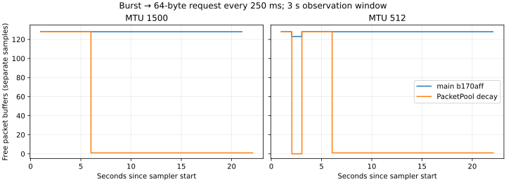

# PacketPool decay during continuous low-rate traffic

This follow-up to [#23](https://github.com/BlackLuny/zfstack/issues/23) starts from main `b170affa14e70d73f3d0834b2e06579dde70ca85`, including the TX low-rate fix merged in #31. It adds the missing PacketPool low-rate reclamation path. The implementation remains opt-in; merging this PR does not enable either pool policy by default.

## Change and expected benefit

`PacketPool::trim_idle(now, idle, target)` starts a shared observation window on its first call. Subsequent calls retire only the LIFO free-list prefix that has never been borrowed during that window. A minimum count under the existing get mutex identifies this prefix; there are no per-packet clocks, extra atomics, or extra get/drop locks. Reused free buffers survive even above the target, which is a floor rather than a cap on the active working set. Late returns age through a subsequent full window. Explicit trims correct the observation state.

Only free buffers are removed. Destruction and budget wakeups occur outside the pool mutex in batches of at most 32 buffers. Removing a prefix shifts the remaining descriptors under the lock; this is not constant-time lock work for arbitrarily large `max_cached`. The benchmark host uses the existing 128-buffer cap. Empty free-list backing is released; nonempty backing retains its original capacity and accounting model.

The benchmark host now maintains each opted-in pool once per second, independently of RX readiness, TX maintenance, and diagnostic sampling. A weak channel sender prevents this task from keeping the reader channel alive; it exits on the next check after reader/driver shutdown. The previous complete-idle reader path still returns the EAGAIN spare and explicitly trims the cache. The library itself starts no background task.

The expected benefit is fewer unused buffers occupying global/port/peer physical budget after a burst, including while occasional packets continue. The cost is one additional coarse task/check per opted-in host pool and a conditional minimum update during cache borrowing. This is not a zero-cost throughput claim.

## Functional and retention evidence

- Rust release workspace/all-features: **254 passed, 0 failed, 3 ignored** (221 core, 2 integration, 17 bench, 14 harness).
- Full default L0 matrix: **20/20 passed**; this is simulated multi-tenant coverage, not real multi-peer TUN acceptance.
- Python runner/analyzer regressions: **20/20 passed**.
- fmt, workspace/all-targets/all-features clippy and no-default-features library build passed. Existing warnings remain.
- New regressions cover 128-buffer low-rate decay, preserving the same hot allocation with floors zero/two, full working-set reuse above the floor, late returns, explicit-trim interaction, zero windows, multi-batch lock-free wakeups, concurrent get/Bytes/drop/explicit/idle trims, and maintenance task/channel lifetime.

The real TUN low-rate workload sends one verified 64-byte request every 250 ms for 20 seconds after two bursts. The interval is shorter than the reader's one-second idle poll timeout, so the old complete-idle policy cannot explain the new reclamation. Both binaries use identical explicit settings: PacketPool observation window 3 seconds, target zero; TX check/warm/cold 1/3/10 seconds, floors 2/2. These are exercise parameters, not recommended production defaults.

| MTU | Buffer capacity including vnet header | Main free buffers | Candidate free buffers | Main free-buffer lease bytes | Candidate free-buffer lease bytes |
|---|---:|---:|---:|---:|---:|
| 1500 | 1510 | 128 | 1 | 193,280 | 1,510 |
| 512 | 522 | 128 | 1 | 66,816 | 522 |

Each stable sample also has one in-use reader buffer. Free-buffer bytes fall **99.2%**, by 191,770 and 66,294 bytes respectively. Recently used capacity survives subsequent requests. This is a cache/lease observation, not a claim that process RSS falls by the same amount. RSS did not show a consistent before/after benefit in these diagnostic runs. Low-rate process CPU was 0.02→0.05 seconds at MTU 1500 and 0.03→0.03 seconds at MTU 512 over 20 seconds; these single diagnostic observations have 10 ms CPU tick resolution and are not a statistical CPU result.

At both MTUs, the candidate also passed a 15-second complete-idle/reburst case with zero free/in-use PacketPool buffers and no wire traffic during the quiet window, and an 8-flow + 100-idle-connection budget case with 8 MiB global / 4 MiB port / 4 MiB peer limits. The analyzer checks separately sampled budget values against their limits; it does not infer atomic conservation from separate reads.

## Paired performance observations

All **96 performance runs passed** payload verification, bounded execution and cleanup: six A/A pairs plus twelve alternating A/B pairs at each MTU (72 runs), followed by twelve additional A/B pairs at MTU 512 (24 runs). There are also **11 successful diagnostic/smoke cases**, including the two sustained-load cases with **2 GiB verified per case**. Two retained preflight setup failures are described below.

Performance cases use eight flows, 8 MiB per flow/direction/burst, 200 requests per RR size (64/512/1400/4096 bytes), one-second idle, and a second burst. Both variants enable the same TX and PacketPool settings; the only executable difference is this PacketPool change. Diagnostic sampling is disabled. The one-second quiet interval mainly measures short-gap reuse and tracking/task overhead; long-cold regrowth performance is not formally accepted by this matrix.

The table shows median paired percentage changes (after/before − 1) with descriptive 95% bootstrap intervals from 10,000 resamples. Positive throughput is better; positive CPU/GB is worse. Complete P50/P95/P99, first-request, CPU/packet, PPS, RSS/high-water and fault comparisons are in `summary.json`, with per-request samples in the archive.

| Group / MTU / phase / direction | Throughput change [95% interval] | CPU/GB change [95% interval] |
|---|---:|---:|
| Initial A/B / 1500 / initial / down | +6.0% [−5.3, +46.7] | −3.1% [−25.7, 0.0] |
| Initial A/B / 1500 / initial / up | −4.9% [−20.6, +2.5] | +7.5% [−12.5, +14.5] |
| Initial A/B / 1500 / reburst / down | +7.5% [−2.7, +12.0] | −6.2% [−14.6, +6.9] |
| Initial A/B / 1500 / reburst / up | +3.1% [−4.8, +31.5] | 0.0% [−22.0, +17.0] |
| Initial A/B / 512 / initial / down | +0.5% [−2.6, +1.9] | 0.0% [−3.9, +2.9] |
| Initial A/B / 512 / initial / up | −2.4% [−14.7, +0.4] | +3.0% [−4.2, +7.5] |
| Initial A/B / 512 / reburst / down | **−4.3% [−10.2, −1.0]** | +6.1% [−1.4, +8.7] |
| Initial A/B / 512 / reburst / up | −4.0% [−26.3, +52.8] | +2.8% [−4.2, +7.4] |
| Confirmation / 512 / reburst / down | **+6.7% [−9.5, +13.4]** | −5.6% [−13.3, +7.6] |
| Confirmation / 512 / reburst / up | +19.7% [−15.5, +67.5] | +1.5% [−8.9, +9.1] |

The initial MTU-512 reburst-download slowdown was investigated, not discarded: the confirmation group reverses its sign and includes zero. A/A itself is unstable (phase-specific bulk intervals extend as far as −49% to +403%). All RR P99 A/B intervals, including the confirmation group, include zero. Small samples, shared-host scheduling, CPU tick quantization, and many metric comparisons prevent a formal non-inferiority conclusion. Neither a reliable speedup nor a repeatable throughput regression is established here. These observations support keeping the measured memory optimization available for opt-in evaluation; they do not justify a default-policy change.

## Scope and remaining work

The user's acceptance criterion allows an optimization with a sound theoretical benefit even when a speed difference cannot be distinguished from measurement noise. Here, free-buffer and budget retention improve directly and deterministically. Speed, RSS, and formal non-inferiority remain separate claims.

| #23 item | Status after this follow-up |
|---|---|
| P0 | Retention/CPU/RSS/latency evidence expanded; alloc/free counts, cache hit/miss, complete timer counts and PMU metrics are still unavailable. |
| P1 | TX prototype and low-rate correction already merged in #31; unchanged here. |
| P2 | This comparison holds the latest TX policy constant on both sides. It is not a new TX-on/off acceptance result. |
| P3 | Explicit trim, lock-outside destruction, continuous-low-rate decay and host scheduling implemented; correctness and scoped TUN evidence recorded. Full performance acceptance and production parameter selection remain open. |
| P4 | Real TUN single-shard/PeerId(0) diagnostics extended. The earlier 64-flow reset/timeout issue, real multi-peer and zfc integration are not resolved or claimed complete. |

There is no real network topology, concurrency, pacing, congestion-control, wire-format, or default-policy change. No new per-connection state is introduced. This PR does not close #23.

## Provenance and reproduction

Candidate executable checkpoint: `db1f6a50a6cb26b5185a0d9ece6c602e2a005e43`. Later changes only clarify documentation and add evidence/scripts; executable Rust behavior is unchanged. Before and after use Rust 1.94.1, the identical archived Cargo.lock, release/fat-LTO/codegen-units=1/panic=abort, and the `packet-pool-idle-trim` feature. They were built in separate target directories; `binary-sha256.txt` records distinct hashes.

The managed VM exposes five CPUs and a four-CPU cgroup quota. Proxy affinity is CPUs 0,1 and the Python loader uses 2,3,4. Tests use a dedicated Docker container, never host networking, and each case owns a fresh network namespace and its child processes. Performance cases run sequentially without diagnostic sampling; cgroup snapshots and exact commands are in the per-case records. Shared-host scheduling and the Python generator can limit results.

`raw-evidence.tar.gz` contains commands, metadata, raw request samples, proxy logs, loader JSON, success/failure/cleanup results, build manifests, Cargo.lock and validation logs. Binaries are identified by hashes rather than included. Two initial setup failures (missing container machine identity, then a missing runtime TUN device) are retained separately from successful workload runs and excluded from performance. Neither exercised the workload. Container setup was corrected before diagnostics/performance.

To reanalyze: extract the archive into an empty directory, then run `python3 analyze.py EXTRACTED_DIR`. It writes `summary.json`. `plot_cache.py EXTRACTED_DIR --outdir OUTPUT_DIR` regenerates the chart using Matplotlib. `SHA256SUMS` covers committed artifacts and `RAW_SHA256SUMS` covers files inside the archive.

To rerun:

1. Build the two source checkpoints with the flags in `build-manifest.json`, using the archived Cargo.lock and separate target directories. Copy binaries to a fresh evidence directory under `bin/before` and `bin/after`.
2. Build the [existing TUN rig Dockerfile](../2026-10-13-pr31-review/Dockerfile), supplying the managed proxy CA as the `proxy_ca` BuildKit secret. Start a dedicated `zfstack-packetpool-rig` container with TUN/netns privileges and no host networking. Mount this repository read-only at `/repo`, the evidence directory at `/evidence`, and `/etc/machine-id` read-only at the same path. Set `--ulimit nofile=65536:65536`. Create `/dev/net/tun` in the running container if Docker's runtime `/dev` has hidden the image's device node (`mknod /dev/net/tun c 10 200`).
3. Set `ZF_PACKET_EVIDENCE` to the host evidence directory (and `ZF_PACKET_RIG` if the container name differs). Run `run_matrix.py smoke`, `diagnostics`, `performance`, `sustained`, and `confirm`. Never reuse a case output directory. Stop/remove only this owned rig after the runs.
