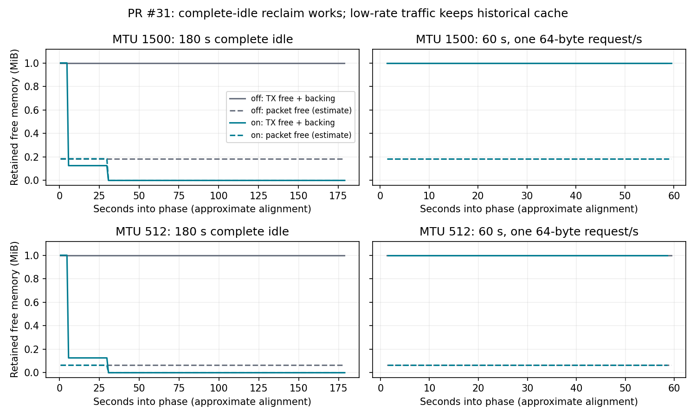

# PR #31 review and follow-up experiments — 2026-10-13

The opt-in prototype reclaims free TX and packet buffers after complete idle, while retaining the existing pressure-reclaim path. It is **not ready for a default-on or Pareto-improvement claim**: continuous low-rate traffic prevents historical-cache shrinkage, paired timing is noisy, and real-TUN pressure cases include resets/timeouts. Keep the PR draft and issue #23 open.

## Review changes

- Integrated main `667e9dbc5a0e4bc86b83fc5c9116a2cb2432eadc`, including #26 RX-credit and #30 scoped admission. No merge conflicts required semantic changes.
- Fixed a measurement classification bug: `ZFBENCH_TX_CACHE_SAMPLE_MS` now requires `--diagnostic`. The original runner could mark instrumented runs performance-eligible. Added parser regressions and explicit, validated CPU affinity overrides; existing defaults are unchanged.
- Fixed latency censoring: an RR exchange started under bulk load must remain in the distribution when it completes after bulk ends. The original wholly-contained filter discarded exactly those slow completions. Added deterministic regressions, including all-late completion and real worker-error cases. Every historical run retains raw samples; the analysis recomputes the corrected distribution from them.
- Added opt-in TX trim to the L0 harness and exercised existing multi-peer/port pressure/fairness assertions with it enabled. CI now runs runner regressions and the experimental PacketPool feature tests.
- Documented the policy's whole-pool idle semantics in `TxCacheTrimPolicy`. Successful get/put activity in either size class resets `quiet_since` for both. A small periodic request therefore preserves old large blocks. This is a remaining design limitation, not a demonstrated failure to honor the configured complete-idle policy.
- Reviewed free-only ownership, descriptor backing charges, pressure-reclaim precedence, eventual idle deadlines, and PacketPool destruction outside its mutex. No additional ownership/accounting defect was established by this review; sampled counters alone are not a proof of continuous conservation.

## Provenance and scope

This follow-up ran in a **managed Linux VM and an owned, isolated privileged Docker container**, not the earlier PR author's ns512147 server. No host networking was used. The container supplies real network namespaces and `/dev/net/tun`; every case owns, bounds and removes its namespace and child processes.

- Original published PR head: `f086e8f283d82af0bd2b46e590a723674576de9d`.
- Baseline: main `667e9dbc5a0e4bc86b83fc5c9116a2cb2432eadc`. The build source at `368ecd512287e2315b1048dc4a7273dd640ec9b9` has the identical Git tree.
- Formal matrix/diagnostic checkpoint: `5e16ff41859c8bd3ded80398cf505abbe3866a0d`. The binary was built from `594e3804b11b8f9ec9a5d4041ff624b216ffab5c`; the intervening commit only changes CI.
- Loader-correction checkpoint: `37ae97b` (full identity is in the later run metadata). Final smoke, sustained and pressure follow-ups use that loader. Rust executable code is unchanged by this correction or the subsequent API documentation/evidence commit.
- Rust 1.94.1; identical frozen Cargo.lock. Formal main/candidate builds: release, fat LTO, codegen-units=1, panic=abort, incremental disabled. Binary SHA256 values are in `binary-sha256.txt`.
- AMD EPYC 9V74 VM; affinity 0–4, cgroup quota 4 CPUs. Proxy uses CPUs 0,1; loader uses 2,3,4. This explicit topology differs from the runner's original six-CPU default. Formal cases run serially; none accrued cgroup throttled time. Long idle diagnostics run up to four isolated cases concurrently and are not timing evidence.
- `main`: unmodified default-feature main binary. `off` / `on`: the **same** candidate binary, with `packet-pool-idle-trim` compiled, runtime policies disabled / enabled. This does not measure a candidate binary compiled without that feature.
- Measurements cover Linux TUN plus the entire proxy and Python/kernel endpoints, not core-only CPU, WireGuard, or cross-peer fairness. Tunproxy maps all flows to PeerId(0). L0 is the separate source of multi-peer/port correctness coverage.

## Completed validation

- Original PR release/all-features: 231 passed, 3 ignored.
- Integrated release/all-features workspace: **242 passed, 0 failed, 3 ignored** (210 core, 2 integration, 16 bench, 14 harness).
- Default-feature bench: 13 passed. Python runner/regression tests: 14 passed; existing L2 Python tests: 6 passed.
- CI-style fmt, clippy, and no-default-features library build passed. Existing clippy warnings remain.
- Full L0 matrix: 20/20 default, 20/20 opt-in. Opt-in unit regression retains existing quota, zero-window, sink-full, lossy, interface-rebuild, noisy-neighbor and peer-alias assertions.
- Real TUN formal matrix: **120/120 passed**, all verified payloads, zero-wire quiet phases and cleanup. Per MTU: 6 A/A pairs, 12 main→off pairs, 12 off→on pairs, alternating AB/BA order.
- Cold/low-rate diagnostics: **12/12 passed** at MTU 512/1500 with off/on, 5/30/60/180-second idle/reburst and 60-second low-rate traffic.
- Sustained diagnostics: **4/4 passed**, off/on × MTU 512/1500, eight flows and 512 MiB per flow in each direction, repeated after idle: **16 GiB verified per case**. These longer runs are correctness diagnostics, not paired performance acceptance.
- Two initial and two corrected-loader TUN smokes passed.

Total recorded cases: **169/178 passed**; 9 failures remain recorded. All started cases cleaned up: **True**.

## Paired performance

Each formal case performs 1,000 RR exchanges for each size 64/512/1400/4096 before and after a 2-second idle, plus eight 8-MiB bulk flows in each direction in both phases and concurrent 1-ms light requests. Bytes are verified. No sampler or capture runs during these measurements.

On-policy exercise settings are intentionally aggressive: TX check/warm/cold = 100/200/1,000 ms, warm targets 2/2; packet idle = 1,000 ms, target 0. They are **test settings, not recommended defaults**. Cold diagnostics instead use TX check/warm/cold = 1/5/30 seconds and packet idle = 30 seconds.

Values below are median paired percentage changes with descriptive 95% bootstrap intervals (10,000 resamples, seed 20261013). CPU/GB and latency: lower is better; throughput: higher is better. Bulk CPU sums the two fixed-byte phases by direction. `/proc` CPU ticks have 10-ms resolution; the short bulk windows make small differences difficult to resolve. Intervals have no multiple-comparison correction.

| Comparison | MTU | Down CPU/GB Δ% [95% interval] | Up CPU/GB Δ% [95% interval] | Down throughput Δ% [95% interval] | Up throughput Δ% [95% interval] |
|---|---:|---:|---:|---:|---:|
| aa (6 pairs) | 512 | -7.91 [-11.89, +9.28] | +2.94 [-18.33, +14.74] | +8.73 [-2.80, +77.86] | -16.19 [-38.11, +11.80] |
| aa (6 pairs) | 1500 | +6.94 [-13.56, +22.26] | -7.89 [-35.50, +14.26] | -1.57 [-11.82, +12.17] | +0.90 [-22.31, +16.40] |
| main-off (12 pairs) | 512 | +1.67 [-7.89, +11.31] | -5.25 [-10.05, +9.79] | -2.93 [-34.30, +8.11] | +6.14 [-18.74, +30.58] |
| main-off (12 pairs) | 1500 | +2.08 [-9.33, +8.71] | -0.00 [-11.15, +36.97] | -2.25 [-9.32, +4.21] | +1.62 [-37.14, +9.78] |
| off-on (12 pairs) | 512 | -2.34 [-14.46, +18.86] | +0.00 [-9.11, +21.40] | +1.13 [-13.49, +17.64] | -6.51 [-29.55, +14.33] |
| off-on (12 pairs) | 1500 | +6.17 [-5.85, +18.01] | -2.63 [-33.91, +27.14] | -5.18 [-52.23, +2.82] | +2.94 [-25.88, +192.85] |

The A/A controls already show substantial variation, and all CPU/GB and throughput intervals above cross zero. These data establish neither a fixed percentage overhead nor non-inferiority. They do not establish a Pareto improvement.

Do not cherry-pick the other endpoints: main→off at MTU 512 has a 4,096-byte reburst RR P99 paired median **+20.13% [1.90%, 32.82%]**, alongside improvements in some initial-burst tails; A/A also has a nonzero descriptive interval for an RR tail. These exploratory, multiple-endpoint observations need a quieter dedicated replication before an acceptance decision. Full tails, first-request latency, raw pairs and all intervals are in `summary.json`; mixed P99 is omitted when fewer than 100 eligible requests exist. Late completions are included even for the original loader checkpoint.

## Memory results and limitations

At both MTUs, off retained 16 large blocks (1,048,576 payload + 1,152 descriptor bytes) and 128 free packet buffers through 180 seconds of verified wire silence. On reached two large blocks at the warm stage, then zero TX payload/backing and zero free/in-use packet buffers at the cold stage. Port physical bytes reached zero; remaining global reservations are separate connection metadata. A configured 5/30-second threshold is checked coarsely, so the 5-second boundary can still show the old cache and the 30-second boundary can still show the warm cache.

Observed RSS in the 180-second diagnostic (one observation per cell, not a general allocator guarantee):

| MTU | Policy | RSS before → after (MiB) |
|---:|---|---:|
| 1500 | off | 11.97 → 11.97 |
| 1500 | on | 11.22 → 7.16 |
| 512 | off | 12.24 → 12.24 |
| 512 | on | 9.51 → 8.95 |

At one 64-byte RR per second for 60 seconds, **off and on both retained all 16 large blocks and 128 packet buffers**, with no idle trim. RX activity likewise prevents the benchmark reader's complete-idle PacketPool schedule. Thus freeing cache after total silence works, but shrinking a historical burst cache under ongoing low load remains unimplemented. The plot's alignment uses child-start plus sampler elapsed time and excludes boundary samples; it is approximate. Sampler fields are separate reads, not an atomic conservation snapshot. Packet free-byte values are payload lease estimates, not allocator/RSS measurements.

## Pressure findings

The 24-case coverage grid uses global budgets 8/64 MiB (port and peer each half), active flows 1/8/64, and idle populations 0/100/1000. It is a **coverage grid, not the full Cartesian product**. All idle sockets are acknowledged and checked for liveness before/after quiet and before final closure. The repeated failure follow-up and main controls remain diagnostics.

| Group | Passed / recorded |
|---|---:|
| pressure-confirm64 | 8/9 |
| pressure-confirm64-preflight | 0/3 |
| pressure-main-fixed-budget | 1/2 |
| stress-64mb-f1-idle1000 | 4/4 |
| stress-64mb-f64-idle1000 | 3/4 |
| stress-64mb-f8-idle100 | 4/4 |
| stress-8mb-f1-idle0 | 4/4 |
| stress-8mb-f64-idle0 | 1/4 |
| stress-8mb-f8-idle100 | 4/4 |

`main-pressure.patch` and `main-pressure64.patch` change only the benchmark host's two budget initialization lines on main to 8/4/4 and 64/32/32 MiB respectively. Their separate binaries use default Cargo release settings, **not** the formal fat-LTO performance build; they are solely functional controls and cannot be used for CPU comparisons. Main lacks the new sampler, so setting its sample variable does not produce observations.

Three confirmation commands were rejected before namespace/process creation because the follow-up wrapper supplied pair-position=2; these are labeled preflight errors, retained, and rerun with a valid position. They are not workload failures or cleanup leaks. Every failed sample is retained below and in the archive. A reproduction on main can establish that the observed failure is not unique to the trim implementation, but does not identify its root cause or prove identical failure mechanisms. Do not turn one successful repeat into a passed pressure acceptance gate.

| Failed case | Workload error | Cleanup |
|---|---|---|
| pressure-confirm64-512-00-0-main | [Errno 104] Connection reset by peer | OK |
| pressure-confirm64-512-00-2-on | issue23_tun_case.py: error: argument --pair-position: invalid choice: 2 (choose from 0, 1) | not started |
| pressure-confirm64-512-01-2-main | issue23_tun_case.py: error: argument --pair-position: invalid choice: 2 (choose from 0, 1) | not started |
| pressure-confirm64-512-02-2-on | issue23_tun_case.py: error: argument --pair-position: invalid choice: 2 (choose from 0, 1) | not started |
| pressure-main-fixed-budget-1500-00-0-main | [Errno 104] Connection reset by peer | OK |
| stress-64mb-f64-idle1000-512-00-1-on | [Errno 104] Connection reset by peer | OK |
| stress-8mb-f64-idle0-1500-00-0-off | [Errno 104] Connection reset by peer | OK |
| stress-8mb-f64-idle0-1500-00-1-on | [Errno 104] Connection reset by peer | OK |
| stress-8mb-f64-idle0-512-00-0-off | timed out | OK |

Sampled budget-bound violations: **0**. This is only a sampled observation; pressure failures and L0 assertions must still be assessed separately. Full reservation-failure and pressure-reclaim counters are retained.

## Remaining acceptance work

1. Design and validate low-load decay if issue #23 requires it, for example independent per-size-class demand/retention or bounded periodic excess reclamation. Evaluate allocation churn before choosing a policy.
2. Diagnose the real-TUN reset/timeout cases, including timeout, RX-credit/admission and host-relay behavior, with a focused trace. They remain an unresolved correctness/acceptance concern; the current evidence does not justify attributing all of them to this PR.
3. Repeat performance on an isolated host with longer CPU windows and predefined non-inferiority limits; separately test TX-only versus PacketPool-only schedules. This matrix compares off to both-on and does not attribute performance effects between them.
4. Allocation/free/cache-hit counters, PMU instructions/cache misses, a complete TCP retransmission/RST counter matrix, core-only costs and real multi-peer/WireGuard fairness were not collected. Existing L0 multi-peer tests are not a substitute for that performance evidence.
5. Choose production parameters only after these gates. No parameter recommendation or default enablement is made here. Final published-head GitHub CI status is recorded on the PR rather than asserted by this static report.

## Evidence and reproduction

- `raw-evidence.tar.gz`: every case's raw loader JSONL, command/provenance/events, stdout/stderr, final metadata, cleanup, wrapper records, relevant test/build logs, frozen Cargo.lock, source snapshots and per-file SHA256 manifest. Includes failed runs; excludes compiled binaries, build caches and unrelated earlier experiments.
- `summary.json`: all paired metrics and values, diagnostics, every outcome/failure and sampled budget checks.
- `analyze.py`, `plot_cache.py`, `run_matrix.py`, `run_followup.py`, `run_pressure_confirm.py`, `Dockerfile`, budget-only patches and `binary-sha256.txt`: exact analysis/orchestration and build identity. `SHA256SUMS` verifies the checked-in artifacts.

To reanalyze without privileges, extract the archive into a fresh directory, copy `analyze.py` there, then run `python3 analyze.py`. For the figure, copy `plot_cache.py` and run it with matplotlib installed. Raw mixed latency must be selected by `bulk_begin <= request_start < bulk_end`; do not use the original loader's censored summary.

For a rerun, build main and candidate from the recorded commits with Rust 1.94.1 and the archived Cargo.lock. For formal binaries set `CARGO_PROFILE_RELEASE_LTO=fat CARGO_PROFILE_RELEASE_CODEGEN_UNITS=1 CARGO_PROFILE_RELEASE_PANIC=abort CARGO_INCREMENTAL=0`, and use `cargo build --locked --release -p zfbench` (candidate additionally `--features packet-pool-idle-trim`). Put them at `bin/main` and `bin/candidate` in a fresh evidence directory. The functional main-pressure binaries instead use default release settings plus their respective patches. Build the supplied Dockerfile with the session CA as the `proxy_ca` BuildKit secret when required; create a dedicated `zfstack-pr31-rig` container with TUN/netns privileges, the tested repository mounted read-only at `/repo` and the fresh evidence directory at `/evidence`. Initialize `/dev/net/tun` and a nonempty `/etc/machine-id` inside that container. Do not use host networking.

Set `ZF31_REPO` to the candidate checkout and optionally `ZF31_EVIDENCE_DIR` to the fresh evidence directory. `run_matrix.py performance`, `diagnostics`, and `stress` record the commands actually executed. The scripts expect CPUs 0–4; adapt the explicit affinity to available CPUs and record the topology change rather than silently repinning. Each invocation refuses reused case directories. Run formal timing serially without compilation or diagnostics competing for CPU. Remove only the owned test container after all cases have reaped their children and removed their namespaces.

