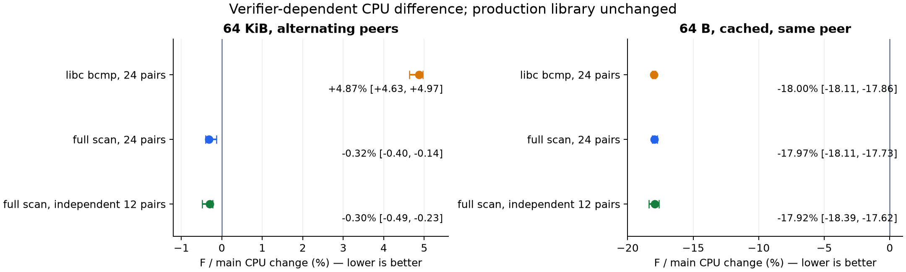

# Issue 22：64KiB 交替 peer CPU 回退定位与基准修正

2026-10-15，第二台 `root@38.207.178.131:22100`。实验目录 `/root/zftxmigrate22-20261015`；工作树 `codex/issue22-tx-cost`。main 在开始与收尾复核时均为 `c2ae50439e50c081940b951bd075a6ce4bb41335`。

**回退主要落在基准调用的 libc AVX2 字节比较器中；本轮修正测量方法，生产代码保持上一轮的小包优化和正确性修复。** 同一窗口 24 对中，旧校验的 64KiB 交替 peer 为 **+4.87% [+4.63, +4.97]**，全字节扫描校验为 **-0.32% [-0.40, -0.14]**。另一个窗口每 run 工作量提高 5 倍，12 对为 **-0.30% [-0.49, -0.23]**。

旧 libc 口径仍能复现该差值。本轮没有把生产 TX 宣称为“又快了约 5%”，也没有撤销或混入旧样本。新旧绝对耗时不可直接合并归因于库；结论来自两种方法各自的 F/main 配对对照。

## 定位证据与修复范围

D 为当前 main；F 为上一轮小包优化。最初用原有二进制复现 24 对，64KiB 交替 peer F/D 为 +4.71% [+4.62, +4.80]；64B 同 peer 缓存仍为 -18.79% [-18.93, -18.65]。

最初注意到相同的标量 checksum 循环在两版中位置不同。但仅 outlining、64 字节代码对齐、页对齐均未取得稳定的无回退结果：页对齐后旧校验仍为 +4.89% [+4.72, +5.00]。因此不把指令缓存行位置当作已证明的硬件根因。

进一步的分段时钟实验把 push、完整校验、consume 分开；再拆分比较和 checksum。64KiB 交替 peer 中，比较段 F/D 为 +10.88% [+10.50, +11.41]，checksum 约为 0.00% [-0.15, +0.21]，push 为 -0.49% [-0.73, -0.26]。分段时钟会改变执行状态，数值用于定位，不和正式未插入时钟的测量合并。

6 个完整排列区组的 `perf cpu-clock:u` 配对采样也把额外热点指向 `__memcmp_avx2_movbe`；没有硬件 PMU 计数，不能进一步确认其缓存、分支或 AVX 状态的具体微架构成因。GDB 在冻结二进制上确认了输入长度、指针布局与循环复用；只调试本次 probe，未附加线上进程。恢复计数器尺寸的 H/J 候选即便恢复相同输入布局，也没有消除旧比较器的差值，因此不能仅归因于新增 PeerId 的 8 字节。

最终改动在 `examples/pareto_probe.rs` 与分析器：

- 用安全 Rust 的 XOR/OR reduction 扫描**全部字节**进行精确比较；相同长度且所有 XOR 的 OR 为零，才判相等。实际数据 checksum 仍逐字节累加，两项工作都在原计时范围内，未抽样、未移出计时。
- 校验函数不内联；Linux x86_64 的独立 ELF section 固定页内布局。冻结的 D/F/F2 实际生成相同地址、相同字节的比较与 checksum 热循环；比较循环为 SSE2，无 bcmp/memcmp 调用。见 `fullscan-layout.json` 和反汇编。
- 输出 `verification_method=portable_full_scan_v1`，分析器拒绝一对记录使用不同方法；原、诊断及新口径各自保留。正式纳入 pooled/migrate TX 模式，记录 warmup 与 retained 账本及地址对 64 的余数，未采样峰值仍为 null。
- 新增错误检测测试，覆盖长度不等、首/中/尾字节错误、相同 checksum 的字节交换，以及标量尾部和 64KiB 边界。

尝试过的 backing 对齐 G、Budget owner 缓存 H/J 都未交付。G 的无缓存 64B 相对 F 增加约 36.75% 分配 CPU，且大块未改善；H/J 也未解决旧比较器差值，并削弱部分小包收益。源码和全部样本保留在原始证据中。

## 第二台正式结果

Rust 1.92.0、统一冻结 manifest/lock/harness、fat LTO、codegen-units=1、panic=abort、incremental=0。CPU3，串行运行；case 顺序交错，variant 使用完整排列区组，每 case 每 variant 一次 warmup。KVM vCPU 未锁定物理频率，使用进程 CPU 时间与区组内配对；不把结果解释为物理网卡吞吐。

交叉实验 DP/FP/DV/FV：6 case × 24 对 × 4 variant，加 warmup，共 600 次。独立复测 DV/FV/FV2：9 case × 12 对 × 3 variant，加 warmup，共 351 次；其中两个 64KiB 缓存场景从每 run 20000 次增加到 100000 次。共 **951 次运行，900 次正式测量**。所有运行的字节、checksum、操作数和最终释放检查通过；D/F/F2 warmup/retained 账本逐格一致。

下表均为 **F/main CPU 逐对比值的中位数及 95% bootstrap 区间**，10000 次重采样，seed422，越低越好；不是两个中位数之比。未混合两轮或新旧方法。

| 场景 | 旧 bcmp，24 对 | 全字节扫描，24 对 | 全字节扫描独立复测，12 对 |
|---|---:|---:|---:|
| 64B，无缓存 | -5.18% [-5.39, -5.06] | -5.13% [-5.31, -5.01] | -4.92% [-5.47, -4.65] |
| 64B，缓存同 peer | -18.00% [-18.11, -17.86] | -17.97% [-18.11, -17.73] | -17.92% [-18.39, -17.62] |
| 64B，缓存交替 peer | -4.70% [-4.91, -4.54] | -4.56% [-4.82, -4.39] | -4.48% [-4.74, -4.13] |
| 1400B，缓存同 peer | -7.80% [-7.84, -7.63] | -7.55% [-7.76, -7.40] | -7.68% [-7.91, -7.30] |
| 64KiB，缓存交替 peer | +4.87% [+4.63, +4.97] | -0.32% [-0.40, -0.14] | -0.30% [-0.49, -0.23] |
| 64KiB，缓存同 peer | +4.49% [+4.18, +4.62] | -0.43% [-0.72, -0.32] | -0.58% [-0.67, -0.42] |
| 64KiB，无缓存 | — | — | -0.24% [-0.52, -0.11] |
| 65535B，缓存同 peer | — | — | -0.46% [-0.60, -0.11] |
| 65537B，缓存同 peer | — | — | -0.50% [-1.22, -0.19] |

独立构建 F2/F 在 64KiB 交替 peer 中为 +0.06% [-0.10, +0.18]；9 个场景的 A/A 中位数绝对值最大 0.25%，各区间均含零。旧小包方法的收益与新方法下约 18% 的缓存收益均保留；生产 `src/` 与上一轮 F **逐字节一致**，不是用改变记账或放宽限制换取结果。

## 正确性与收尾

第二台冻结 FV，Rust1.92：库 **253 passed，0 failed，6 ignored**；集成测试 1+2+1 全部通过；probe **5 passed**；显式运行 256 流 splice/延迟 ACK 压力测试 **1 passed**，8.20 秒，包含最终账本归零断言；无默认特性构建通过。Linux Python 全套 **30 passed**。本地 Rust1.94.1 的 fmt、core clippy（按 CI 允许既有 style warnings）、无默认特性构建和 5 项 probe 测试通过。

descriptor 实际容量计费、global/port 身份检查、非空 TX 拒绝换 peer、提前预留/commit/回滚、缓存 peer 重新预留配额及唤醒逻辑全部保持原样，相关回归测试继续通过。`source-equivalence.json` 与 `worktree-source-match.json` 核对 main、先前 F、冻结输入和当前工作树。

本轮未重测 socket/TUN 或物理 NIC；上一轮相同生产源码的 76 次 socket/TUN 结果见[原报告](2026-10-15-issue22-tx-optimization.md)。测试未修改 governor/IRQ、未替换或重启线上服务；收尾无本次 benchmark 进程，隔离目录和构建缓存保留。

[原始数据、冻结输入、脚本与复现说明](../../bench/results/2026-10-15-issue22-tx-migrate/README.md)。更细的硬件原因尚未由 PMU 确认；这里确认并修正的是该 TX probe 的校验器引入的测量回退，不代表 Issue22 所有性能边界都已消失。
