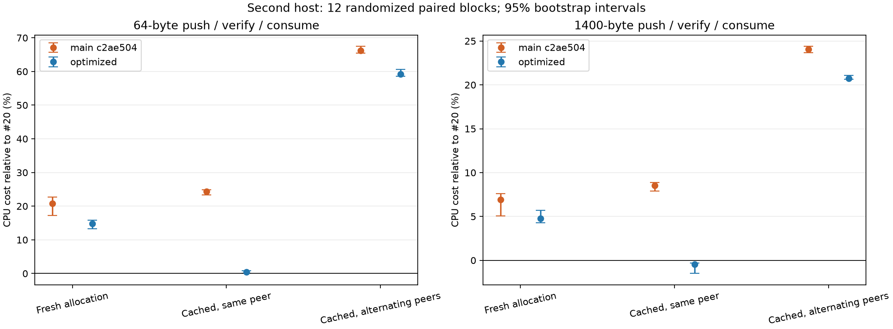

# Issue 22 小包 TX 优化与第二台机器验证

> 后续定位见 [64KiB 回退与基准修正](2026-10-15-issue22-tx-migrate.md)：额外 CPU 主要在旧 libc 校验器中。原报告样本与数字保留，新旧校验方法分别统计。

2026-10-15。主机 `root@38.207.178.131:22100`，隔离目录 `/root/zfopt22-20261015`。实现位于 `codex/issue22-tx-cost` 工作树，基于 main `c2ae50439e50c081940b951bd075a6ce4bb41335`；开始及复核时远端 main 均为此提交。

**常见的同 peer 缓存路径已接近 #20 的 CPU 成本，正确性修复保留。** 本轮 64B 场景 main 相对 #20 为 +24.37% [+23.40, +24.91]，优化后相对 #20 为 **+0.46% [+0.05, +0.80]**；优化后相对 main 为 **-19.02% [-19.35, -18.84]**。1400B 同 peer 缓存为 -8.44% [-8.86, -7.83]。

这不等于所有 TX 开销都消失：无缓存和跨 peer 迁移仍有成本；64KiB 迁移压力场景还保留了偏正的 CPU 差值，见后文，不能按“全场景无回退”验收。

## 定位与实现

生产改动集中在 `src/budget.rs`，`src/buf.rs` 新增所有者回归测试。

1. **去掉所有者确认的重复哈希。** `LevelUse` 在创建 peer 计数器时记录不可变 PeerId。`can_reuse_index` / `prepare_index_peer` 先确认 global 与 port 的 Arc 身份，再直接检查已持有计数器的 PeerId。同一 Budget 的 physical peer map 不移除、不替换计数器，因此与原先“哈希查找再比指针”具有相同身份语义。PeerId 0 和 u64::MAX 均可使用。
2. **缓存 payload 记住已释放配额的计数器。** `park_cached` 仍立即停止 drain、释放 peer used 并唤醒等待者；新增 `peer_parked` 标记明确该 Arc 不占 peer 配额。同 peer 取用仍执行完整的 `reserve_amount`，只是省去 map 查找和 Arc clone/drop。换 peer 时仍查找新计数器并在预留成功后更换；失败保持旧计数器未计费，销毁不会重复扣减。

保留了 descriptor 的实际容量计费、global/port 身份检查、非空 TX 拒绝换 peer、空 index 的提前 peer 预留、旧所有者到 commit 才释放、payload 失败的 reservation 回滚、cache cap/debt/waiter 检查、park/activate 及唤醒逻辑。没有通过跳过记账、放宽配额或保留未计费的 payload/descriptor backing 换取结果。

代价是每个 LevelUse 数据多 8B，以及缓存块最多多保留一个已有 peer 计数器的 Arc；Budget 存活时该计数器原本就在 map 内。`peer_parked` 在本轮 x86_64 的布局中未增加 MemoryLease/Block 的大小；实际 TX warmup 与循环后 retained 账本和 main 逐格相同。这里没有直接测量 malloc 总驻留或长期 RSS。

## 消融与正式微基准

统一 Rust 1.92.0、同一份 C manifest/lock/bench 与扩展 schema-v2 probe；fat LTO、codegen-units=1、panic=abort、incremental=0。CPU3，串行随机完整区组；未锁定 vCPU 的物理频率，主机原有服务继续运行，未使用不存在的硬件 PMU 数据。

- B：#20 `8b3f418f15f473baf5dce043c981ab753f0a5a11`。
- D：main；F：本轮优化；F2：F 相同源码、不同目录独立构建。
- P1：仅替换所有者身份查找，用于消融。
- 正式矩阵 27 case × 12 正式区组 + 每 case 1 warmup，B/D/F/F2，共 **1404 次运行**。
- 独立消融 6 case、D/P1/F、相同重复数，共 **234 次运行**；64KiB 定向补测另有 **156 次运行**。

下列数值是逐对 CPU 比值的中位数与 5000 次 bootstrap 的 95% 区间，seed22；不等于两个组中位数的比值。不同 case 所处的 VM 频率/调度窗口不同，只在同一 case 内比较，不能用跨 case 绝对 ns 推断缓存收益。每个 TX iteration 包含 push、逐字节核对、consume；无缓存为 cache0，缓存为 cache32，迁移在同一空 TxBuf 上交替 peer1/2。

| 场景 | main / #20 CPU | 优化 / main CPU | 优化 / #20 CPU |
|---|---:|---:|---:|
| 无缓存 64B | +20.75% [+17.17, +22.77] | -4.03% [-6.46, -1.87] | +14.83% [+13.23, +15.77] |
| 无缓存 1400B | +6.91% [+5.07, +7.61] | -2.36% [-2.63, +2.31] | +4.77% [+4.30, +5.71] |
| 缓存、同 peer 64B | +24.37% [+23.40, +24.91] | -19.02% [-19.35, -18.84] | +0.46% [+0.05, +0.80] |
| 缓存、同 peer 1400B | +8.55% [+7.90, +8.87] | -8.44% [-8.86, -7.83] | -0.45% [-1.48, -0.30] |
| 缓存、交替 peer 64B | +66.19% [+65.40, +67.46] | -4.31% [-4.61, -3.89] | +59.24% [+58.52, +60.60] |
| 缓存、交替 peer 1400B | +24.07% [+23.69, +24.39] | -2.46% [-2.84, -2.28] | +20.74% [+20.64, +21.08] |

独立消融中，64B 同 peer 缓存 P1/main 为 **-7.19% [-8.64, -4.64]**，F/P1 为 **-11.38% [-12.35, -8.44]**，F/main 为 -16.73% [-17.98, -15.86]。两个改动均带来可重复收益，百分比不可直接相加；此轮区组单独分析，没有与选择候选前的 4 区组 pilot 混算。

64B 同 peer 缓存的同源码构建 F2/F 为 +0.05% [-0.21, +0.26]；全矩阵 A/A CPU 中位数绝对值最大为 2.04%。全量 B/D/F/F2 对照、budget/retained-handle、RX、heap 与 pump 见 [完整表](../../bench/results/2026-10-15-issue22-tx-opt/micro-table.md)。heap_pop 的 F/D 为 +0.61% [+0.05, +1.16]，此量级应结合其 A/A 区间看待。

短流 packet pump 的 F/D CPU：64 流 **-4.19% [-6.43, -0.92]**，256 流 **-3.75% [-5.99, -1.92]**。它包含两份 Shard、数据核对与合成协议时钟，不能作为单端物理网卡吞吐。

### 尚未抹平的边界

64B 无缓存优化后相对 #20 仍为 **+14.83% [+13.23, +15.77]**；64B 交替 peer 为 **+59.24% [+58.52, +60.60]**。前者仍需 payload 分配与 index 记账，后者必须保留所有者迁移预留。下一步若继续降低它们，应独立评估同一 owner 的批量 allocation scope 或 inline descriptor，不应撤销 #21 的计费/迁移检查。

64KiB 交替 peer 的原 12 对 F/D 为 **+4.80% [+4.60, +4.93]**；追加 12 对为 **+0.37% [-0.81, +1.39]**；合并 24 对为 **+4.16% [+0.86, +4.68]**。两轮差值分布不同，补测不能抹去首轮。该迁移压力场景没有取得一致的无回退证据，不能把同 peer 小包收益外推到它。64KiB 同 peer 缓存合并为 +0.43% [-0.24, +1.84]。两轮和合并明细分别保留在 summary.json 的 micro、large_followup、large_combined 中；本轮没有确定此差异的硬件/代码布局根因。

## 真实 socket/TUN 与正确性

相同冻结 harness，MTU1420、两端 CUBIC、seed1；CPU0–3。mixed RTT12、200Mbps；千并发每 run 4000 次建连；不限速上下行8流 RTT1、link queue64MiB。数据流参数 secs6/warmup1，计时窗口为5秒。上行两版都把临时 TUN txqueuelen 设为100000，pfifo limit仍为10000，避免前轮已定位的 TUN 容量丢包。

| 场景 | main 中位数 | 优化中位数 | 优化 / main 配对变化 |
|---|---:|---:|---:|
| mixed 64B loaded RR P99 | 35.897 ms | 35.899 ms | +0.00% [-0.03, +0.17] |
| 千并发建连 P99 | 103.889 ms | 89.352 ms | -10.56% [-14.85, +0.94] |
| 千并发完整事务 P99.9 | 121.704 ms | 106.953 ms | -8.67% [-12.46, +4.11] |
| 8流不限速下行 | 3.366 Gbit/s | 3.539 Gbit/s | +10.30% [-33.71, +12.67] |
| 8流不限速上行，TUN队列100000 | 5.212 Gbit/s | 5.810 Gbit/s | +12.15% [-21.28, +43.10] |

吞吐越高越好，延迟越低越好。mixed 与 connect 各12对，吞吐各5对，另各有一个 warmup 配对，共 **76 次运行**；正式建连 **96000 次全部成功**。每次运行的应用模式/字节完整性检查通过，TUN tx/rx/qdisc 和 softnet backlog drop 均为0。P99.9 的每 run 样本有限，本轮5对极限吞吐的区间很宽，既不能确认吞吐提升，也不能排除中等幅度回退；只对已测 socket/TUN 参数负责，没有测物理 NIC/WireGuard 或长期 RSS。

正确性检查：

- 第二台 Rust1.92 release：**253 passed、0 failed、6 ignored**；集成测试1+2+1全部通过。
- 显式运行 ignored 的256流 splice/延迟ACK压力测试，1 passed、0 failed，约8.69秒完成；测试断言最终 global ledger 为0。
- 本地 Rust1.94.1：253库测试与4项集成测试通过；debug 下 budget36项、buf38项通过，覆盖新增状态断言。
- 新增同 peer 配额被占满后拒绝/重试、迁移失败后销毁只释放一次、PeerId 0/u64::MAX、同id跨port/global拒绝（push与write_with）的回归测试。原有descriptor分配/容量失败、peer debt、精确waiter唤醒与cache回收测试继续通过。
- fmt、core clippy1.94.1及无默认特性构建通过。Linux冻结workspace用机器已有的Rust1.96 stable完成clippy与无默认特性构建，日志单独保存（1.92 Clippy组件下载未完成，取消后改用已安装工具；性能构建仍固定1.92）；macOS全workspace的benchmark因Linux API不可用而失败，保留该日志，没有修改无关benchmark来消除平台错误。

## 证据与收尾

[数据索引与复现命令](../../bench/results/2026-10-15-issue22-tx-opt/README.md) 包含源码patch、冻结输入归档、构建/测试日志、全部JSONL、版本及source/binary/evidence SHA。所有正式区组的工作量、checksum、最终global账本、TX retained账本以及网络成功数均由analyze.py核对。

最初网络等待只检查TUN UP，遇到内核默认队列500尚未切到harness10000的初始化窗口；该准备运行只有2次warmup，保留为network-initial.*。已改为等待UP、qlen10000及pfifo limit10000，完整重新运行正式矩阵，没有复用准备样本。大块补测由首轮偏正差值触发，所有原样本保留。

测试未修改governor/IRQ、未重启或替换线上服务。临时TUN/netns与本轮benchmark进程已清理；实验目录、源码和构建缓存保留。优化范围是小包常见缓存路径；无缓存、跨所有者慢路径及64KiB迁移压力场景的残余明确保留，不能据此宣称 Issue22 所有性能问题均已消失。
