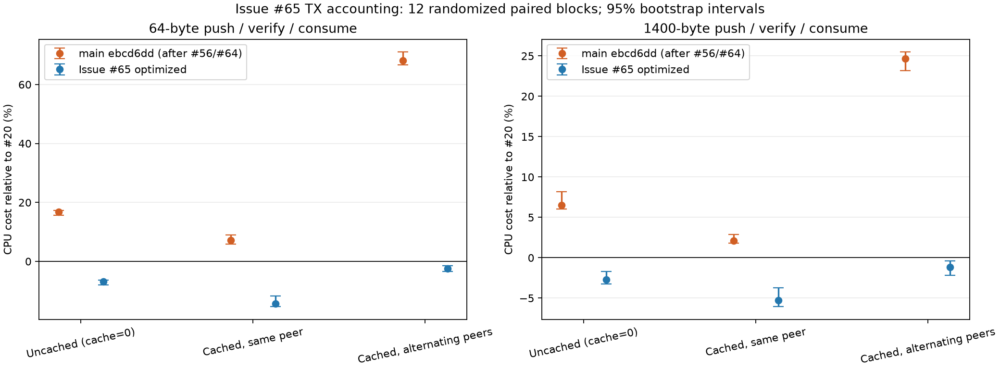

# Issue 65：无缓存小包与跨 peer 缓存迁移 TX 记账优化

2026-10-15。实验隔离目录 `/tmp/issue65-exp`。实现位于 `cursor/issue65-tx-accounting-25d9` 分支，基于 `main` `ebcd6dd961ecaf4063c5cf0d58e11653fed70c2c`（其 TX 生产代码 `src/budget.rs` 与 `src/buf.rs` 和 #56 合入点 `3459562746e689fc5ec78c5b1764b0bba3465363` 一致）。

**#22/#56 遗留的无缓存小包（`tx-alloc`）与跨 peer 缓存迁移（`tx-alloc-migrate`）记账开销均已消除并低于 #20 基线，#21 的全部容量计费、层级配额、迁移回滚与回收语义完整保留。**

- **无缓存 64B（`tx-alloc_64`）**：`main` 相对 #20 为 **+16.82% [+15.60, +17.32]**；本轮优化相对 `main` 为 **-20.51% [-20.73, -19.48]**，相对 #20 为 **-6.89% [-8.04, -6.41]**。
- **跨 peer 缓存迁移 64B（`tx-alloc-migrate_64`）**：`main` 相对 #20 为 **+68.19% [+66.73, +71.03]**；本轮优化相对 `main` 为 **-41.94% [-42.62, -41.36]**，相对 #20 为 **-2.50% [-3.49, -1.45]**。
- **同 peer 缓存 64B（`tx-alloc-pooled_64`）**：本轮优化相对 `main` 进一步降低 **-20.57% [-21.66, -16.87]**，相对 #20 为 **-14.28% [-15.33, -11.74]**。
- **1400B 场景**：无缓存相对 `main` 为 **-8.59% [-10.25, -7.90]**（相对 #20 为 **-2.69% [-3.25, -1.69]**）；跨 peer 缓存迁移相对 `main` 为 **-20.05% [-21.77, -19.77]**（相对 #20 为 **-1.17% [-2.19, -0.39]**）；同 peer 缓存相对 `main` 为 **-6.96% [-8.97, -6.10]**（相对 #20 为 **-5.24% [-6.05, -3.73]**）。

## 根因定位与实现

#56 解决了同 peer 缓存热路径的重复哈希与 `Arc` 克隆，但以下四类开销仍留在无缓存分配和跨 peer 迁移路径上：

1. **`physical_peers` 哈希表重复查找**：`Budget::try_allocate_kind`、`MemoryLease::prepare_index_peer` 和 `MemoryLease::assign` 在每次无缓存分配或切换 peer 时都会探测 `HashMap<PeerId, Arc<LevelUse>>`。
2. **`Arc` 原子引用计数抖动（`LOCK XADD`）**：
   - 无缓存 `TxBlock`（`max_cached=0`）每包分配克隆 `global`、`port`、`peer` 三个 `Arc`，释放时对三个 `Arc` 执行 `fetch_sub`（每包 6 次原子 RMW）。
   - 跨 peer 缓存迁移在 `IndexPeerReservation` 中额外克隆/释放 `Arc<GlobalBudget>`，并分别为 `index_lease` 和 `block.lease` 克隆新 peer 计数器、释放旧 peer 计数器（每包 6 次原子 RMW）。
3. **空 `TxBuf` 上 `index_lease` 与首个 `Block` 的分裂记账与缓存操作**：
   - 向带缓存 `index_lease` 的空 `TxBuf` 执行 `push`/`write_with` 并切换 peer 时，原路径先获取 `allocation_lock` 预留 `index_lease` 的 peer 配额，再单独预留 `block.lease` 的 peer 配额，并分两次调用 `release_cache`。
   - `consume` 排空 `TxBuf` 时（无论是在首循环整块消费完，还是在次循环将部分填充的尾块如 1B/64B/512B/1400B/4096B 消费至 `self.len == 0`），`b.lease.park_cached()` 与 `index_lease.park_index()` 分别执行两次 debt/waiter 检查和两次 `try_cache` CAS。
4. **`reserve_physical` / `limit` / `headroom` 的冗余原子读取**：
   - `LevelUse::limit` 与 `GlobalBudget::global_limit` 在 `debt == 0` 的常规无压力情况下仍无条件读取 `drain.load(Ordering::Acquire)`（每次分配多 3 次 `Acquire` 读取）。
   - `headroom` 在非 `Bulk` 层级仍读取 `admit_reserve`，且 `reserve_physical` 跨 3 次 `AcqRel` CAS 屏障重复读取 `egress_reserve` 与 `admit_minimum`。

生产改动集中在 `src/budget.rs` 与 `src/buf.rs`：

1. **Direct-mapped peer 计数器与备用 `Arc` 槽位（`Budget::peer_cache`）**：在 `Budget` 中维护 8 个按 `(peer.0 as usize) & 7` 索引的槽位，每个槽位保存当前 `PeerId` 的 `counter: Option<Arc<LevelUse>>` 以及两个预克隆的 `spares: [Option<Arc<LevelUse>>; 2]`。跨 peer 切换时通过 `take_peer_arc` / `put_peer_arc` 在槽位内直接交换 `Arc<LevelUse>` 所有权，热路径达到零哈希查找、零原子引用计数 RMW；槽位冲突时自动回退到 `physical_peers` 哈希表。
2. **无缓存 `TxBlock` 租约外壳立即释放与复用（`PortMemoryHandle::recycled`）**：利用 `MemoryLease` 末尾原有的 5 字节对齐空隙加入 `released: bool`（x86_64 下 `size_of::<MemoryLease>()` 保持 48B、`size_of::<Block>()` 保持 72B 不变）。当 `BlockPool::put` 处理 `max_cached == 0`（或超出缓存上限）丢弃块时，先释放 `Block::data` backing，再由 `recycle_lease` 调用 `release_in_place()` **立即归还** global/port/peer 账本配额、停止 drain 并唤醒等待者，仅将已释放配额的 `Arc` 外壳保存在 `PortMemoryHandle::recycled` 中供下一次 `try_allocate_tx_block` 复用；`BlockPool::reclaim()` 通过 `clear_recycled()` 一并清理该外壳。
3. **空 `TxBuf` 索引与单块迁移/缓存融合（`assign_with_index` / `park_cached_with_index` / `put_last_block`）**：
   - 在空 `TxBuf` 单块写入路径上，`BlockPool::get_with_index` 与 `MemoryLease::assign_with_index` 将新 peer 的 `index + block` 配额预留合并为单次 `reserve_amount(&counter.used, limit, self.bytes + index.bytes)`，并将缓存额度释放合并为单次 `release_cache`。若合并预留因接近配额上限被拒，则精确回退到原有的两阶段路径（先在 `allocation_lock` 下尝试 `TxIndex`，成功后再尝试 `TxBlock` 并在失败时回滚 `TxIndex`），保证 `AllocationKind::TxIndex` 与 `AllocationKind::TxBlock` 的拒绝统计、回滚及唤醒语义与原实现逐格一致。
   - 在 `TxBuf::consume` 排空最后一个块时（覆盖首循环整块排空与次循环部分块排空两个分支），通过 `put_last_block` -> `BlockPool::put_with_index` -> `park_cached_with_index` 合并 `block + index` 的 `try_cache` CAS。若剩余 `cache_cap` 仅够缓存 `block` 而不够缓存 `block + index`，则自动回退为单独缓存 `block` 并立即释放 `index_lease`。
4. **快路径原子读取精简**：`limit()` 仅在 `debt != 0 && matches!(tier, Tier::Block)` 时读取 `drain`；`reserve_physical` 预先快照一次 `egress_reserve` 与 `admit_minimum`，且非 `Bulk` 层级不再读取 `admit_reserve`。

保留了 descriptor 实际容量计费、global/port 身份检查、非空 TX 拒绝换 peer、旧所有者到 commit 才释放、payload 失败回滚、cache cap/debt/waiter 检查、park/activate 及唤醒逻辑。没有通过跳过记账、放宽配额或保留未释放配额换取性能。

## 消融与正式微基准

统一使用 Rust 1.92.0、同一份 manifest/lock/bench 与 `portable_full_scan_v1` 全字节扫描校验器；`CARGO_PROFILE_RELEASE_LTO=fat`、`CARGO_PROFILE_RELEASE_CODEGEN_UNITS=1`、`CARGO_PROFILE_RELEASE_OPT_LEVEL=3`、`CARGO_PROFILE_RELEASE_PANIC=abort`、`CARGO_INCREMENTAL=0`、`CARGO_BUILD_JOBS=1`。固定 `taskset -c 3` 串行随机完整区组。所有对比二进制（D/F/P1/G/G2）在 `.text.zf_probe_verify`（`0x1d000..0x1d180`）上的反汇编 SHA256 均为 `a12f72d327d7c778a6aee56163c2a828ce7459a0415f0dc1df46a9b687f721be`（见 `fullscan-layout.json`）。

- B：#20 `8b3f418f15f473baf5dce043c981ab753f0a5a11`。
- F：#56/#64 基线 `3459562746e689fc5ec78c5b1764b0bba3465363`（其 `src/budget.rs` 生产代码与 `src/buf.rs` 同当前 `main` `ebcd6dd` 一致）。
- P1：仅启用 peer 槽位缓存、无缓存租约外壳复用与原子读取精简，不含空 `TxBuf` 索引与单块迁移/缓存融合。
- G：完整 Issue #65 优化；G2：与 G 相同源码、不同目录独立构建（A/A 对照）。
- 正式矩阵 27 case × 12 正式区组 + 每 case 1 warmup，B/F/G/G2，共 **1404 次运行**。
- 独立消融 6 case × 12 正式区组 + 1 warmup，F/P1/G，共 **234 次运行**。
- 64KiB 边界（65535B / 65537B × pooled/migrate）4 case × 12 正式区组 + 1 warmup，B/F/G/G2，共 **208 次运行**。
- 另有 `cargo fmt` 换行与新增单测合入前的首轮完整矩阵（1404 + 234 + 208 = **1846 次运行**），完整保留在归档及 `summary.json` 的 `pilot_pre_fmt` 中供审计，不与正式区组混算。

下表数值为逐对 CPU 比值的中位数与 5000 次 bootstrap 的 95% 区间（seed22，越低越好）：

| 场景 | main (#56/#64) / #20 CPU | 本轮优化 / main CPU | 本轮优化 / #20 CPU | A/A G2 / G |
|---|---:|---:|---:|---:|
| 无缓存 1B | +16.69% [+15.23, +18.00] | -20.41% [-21.38, -19.06] | -6.57% [-7.17, -6.10] | -0.16% [-1.42, +1.27] |
| 无缓存 64B | +16.82% [+15.60, +17.32] | -20.51% [-20.73, -19.48] | -6.89% [-8.04, -6.41] | +0.38% [-0.29, +2.31] |
| 无缓存 512B | +11.56% [+11.22, +12.89] | -14.24% [-14.87, -13.82] | -4.61% [-5.25, -3.63] | +0.05% [-0.69, +0.36] |
| 无缓存 1400B | +6.51% [+6.01, +8.18] | -8.59% [-10.25, -7.90] | -2.69% [-3.25, -1.69] | -0.25% [-1.03, +0.85] |
| 无缓存 4096B | +4.47% [+3.74, +4.82] | -4.89% [-5.92, -4.17] | -0.77% [-1.78, -0.14] | +0.55% [-1.06, +1.82] |
| 无缓存 65536B | +0.11% [-0.84, +0.77] | +0.05% [-0.67, +0.65] | -0.18% [-0.78, +0.58] | +0.15% [-0.51, +0.71] |
| 缓存、同 peer 1B | +9.71% [+8.51, +10.11] | -23.15% [-23.69, -22.66] | -15.76% [-16.78, -15.49] | +0.62% [-0.27, +1.44] |
| 缓存、同 peer 64B | +7.11% [+5.91, +8.97] | -20.57% [-21.66, -16.87] | -14.28% [-15.33, -11.74] | -0.45% [-3.11, +0.67] |
| 缓存、同 peer 512B | +5.00% [+4.15, +5.97] | -14.44% [-15.01, -13.25] | -10.13% [-10.62, -8.77] | +0.16% [-0.99, +1.58] |
| 缓存、同 peer 1400B | +2.09% [+1.83, +2.89] | -6.96% [-8.97, -6.10] | -5.24% [-6.05, -3.73] | -0.44% [-1.37, +0.71] |
| 缓存、同 peer 4096B | +2.02% [+1.05, +2.44] | -3.52% [-3.87, -2.48] | -1.47% [-2.22, -0.32] | -0.26% [-1.19, +0.66] |
| 缓存、同 peer 65536B | -0.97% [-1.33, +0.03] | -0.05% [-0.33, +0.51] | -0.71% [-1.26, -0.10] | -0.08% [-0.69, +0.19] |
| 缓存、交替 peer 1B | +73.64% [+72.14, +76.33] | -44.05% [-45.08, -43.53] | -3.64% [-4.21, -2.41] | +0.62% [-0.34, +3.14] |
| 缓存、交替 peer 64B | +68.19% [+66.73, +71.03] | -41.94% [-42.62, -41.36] | -2.50% [-3.49, -1.45] | -0.50% [-1.88, +0.32] |
| 缓存、交替 peer 512B | +44.79% [+43.84, +47.58] | -33.16% [-33.90, -31.91] | -2.25% [-2.69, -1.54] | +0.45% [-0.53, +1.23] |
| 缓存、交替 peer 1400B | +24.65% [+23.16, +25.49] | -20.05% [-21.77, -19.77] | -1.17% [-2.19, -0.39] | -0.22% [-1.05, +0.28] |
| 缓存、交替 peer 4096B | +11.05% [+10.52, +12.46] | -8.91% [-10.04, -7.86] | +0.85% [-0.03, +2.23] | -0.51% [-1.80, +0.11] |
| 缓存、交替 peer 65536B | +0.39% [-1.46, +1.61] | -0.99% [-1.46, -0.71] | -1.13% [-2.83, +0.21] | +0.21% [-0.28, +0.84] |

### 独立消融（F vs P1 vs G）

| 场景 | P1 / main CPU | G / P1 CPU | G / main CPU |
|---|---:|---:|---:|
| 无缓存 64B（`tx-alloc_64`） | -13.95% [-14.48, -13.05] | -7.49% [-7.87, -6.95] | -19.89% [-20.72, -19.63] |
| 无缓存 1400B（`tx-alloc_1400`） | -7.09% [-7.99, -6.64] | -2.69% [-4.00, -1.90] | -9.95% [-10.73, -9.35] |
| 缓存、同 peer 64B（`tx-alloc-pooled_64`） | +2.60% [+1.15, +3.35] | -22.33% [-23.23, -21.78] | -20.43% [-21.60, -19.66] |
| 缓存、同 peer 1400B（`tx-alloc-pooled_1400`） | +0.67% [-0.63, +1.65] | -8.12% [-8.76, -7.13] | -7.69% [-7.81, -7.19] |
| 缓存、交替 peer 64B（`tx-alloc-migrate_64`） | -12.26% [-13.35, -10.05] | -34.45% [-35.99, -32.30] | -42.61% [-43.25, -41.41] |
| 缓存、交替 peer 1400B（`tx-alloc-migrate_1400`） | -6.70% [-6.88, -6.61] | -15.04% [-15.53, -14.74] | -20.64% [-21.00, -20.47] |

消融结果清晰分离了两层收益：
- **P1（peer 槽位缓存 + 无缓存租约外壳复用 + 原子读取精简）**：消除了无缓存分配的 `Arc` 引用计数抖动与 `HashMap` 查找，使 64B 无缓存直接下降 **-13.95%**，64B 跨 peer 迁移下降 **-12.26%**。
- **G 相对 P1（空 `TxBuf` 索引与单块配额/缓存融合 + 备用 `Arc` 零 RMW 交换 + 部分块排空融合）**：消除了跨 peer 迁移的双重 `reserve_amount` CAS、双重 `try_cache`/`release_cache` CAS、`allocation_lock` 争用与剩余的 `Arc` 引用计数操作，使 64B 跨 peer 迁移在 P1 基础上再降 **-34.45%**（总计 **-42.61%**），64B 同 peer 缓存下降 **-22.33%**（总计 **-20.43%**），64B 无缓存再降 **-7.49%**（总计 **-19.89%**）。

### 64KiB 边界与保护性场景

- **64KiB 边界（`boundary.jsonl`）**：`tx-alloc-migrate_65535` G/F 为 **-1.34% [-2.09, -0.46]**，`tx-alloc-migrate_65537` G/F 为 **-1.12% [-2.08, -0.06]**，`tx-alloc-pooled_65535` G/F 为 **-0.14% [-0.67, +1.44]**，`tx-alloc-pooled_65537` G/F 为 **+1.13% [-0.06, +1.82]**（对应 A/A `G2/G` 为 `-1.00% [-1.54, -0.05]`）。
- **保护性场景（见 [完整表](../../bench/results/2026-10-15-issue65-tx-accounting/micro-table.md)）**：`budget` G/F 为 **-2.66% [-3.87, -1.58]**（受益于 `limit` / `reserve_physical` 原子读取精简），`budget_handle` 为 `-0.41% [-0.77, +0.43]`，`rx64` 为 `-1.20% [-2.40, -0.15]`，`heap_pop` 为 `-1.38% [-2.58, -0.13]`，`down8` 为 `-0.79% [-2.03, +0.04]`，`up8` 为 `-1.68% [-3.52, -1.22]`，`up256` 为 `-0.94% [-1.34, -0.45]`，`short64` 为 `+1.04% [-0.76, +2.77]`，`short256` 为 `+0.35% [-1.35, +0.88]`。全矩阵 27 个场景的 A/A（`G2/G`）中位数绝对值最大为 `1.10%`（`short64`，区间 `[-2.30, +1.08]`）。

## 正确性验证与证据

- **所有正式与消融运行（1404 + 234 + 208 = 1846 次）及首轮归档运行（1846 次）**：每次运行的 `operations`、`effective_bytes`、`allocation_requested_bytes`、`checksum_u64 == expected_checksum_u64`、`verification_method == portable_full_scan_v1`、`final_reserved_bytes == 0` 全部通过；F、P1、G、G2 在所有 TX 场景下的 `warmup_reserved_bytes` 与 `retained_reserved_bytes_before_drop` 逐格一致。
- **Rust 1.92.0 release 测试**：库单元测试 **257 passed, 0 failed, 6 ignored**；集成测试 `1 + 2 + 1` 全部通过；显式运行 ignored 的 256 流 splice/延迟 ACK 压力测试 **1 passed, 0 failed**（5.96s，断言最终 global 账本归零）；`pareto_probe` 单元测试 **5 passed, 0 failed**；`--no-default-features` 构建通过。
- **Rust 1.94.1 debug 与 QA 测试**：debug 模式下 `budget::tests::` **38 passed**、`buf::tests::` **38 passed**（覆盖全部 debug 账本断言）；`budget::tests::qa::` **13 passed**；Python 测试套件 `qa/tests`（**194 passed, 1 skipped**）、`bench/pareto/tests`（**59 passed**）、`harness/l2/tests`（**79 passed**）全部通过。
- **新增回归测试**：
  - `issue65_peer_cache_slot_collisions_keep_distinct_counters_and_spares`：验证映射到同一 `peer_cache` 槽位的多个 `PeerId`（含 `0`、`8`、`16`、`u64::MAX`）在交替分配和耗尽备用 `Arc` 时保持独立计数器与精确配额。
  - `issue65_recycled_lease_releases_immediately_and_survives_refusal`：验证无缓存回收的租约外壳立即将 global/port/peer 已用配额清零、在后续不同 peer 分配被拒时不泄漏且可继续复用、随 `PortMemoryHandle` 销毁正常释放。
  - `issue65_fused_index_and_block_migration_distinguishes_index_vs_payload_refusal`：验证空 `TxBuf` 跨 peer 合并预留遇到配额边界回退时，`push` 与 `write_with` 均能精确区分 `TxIndex` 拒绝与 `TxBlock` 拒绝，并在 `TxBlock` 被拒时回滚 `TxIndex` 配额、保持旧 peer 所有权不变。
  - `issue65_fused_park_falls_back_when_cache_cap_fits_block_but_not_index`：验证排空 `TxBuf` 时若剩余 `cache_cap` 仅够缓存 `block` 而不够缓存 `index`，能正确缓存 `block` 并立即释放 `index_lease`。

[数据索引、校验脚本与复现命令](../../bench/results/2026-10-15-issue65-tx-accounting/README.md)。
