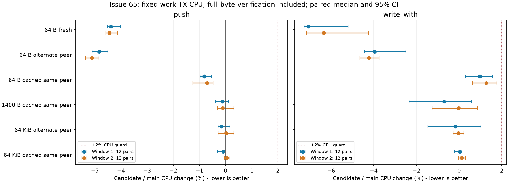

# Issue 65：无缓存小包与跨 peer TX 的 owner 复用

实验从 2026-10-15 开始，使用第二台 `root@38.207.178.131:22100`，隔离目录 `/root/zf65-20261015`。原工作目录中的其他实验未修改。机器为4 vCPU 的 x86_64 VM，暴露 i7-1265U 型号，Ubuntu kernel 5.4.0-216-generic；未暴露 cpufreq governor。本轮构建 shell 没有 RUSTFLAGS/target 覆盖，检查的全局与实验根 Cargo config 均不存在。环境原始记录见证据包。

跟踪 [#65](https://github.com/BlackLuny/zfstack/issues/65)，承接 [#56](https://github.com/BlackLuny/zfstack/pull/56)。本轮候选的两个64B CPU目标与正确性检查通过，后续固定64对长窗口已解决下行保护项，但上行 CPU/GB 区间仍跨过 +2% 保护界，完整性能资格为 **INCONCLUSIVE**，不应标记 #65 已完成验收或作为可直接合并的候选。

完整 [证据索引](../../bench/results/2026-10-15-issue65-tx/README.md)、[逐项判定](../../bench/results/2026-10-15-issue65-tx/qualification.json) 与源码/二进制清单随附；原始样本及未通过项全部保留。

## 生产改动与成本来源

本项承接 #56；目标是继续降低无缓存小包与交替 peer 的成本，保持已经交付的同 peer 缓存收益与 #21/#56 的记账、配额、回收语义。

软件 `perf cpu-clock:u` 的基线无缓存 64B 样本中，`Budget::try_allocate_kind` 约 28%、租约析构约 25%，`hash_one` 约 2.6%；交替 peer 的 hash 相关路径也可见。符号占比用于定位，不能把采样百分比直接当作预计生产收益；此 VM 没有硬件 PMU，未报告编造的指令或 cycles 数。

最终 T/U 各 2000 万次的独立软件采样中，cache0 的 `hash_one` self 从 T 的 1.48% 在 U 的报告中未出现（不将未显示等同于精确零计数）；交替 peer 从 2.72% 到 1.31%。这与源码路径从 cache0 每次一次查表变为零次、迁移从 index/payload 两次变为一次一致。新 payload 的三个 owner Arc 及租约释放、迁移需要的持久 owner Arc 都保留，未声称删掉必要的原子操作。cache0 的预算/租约析构仍是主要热点，剩余成本没有归零。

早期主线上的独立消融使用 M / N（仅 cache0 直接析构）/ R（再复用已解析 owner），各 12 对。64B cache0 的 N/M 为 -0.68% [-0.83, -0.31]，R/N 为 -3.41% [-3.77, -3.21]，R/M 为 -4.29% [-4.53, -3.72]；64B 交替 peer 的 N/M 为 -0.18% [-0.31, 0.16]，R/M 为 -5.30% [-5.40, -5.17]。百分比不相加，旧主线消融也不替代最终 T/U 资格。

实际删除的重复工作是：TX index 已确认或预留了目标 peer counter，随后 payload 分配/换 peer 又查询相同的物理 peer 表。新代码借用 index 的 counter，迁移时借用尚未 commit 的 reservation counter，省掉这次重复查找。缓存同 peer 直接使用 payload 已持有的 counter，保持 #56 的 Arc 复用，不先构造 scope；只有需要新 payload 时构造短期 `MemoryScope`。每次新 backing 仍完整预留 global/port/peer 配额；缓存 payload 保留原有 global/port 计费，重新取得当前 peer 配额。

另一项独立改动是 `max_cached==0` 时直接让返回的 payload block 析构，略过无法缓存的 eviction/activity 分支。Box 与租约的实际释放顺序、drain/used/epoch 和 waiter 唤醒不变。这里 cache0 指没有空闲 payload 缓存；小型 TX descriptor backing 仍按原有规则保留、计费与回收。

descriptor 的实际容量计费、global/port 身份、非空 TX 拒绝换 peer、迁移先预留再提交、旧 index owner 留到 payload admission 成功、失败回滚和 cache/debt/waiter 检查全部保留。新增测试覆盖 0/u64::MAX peer、同 peer 配额被占满、跨预算拒绝，以及三个预算层级下 index 预留成功但 payload 拒绝后的回滚/重试；push 和 write_with、cache0/cache32 均覆盖。

没有新增常驻字段、owner 堆对象或运行时依赖。冷启动及需要新 descriptor backing 的增长继续保留原有 get 路径；已保留 index 的额外 payload 使用新路径；优化不宣称消除首次写入的全部分配/计费成本。

## 冻结版本与测量口径

- F56：#56 合并提交 `3459562746e689fc5ec78c5b1764b0bba3465363`，用先前冻结的 FV 二进制作定向上下文对照。
- M：开始工作时的 main `ebcd6dd961ecaf4063c5cf0d58e11653fed70c2c`。它还包含 #56 后的 pacing 等改动，不能将 M/F56 的全部变化归给 TX owner 优化。
- R：初始方案 `3ae01f6fc685d7ff1ec92fcd0212f08cbcb95771`，R2 为独立构建；仅作为旧主线上的定位/消融证据。
- T：验证期间合入 #67 后的主线 `88a2e3f7a2e86fb6948223054a377e8a7f831af1`。
- U：本轮保留的生产候选提交 `2694c1406b7ebb5d1eef381a0c1a69e27f1ea743`，U2 为独立构建；最终表格与网络保护以 T/U 为准。
- 候选 P/Q/C 与 R 的快速、长试测各自保留。本文原始数据标签 C 指 eager-scope 候选，不是 #22 的 #21 版本 C。C 的目标场景有收益，但缓存小包出现约 1%–2% 的额外 CPU，一些区间不能排除 +2% 保护界，因此未选为最终方案。R 的快速试测也有较大噪声；完整保存后追加长试测，没有删除原样本或合并为正式结果。

性能构建使用共同冻结的输入、Rust1.92.0、fat LTO、codegen-units=1、panic=abort、incremental=0、单 build job。根 Cargo manifest/lock 取既有 FV 冻结版本，实际构建使用的 bench/Cargo.toml 与 bench/src 是 main `ebcd6dd` 的版本，同一阶段各版本的实际 bench 输入逐文件相同（最终 T/U/U2 使用 `88a2e3f` 的 bench）；源码归档和 SHA 清单记录的是这些实际输入。F56 的 CPU probe 不链接 bench crate；历史网络分数不与本轮混算。各版本的 src 来自上述冻结版本；用于 perf 的公共 manifest/bench 与用于原生功能检查的当前仓库 manifest 分开保存。T/U/U2 均使用相同的 `portable_full_scan_v1` 校验器；全部字节精确比较及 checksum 留在 timer 内，本轮没有变更校验算法或将正确性检查移出计时。

CPU3 串行运行，case 交错，variant 完整排列区组；每 case/variant 先运行一次不计入统计的 warmup。两个独立窗口各 12 对，另有独立构建 A/A。push 与 write_with 用不同但各版本相同的 probe，分开统计；write_with 的公共 sidecar 只替换写入方式，保持 verify 与计时范围一致；若一次返回部分容量，则循环写完整个 payload（65537B 会涉及多次调用），每 operation 指一份完整 payload 的写入、校验和 consume。诊断 allocator 和 perf 采样使用单独二进制/运行，不纳入正式 CPU 比值。

每个 API 的每窗口包含 cache0/cache32同peer/cache32交替peer × 1/64/512/1400/4096/65535/65536/65537B 共 24 case。四个正式窗口共 3744 次运行，其中 3456 次为正式测量。统计采用逐对 CPU 比值中位数、10000 次 bootstrap 95% 区间、seed65；不是两个中位数之比。不把不同 API、长度或试测窗口混成一个得分。

## 验证期间的主线正确性更新

#67 将 cached assign 改为使用当前 `budget.peer_limit`，而不是 lease 创建时的旧额度。发现主线变更后，停止旧基线网络阶段并保存部分记录，保留原 CPU 数据；隔离域被销毁，宿主 TUN 状态未改变。随后 rebase，并补充“4KiB 准入 → 收紧到 1KiB → 拒绝/回滚 → 恢复配额重试”的测试，覆盖 cache0/cache32、同 peer/迁移、push/write_with。

这个用例先在旧 shortcut 上失败，再在修复后通过。最终 public assign 与 index shortcut 共用当前配额预留、drain 和 cache 状态更新，避免两条路径继续复制而遗漏正确性修复。没有为跑分使用旧额度。旧网络部分记录标记为主线变更后取消，不计入最终网络资格。

最终版本重新执行固定的排除预热和完整矩阵，不将旧主线 R 的分数拼接成 U 的结果。

## 正式 CPU 结果

| API / 窗口 | 场景 | T CPU ns/op | U CPU ns/op | U/T 配对变化 [95% CI] |
|---|---|---:|---:|---:|
| push / 1 | 64B cache0 | 263.23 | 251.93 | -4.38% [-4.51, -4.02] |
| push / 1 | 64B 交替 peer | 259.85 | 246.62 | -4.83% [-5.11, -4.50] |
| push / 1 | 64B 同 peer 缓存 | 167.15 | 165.59 | -0.82% [-0.98, -0.54] |
| push / 1 | 64KiB 交替 peer | 16470.80 | 16458.08 | -0.16% [-0.28, +0.16] |
| push / 2 | 64B cache0 | 263.46 | 251.65 | -4.45% [-4.59, -4.13] |
| push / 2 | 64B 交替 peer | 259.68 | 246.35 | -5.11% [-5.36, -4.85] |
| push / 2 | 64B 同 peer 缓存 | 166.98 | 165.51 | -0.71% [-1.25, -0.47] |
| push / 2 | 64KiB 交替 peer | 16482.52 | 16472.05 | +0.02% [-0.28, +0.32] |
| write / 1 | 64B cache0 | 232.37 | 216.26 | -7.07% [-7.26, -5.21] |
| write / 1 | 64B 交替 peer | 274.23 | 262.62 | -3.96% [-4.43, -2.49] |
| write / 1 | 64B 同 peer 缓存 | 150.10 | 149.24 | +0.98% [+0.29, +1.57] |
| write / 1 | 64KiB 交替 peer | 10340.86 | 10259.46 | -0.18% [-1.46, +1.02] |
| write / 2 | 64B cache0 | 186.02 | 176.70 | -6.35% [-7.16, -4.26] |
| write / 2 | 64B 交替 peer | 182.92 | 174.79 | -4.24% [-4.66, -3.75] |
| write / 2 | 64B 同 peer 缓存 | 121.52 | 122.03 | +1.28% [+0.64, +1.76] |
| write / 2 | 64KiB 交替 peer | 10455.53 | 10481.83 | -0.03% [-0.28, +0.22] |

完整 96 个 API/窗口/case 的 CPU/op、CPU/byte、独立构建 A/A 与区间见 [cpu-table.csv](../../bench/results/2026-10-15-issue65-tx/cpu-table.csv)；CPU/byte 由每操作字节数换算，不另行计时。CPU probe 的时间采用 CLOCK_PROCESS_CPUTIME_ID（user+system），包括完整逐字节校验及 checksum，因此不能将 CPU/op 当作纯写入函数耗时。表中各臂绝对 CPU/op 中位数的比值不等于逐对比值中位数，write 窗口 1 尤其明显；VM 的窗口间绝对速度有变化，决策采用交错配对结果。

四个主窗口独立构建 A/A 的中位数最大绝对值为 0.60%。96 个 CPU 保护单元中，94 个区间上界不超过 +2%；两个 write_with / 1B 同 peer 缓存单元分别为 +2.56% [1.41, 3.11] 与 +1.50% [1.10, 2.54]，原始结论均为 INCONCLUSIVE。追加更长采样独立记录，不覆盖原结果。

两个 64B 目标在四个窗口均得到区间上界小于 0 的降低证据；同 peer 64B 的 write_with 有约 1.0%–1.3% 的额外成本，但区间排除 +2%。push 同 peer 64B 进一步下降约 0.7%–0.8%。64KiB 交替 peer 与同 peer 均排除 +2% 回退。

### 原始保护项及长采样

1B 缓存 write_with 原始两个窗口跨过 +2% 上界，追加两个各 12 对的 1000 万次迭代窗口（原窗口 200 万次）；变化分别为 +1.50% [0.89, 1.70]、+1.53% [1.40, 1.67]。同时测的 64B 缓存 write_with 为 +1.45% [1.32, 1.55] 与 +1.36% [1.14, 1.48]。小幅 CPU 代价存在，但均排除预登记的 +2% 回退。

原始短流 256 为 +0.75% [-0.70, 5.22]、down8 pump 为 +1.36% [-2.56, 2.62]，均为 INCONCLUSIVE。各加长 10 倍迭代，两个独立 12 对窗口得到：短流 256 +0.41% [-0.42, 0.96] / +0.35% [-1.21, 0.98]，down8 +0.45% [-0.15, 0.65] / -0.03% [-0.70, 0.86]。短流 64、up8 和 budget control 原窗口也排除了 +2%。这些 pump 使用虚拟链路，不能当作 TUN 吞吐证据。

F56 冻结 probe 的独立 12 对上下文对照中，U/F56：64B cache0 -2.18% [-4.39, -1.06]，64B 交替 peer -4.02% [-4.87, -2.62]，64B 同 peer 缓存 -0.10% [-0.38, 0.88]，1400B 同 peer缓存 +0.06% [-0.58, 0.50]，64KiB 交替 peer -0.15% [-0.98, 0.60]。全部排除 +2%，但这组跨 main 的比较包含主线其他改动，生产优化的归因仍以 U/T 两个主窗口为准。

两个主窗口的 A/A 有一格 write_with / 1B 交替 peer 区间为 [-2.03%, +0.63%]，反映小样本 VM 噪声；该格 U/T 保护通过。A/A 最大绝对中位数为 0.60%，没有把其均值强行归零或用于校正 U/T。完整区间随原始数据保留。

## 实际分配、账本与编译校验

T/U 两套独立 allocator 插桩，各测 2 个 API × 3 种缓存/peer 模式 × 8 个长度，共 96 条记录；另有单独的首次写入诊断 96 条。相同场景的实际 alloc/free、请求字节、warmup/retained ledger 在 T/U 之间全部一致。插桩未用于正式 CPU 比值。

每项热循环 10000 次：64B cache0 各 10000 alloc/free、每次请求 2048B；65536B 各 10000 alloc/free、每次 65536B；65537B 各 20000 alloc/free、每次两个 65536B。cache32 同 peer 热循环为 0 alloc/free；交替 peer 热循环总计一次 64B owner 建立，随后不再分配，不把这次首次建 peer 成本隐藏成零。

从空池开始的首次写入（只包围 push 或 write_with，未把 consume 算进去）：64B 为 4 次请求共 2484B，65536B 为 4 次共 65972B，65537B 为 5 次共 131508B，两 API、两版本一致。它包含首次 peer 表/owner 建立等 allocator 请求，口径与 payload/index 的预算账本不同，也不含 allocator 内部管理成本，不能当作 RSS。

64B warmup push 的已提交账本为 2336B（2048B payload + 288B TX descriptor），循环结束 cache0 保留 288B descriptor，cache32 保留 2624B（再含 288B pool descriptor）。65536B 对应 warmup 65824B、cache32 retained 66112B；65537B 为 131360B / 131648B。它们都是观察点，不是包含临时预留的 peak；drop 后每条记录全局账本为零。global/port/peer 细分、迁移失败不改变旧 owner、重试与精确释放由定向断言覆盖。

常驻布局未增加字段：本次 x86_64 构建 MemoryLease 48B、Block 72B。T/U/U2 的两个正式 probe 校验函数均在 0x1d000，逐字节与 checksum 后向循环的机器码、页内偏移一致；没有 libc bcmp/memcmp 调用。主窗口及长采样每一配对组记录的 warmup 源/目标地址 mod64 也在各臂间相同，统计脚本对此有断言；它是 warmup 观察值，不宣称逐次跟踪了所有后续指针。相同公共 verifier 源码 SHA 与所有二进制身份保存在 layout、manifest 和原始 meta 中。

## socket/TUN 与边界

MTU1420、两端 CUBIC、seed1、CPU0–3，独立 mount/network/PID namespace。mixed RTT12 / 200Mbps / queue2BDP，loaded RR 64B；connect 每次 4000 次连接、并发1000；上下行均为不限速、RTT1、8流、queue64MiB。数据流 secs12/warmup3，稳态窗口9秒；mixed 另含 idle RR 阶段。上行双方 TUN txqueuelen100000，其他10000，pfifo limit始终10000。测试不改变宿主服务、调度、IRQ 或 WireGuard 设置。

首轮四项各 12 对，另各一次排除 warmup，共104次运行、96次正式运行。正式连接96000次全部成功；每次应用模式/字节检查通过，实际 TUN 接口的 tx/rx/qdisc drop 及 softnet backlog drop 为0。`tun_b` 在此拓扑为 null，不把它当作已测接口；200Mbps mixed 的有界链路队列按设定存在瓶颈丢包，与 TUN/softnet 容量丢包区分。

| 场景 | 指标 | T 中位数 | U 中位数 | U/T 配对变化 [95% CI] |
|---|---|---:|---:|---:|
| mixed64 | loaded RR P99 ms | 35.105 | 35.305 | +0.08% [-0.19, +1.26] |
| mixed64 | stack CPU s/GB | 6.857 | 6.777 | -0.64% [-2.69, +0.61] |
| connect1000 | connect P99 ms | 100.675 | 97.404 | -2.76% [-6.01, +8.98] |
| connect1000 | total P99 ms | 114.341 | 111.504 | -0.96% [-5.93, +8.98] |
| connect1000 | stack CPU s / 4000 connections | 0.054 | 0.053 | +3.40% [-1.79, +10.36] |
| down8 | goodput Mbps | 4767.051 | 4569.957 | -3.68% [-6.86, -0.08] |
| down8 | stack CPU s/GB | 1.247 | 1.294 | +2.87% [+0.85, +8.00] |
| up8 | goodput Mbps | 6063.459 | 6226.189 | +1.47% [-5.69, +7.53] |
| up8 | stack CPU s/GB | 1.224 | 1.199 | -1.83% [-6.63, +6.90] |

CPU/GB 使用栈线程在同一窗口的 CPU / 有效业务字节，并非整个 harness 的进程 CPU。connect 的 CPU 以相同4000成功数归一；process CPU 与 P99.9 在 JSON 中单列描述，不将其有限尾部样本说成稳定性保证。

首轮 mixed 的 P99/CPU 保护通过；connect 三项与上下行四项为 INCONCLUSIVE，不能称作“网络无回退”。连接每次栈 CPU 约54ms，追加固定192对原参数；bulk 针对跨界项目追加固定24对、secs30/warmup5（25秒稳态窗口），保留 RTT、rate0、8流、queue 与 TUN 配置。原结果保留，补测独立统计、不拼接样本。

连接确认：固定192对原参数，另1对排除 warmup，386次运行。正式1536000次连接全部成功；connect P99 +1.50% [-0.50, 4.00]，total P99 +1.72% [-0.66, 3.11]，栈 CPU/4000成功连接 +0.05% [-0.98, 1.27]，均排除保护界。整个进程 CPU +0.08% [-0.78, 1.51]，作为额外上下文记录；不与原12对合并。P99.9 +1.61% [-0.09, 3.50] 仅作描述。

下行长窗口：24对、另1对排除 warmup，50次运行，应用及实际 TUN/softnet 检查全部通过。吞吐 +0.42% [-2.36, 2.00]，排除 -5% 回退；栈 CPU/GB -0.16% [-2.47, 2.60]，仍为 **INCONCLUSIVE**。同一窗口栈 CPU 时间 +0.06% [-1.07, 0.89]，链路搬运线程接近一个完整 CPU；吞吐与归一 CPU 的区间反映此 VM 下的端到端波动，不能把固定 TX 工作量的收益外推为网络收益，也不能据此断言没有 +2% CPU/GB 回退。

上行长窗口：24对、另1对排除 warmup，50次运行，应用及实际 TUN/softnet 检查全部通过。吞吐 -1.53% [-4.93, 2.86]，按原定 -5% 界通过；栈 CPU/GB +0.40% [-2.87, 3.13]，仍为 **INCONCLUSIVE**。同一窗口栈 CPU 时间 -0.49% [-1.24, 0.53]。本轮不把接近零的点估计写成已证明非劣。

本轮 U 的网络运行合计590次（含14次排除 warmup），其中正式连接共1632000次全部成功。两次固定 bulk 队列/负载的不同测量窗口均未把 CPU/GB 区间压进 +2%；当前证据不能判断存在超过2%的代码回退，也不能排除它。此缺口与已通过的 CPU 微基准、mixed、connect、吞吐保护分别记录。

## 延迟 index 检查的补充候选（未采用）

在 U 之后尝试 V `aefc7dc54120a0e49736801af5434300dfa82b61`，V2 为独立构建：仅当 cache miss/更换 owner 时才 unwrap index，并将准备 token 的旧 owner 参数改为惰性求值，保留现有额度、身份和状态转换。它通过本地282项库测试，但未获得完整性能资格，也未替换交付分支中的 U。

试测每 API 4 个小包 case、各12对和排除 warmup；push 每次500万迭代，write_with 每次1000万迭代。预先记录的采用门槛是 write_with 1B/64B 同 peer 缓存各收回至少1%且区间上界<0，同时其他 CPU 区间上界<=+2%（均相对 U）。V/U 的1B缓存为 -0.59% [-1.42, +0.002]、64B缓存 -0.21% [-0.97, +2.53]；write_with 64B交替peer +0.10% [-0.56, +2.78]。未达到门槛，因此保留为未采用试验。push cache0 有 -0.37% [-1.25, -0.31] 的小收益，但不能补足该门槛；完整8个比较、A/A、原始数据、源码和决定均归档。没有把 V 的局部结果拼接到 U 的正式窗口。

## 正确性与复现

最终 U 提交的本地 Rust1.94.1 QA portable 已经完整通过：17/17 个必需实例 PASS。它涵盖核心、adapter、定向预算、harness、工具、feature、coverage、eager/event-only 与四类 replay。相应的冻结计划、原始执行记录、build/environment manifest 和聚合报告均归档，不能将这个本机功能资格当作 Linux 性能资格。

第二台 Linux 的当前仓库 manifest/lock 检查通过：库单测 282 项通过、6 项既有 ignore；集成测试 1+2+1 项通过，另有既有 ignore。显式单独执行原来忽略的 256 流延迟 ACK 压力测试，实际执行 1 项并通过。probe 5 项、Python 工具 59 项及 no-default 构建通过。新增测试没有 ignore/skip；clippy 与格式检查通过。动态限额回归的先红后绿日志保留，失败原因是 shortcut 使用旧额度，修复后才用于性能资格。

本轮未满足的网络 CPU/GB 保护项仍属于 #65 的验收缺口；不能转交 #66 后把 #65 视作完成。更广的冻结 A/B/C 网络、1500 MTU 与长期 RSS 工作仍归 #66；本项没有把 #20 未完整计费的低成本当成必须恢复的生产预算标准。

所有原始计时工作结束后逐文件核对 F56/M/R/T/U/U2/V/V2 与其冻结 Git 源码，并重新校验28份完成的 micro meta及三份网络 meta中记录的二进制 SHA；全部匹配。U/U2、V/V2 的实际性能输入分别完全相同。宿主 `zfbA` 与 `zfbns` 均不存在，私有测试域已经退出；未更改宿主服务或默认 Rust 工具链。

性能输入源码、原始记录、派生脚本和完整测试记录分别随 inputs/raw/QA 归档，SHA256SUMS 校验可交付文件。统计可从干净 Git 导出在新目录重放，方法与边界见证据索引。初轮据此保留候选，建议先做同二进制网络 A/A 和更高精度的固定对照。下面记录该补测；当前仍应**暂不合并、不关闭 #65**，不能将微基准通过等同于网络非劣。

## 2026-10-16 固定补测与 PR 状态

生产源码仍为 U `2694c14`，T/U 二进制 SHA 在所有计时结束后再次与原清单匹配，没有重新编译或改动校验器。固定计划先保存 runner SHA、样本数与界限，再执行测量；所有新原始数据在 [bulk-final-evidence.tar.gz](../../bench/results/2026-10-15-issue65-tx/bulk-final-evidence.tar.gz)，统计及取消记录在 [bulk-final-summary.json](../../bench/results/2026-10-15-issue65-tx/bulk-final-summary.json)。

先试验按角色放置线程（stack=CPU0、link-down=CPU1、link-up=CPU2、其余=CPU3），保持原协议，以同一个 T 二进制做每方向12对 A/A。线程放置审计和应用校验通过，但 CPU/GB 配对区间下行为 -0.53% [-7.90, +10.17]，上行为 -5.46% [-14.21, +20.05]，未通过预登记的 A/A 精度门槛。此方法未采用；其 T/U 只记录了2次不计入统计的 warmup 运行，随后因校准失败取消，不计算性能结论。只终止实验私有 PID namespace，未改宿主服务。

随后回到原 CPU0–3 放置，不使用线程 pinner：固定每方向12对、secs30/warmup5 的同二进制 A/A，再固定每方向64对 T/U；与原24对长窗口保持相同协议，仅增大样本数。两组完整运行，未查看中途性能统计或在通过时提前停止。A/A 不校正 T/U 比值，各历史窗口独立保留，不拼接样本。

同二进制 A/A 的 CPU/GB：下行 +2.05% [-1.31, +4.67]，上行 -0.37% [-7.18, +9.88]，显示这台 VM 下仍有较大重复性波动。一次资源检查未见明显内存、换页或 I/O 压力，但尚未确定波动根因，不能据此把候选区间越界全归因于调度。

| 最终64对 / 25秒稳态窗口 | T 中位数 | U 中位数 | U/T 配对变化 [95% CI] | 判定 |
|---|---:|---:|---:|---|
| down8 goodput Mbps | 4406.937 | 4410.772 | +0.25% [-1.42, +1.66] | PASS（-5%） |
| down8 CPU s/GB | 1.327 | 1.332 | -0.06% [-1.54, +0.95] | PASS（+2%） |
| up8 goodput Mbps | 6431.483 | 6345.747 | -1.95% [-3.16, +0.47] | PASS（-5%） |
| up8 CPU s/GB | 1.137 | 1.157 | +0.97% [-1.60, +4.86] | INCONCLUSIVE（+2%） |

下行 CPU/GB 的原12对和24对不确定项由最终64对确认解决；上行三个窗口的 CPU/GB 仍保留为未解决。142项保护/收益检查中，最终 `unresolved` 为上行同一指标的3个窗口，完整性能资格仍为 **INCONCLUSIVE**。本轮不再追加样本到通过为止，也不将同窗口栈 CPU 时间（上行 +0.10% [-0.59, +0.72]）替换成 CPU/GB 保护项。

最终64对共260次运行（含4次排除 warmup），全部应用/模式校验通过，实际 TUN/qdisc/softnet drop 为0。U 的网络对照累计850次运行（含18次排除 warmup）；另有两组同二进制 A/A 共104次诊断运行，与候选对照分别统计。正式连接成功数仍为1632000。结束后确认宿主测试 TUN/netns 不存在，黄金二进制未改变。

[PR #71](https://github.com/BlackLuny/zfstack/pull/71) 已建立为草稿，关联 #65。首轮 [GitHub CI](https://github.com/BlackLuny/zfstack/actions/runs/38795852415) 六个任务全部成功，`qa/gate` 为21/21必需实例 PASS（head `179c343`，实际 tested merge `9a66a94635fd606f6d9f9ca16eeb847ebd1accf3`）。补测证据提交后的最终 CI 状态以 PR checks 为准。CI 通过不代表尚未满足的网络性能保护项通过，当前不转为可合并候选。
