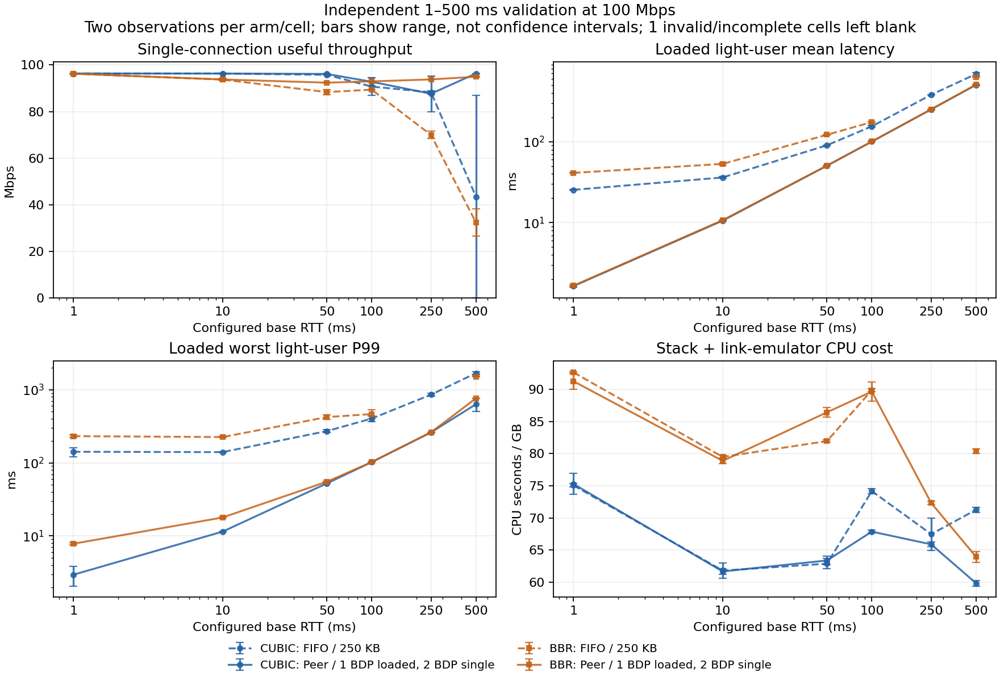

# 公平性、CPU 与少连接吞吐：联合变量及 1–500 ms RTT 最终报告

**结论：有明确的优化空间，但尚未找到同时满足全部约束、可以直接替换生产默认值的统一解。**
最有证据支持的方向是在真正可控的瓶颈按用户轮转，保留原来的 TCP 窗口、调度批量和预取参数，
再按带宽时延积配置队列。它能大幅降低不同用户之间的排队延迟。
不过，CUBIC 少连接峰值检查出现回退，部分 RTT 的 CPU 仍增加；因此本次保留生产默认值。
这里的“最优”指本次有界搜索得到的条件候选，不是全局最优或已经完成的在线自适应实现。

本轮共保留 **468 次尝试**，其中修正测量宿主后的最终系列 **280 次**；加上前一轮容量实验的 92 次，
两轮合计 560 次。不同宿主版本不混合估计收益。全部最终系列通过二进制、源码和配置身份审计，
275/280 次通过测量完整性检查；失败尝试原样保留。生产 `src/` 相对
`9d6fb7684e3842da16e673825d3c9ace724aa433` 没有改动。

## 最有把握的收益

独立确认实验使用 CUBIC、20 ms 基础 RTT、100 Mbps、一个重用户的 200 条下载连接，
以及三个独立交互用户。两侧队列上限都是 250,000 字节，核心参数相同，因此这里隔离的是
FIFO 与按 peer 字节轮转/拥塞时挤出最大积压队列尾包的差异。
12 对相邻、平衡顺序的独立重复，不复用筛选样本；39,600 个计划请求全部完成。

| 指标 | FIFO 各次结果的中位数 | peer 队列各次结果的中位数 | 配对变化中位数 | 配对 bootstrap 95% 区间 |
|---|---:|---:|---:|---:|
| 三个交互用户等权平均延迟 | 54.64 ms | 20.64 ms | **−62.22%** | −64.65% ～ −59.73% |
| 最差交互用户 P99 | 199.99 ms | 21.90 ms | **−88.94%** | −90.61% ～ −87.41% |
| 有效吞吐 | 96.134 Mbps | 96.154 Mbps | +0.032% | +0.00009% ～ +0.053% |
| 栈线程 CPU 秒/GB | 11.011 | 11.036 | −0.018% | −2.32% ～ +6.72% |
| 栈＋双向链路模拟线程 CPU 秒/GB | 63.092 | 62.781 | +0.663% | −1.32% ～ +2.92% |
| 整进程 CPU 秒/GB | 68.566 | 68.411 | +0.166% | −1.32% ～ +3.47% |
| 整进程峰值 RSS | 37.75 MiB | 37.84 MiB | +0.315% | −0.54% ～ +0.65% |

各臂中位数之比不等于“配对变化中位数”；表中保留这两个不同统计量。
置信区间由整对运行重采样 10,000 次得到，未把同一运行内的请求当作独立重复。
延迟收益稳定；CPU 没有显示确定变化，**不能据此证明严格零回退或 CPU 降低**。
相同吞吐下，栈 CPU 秒/秒的配对变化为 +0.021%〔−2.33%, +6.76%〕，
栈＋链路为 +0.750%〔−1.33%, +2.95%〕。
原始统计见 [final-confirm-summary.json](final-confirm-summary.json)。

## 参数取舍与推荐边界

| 场景 | 本次证据支持的选择 | 不能省略的条件 |
|---|---|---|
| 当前生产默认值 | 保持现状 | 新队列未通过少连接峰值保护，不能无条件开启 |
| 已知、可控、多个用户竞争的 100 Mbps 瓶颈 | peer 字节 DRR＋最大积压队列尾部 pushout；原核心参数；重载先采用约 1 BDP 队列 | 这是实验候选；CUBIC/250 ms、BBR/50 ms 有 CPU 代价，BBR/100 ms 的 2 BDP 备选值得保留 |
| 高 RTT、少连接的受控链路 | 确保有足够窗口和缓存余量；深度筛选中 CUBIC/500 ms 需要 2 BDP 才跑满 | 不能把多用户公平队列的维护成本永久加到极限单流路径；尚未实现/验证自动旁路 |
| worker 之前的运营商入口拥塞 | 按认证用户聚合控制源站 socket 的读额度/接收窗口，允许借用空闲容量 | 仍是设计，必须在入口验证；本地出队调度不能消除数据到达前的等待 |

保留的核心值是：16 MiB 发送在途/接收窗口、发送总缓存不新增小上限、
调度 quantum 64 KiB / round cap 256 KiB、预取最小 64 KiB / 时间 20 ms / 原最大值，
以及原有全局/port/peer 预算 512/64/32 MiB。这里是服务端实验配置，不能直接覆盖本地 client 配置。
peer 队列原型的 DRR quantum 为 1420 字节；它与核心调度 quantum 是两层不同参数。

实验使用已知瓶颈速率 `B`（bit/s）和已配置基础 RTT `R`（秒），每个方向的逻辑队列上限为：

```
已知重载场景：Q = max(250000, B × R / 8)
单连接场景：  Q = max(250000, 2 × B × R / 8)
```

这两种工况分别配置，**没有测试用连接数阈值实时切换的算法**。队列不包含传播延迟中的包，
但包含正在串行发送的包。两侧使用同样的串行器，避免把不同模拟器当成队列收益。

| 基础 RTT | 重载 1 BDP 上限/方向 | 单连接 2 BDP 上限/方向 |
|---:|---:|---:|
| 1 ms | 250,000 B | 250,000 B |
| 10 ms | 250,000 B | 250,000 B |
| 50 ms | 625,000 B | 1,250,000 B |
| 100 ms | 1,250,000 B | 2,500,000 B |
| 250 ms | 3,125,000 B | 6,250,000 B |
| 500 ms | 6,250,000 B | 12,500,000 B |

这些是允许占用的上限，不是预分配 RSS。100 Mbps × 500 ms 的 BDP 为 6.25 MB；
更高带宽需要重新检查核心窗口、预算和内核 socket 上限，不能把本结果外推为任意带宽的 500 ms 支持。
500 ms 深度筛选中，单流 CUBIC 在 1 BDP 下为 80.29/80.22 Mbps，在 2 BDP 下为 96.34/96.34 Mbps；
200 条连接时两种深度都约 96.15 Mbps。这是分别选择容量的依据。

## 1–500 ms 的重载结果

下表为对 FIFO/250 KB 的配对变化中位数。每格仅两对，属于跨工况验证的描述性结果，
不能使用 20 ms 的 12 对置信区间替它背书。1/10 ms 的两条容量公式相同，复用最终 2 BDP 系列中
这 16 次未改变的运行；50–500 ms 使用另行冻结并执行的 32 次 1 BDP 直接对照。

| CC / RTT | 有效吞吐 | 平均用户延迟 | 最差用户 P99 | 栈 CPU/GB | 栈＋链路 CPU/GB | RSS |
|---|---:|---:|---:|---:|---:|---:|
| CUBIC / 1 ms | −0.06% | −93.51% | −97.96% | +1.86% | +0.29% | −0.81% |
| CUBIC / 10 ms | +0.01% | −70.71% | −91.81% | −0.75% | −0.16% | −0.15% |
| CUBIC / 50 ms | −0.36% | −44.06% | −80.68% | −1.77% | +0.79% | +1.64% |
| CUBIC / 100 ms | +0.29% | −35.09% | −74.39% | −12.56% | −8.47% | +13.52% |
| CUBIC / 250 ms | −0.81% | −33.95% | −69.38% | **+17.94%** | −2.19% | +6.43% |
| CUBIC / 500 ms | +42.88% | −26.58% | −62.73% | −17.27% | −16.01% | +0.46% |
| BBR / 1 ms | +0.10% | −95.95% | −96.60% | −2.92% | −1.49% | −19.66% |
| BBR / 10 ms | −0.01% | −79.79% | −92.05% | +2.63% | −0.77% | +5.24% |
| BBR / 50 ms | **−3.48%** | −58.51% | −86.84% | +1.68% | **+5.45%** | −3.69% |
| BBR / 100 ms | **−4.12%** | −42.45% | −77.55% | +0.03% | −0.24% | +7.06% |
| BBR / 250 ms | 未确认¹ | 未确认¹ | 未确认¹ | 未确认¹ | 未确认¹ | 未确认¹ |
| BBR / 500 ms | +32.47% | −19.10% | −49.53% | −15.87% | −20.42% | +5.24% |

¹ 1 BDP 系列的一个 FIFO 对照因发生器最大迟到 21.97 ms，漏了两个计划到达，超过预定 20 ms 门槛。
两次候选均有效，但整格缺少两对完整比较，不能用另一系列的好结果替换该失败。
诊断性数值及每次结果仍在 [regimes-table.json](regimes-table.json) 和
[final-loaded-summary.json](final-loaded-summary.json) 中，`valid: false` 必须一并解释。

1 BDP 修复了统一 2 BDP 的一些明显代价：CUBIC/50 ms 的栈＋链路 CPU/GB 从 +11.54% 降为 +0.79%，
BBR/50 ms 从 +17.92% 降为 +5.45%。但它不是每格都占优：
BBR/100 ms 的独立 2 BDP 对照得到吞吐 −1.82%、栈 CPU/GB −6.20%、栈＋链路 −8.82%，
候选吞吐 86.93/86.96 Mbps，高于 1 BDP 的 84.88/84.81 Mbps；其 RSS 约 82.60 MiB，
高于 1 BDP 的 78.52 MiB。这是保留更多内存换吞吐/CPU 的备选，两个系列并非直接相邻的 1 对 2 BDP 实验。
完整的 2 BDP 结果见 [policy-table.json](policy-table.json)，其中包括未通过的格子。

不能把 CPU/GB 与 CPU/秒混为一谈。500 ms 重载候选交付了更多有效数据：CUBIC 的栈 CPU/秒
仍增加 18.18%，栈＋链路增加 19.99%；BBR 分别增加 11.42% 和 5.39%。单位工作更省不等于
固定时间内 CPU 更低。CUBIC/250 ms 的栈 CPU/秒增加 16.95%，也不能用链路模拟器的下降掩盖。

## 单连接与极限峰值保护

100 Mbps 下的单连接采用 2 BDP，以下列出两次实际吞吐，避免用基线接近零时的巨大百分比宣传收益。
它们在原 96 次最终系列中测得，未和旧宿主结果混用。

| RTT | CUBIC FIFO → peer，Mbps | BBR FIFO → peer，Mbps |
|---:|---|---|
| 1 ms | 96.338 / 96.338 → 96.338 / 96.338 | 96.281 / 96.228 → 96.230 / 96.241 |
| 10 ms | 96.338 / 96.338 → 96.435 / 96.216 | 93.271 / 94.191 → 94.099 / 93.430 |
| 50 ms | 95.892 / 95.651 → 96.101 / 96.206 | 87.239 / 89.457 → 92.492 / 92.327 |
| 100 ms | 86.841 / 94.613 → 94.426 / 91.145 | 89.359 / 89.442 → 93.099 / 92.809 |
| 250 ms | 87.536 / 89.003 → 79.924 / 95.362 | 71.553 / 68.357 → 93.779 / 93.815 |
| 500 ms | **0.043 / 86.888 → 96.337 / 96.338** | 26.412 / 38.313 → 94.847 / 95.050 |

500 ms CUBIC 的异常 FIFO 运行保留。它有一次 RTO、约 2.47 MB 生命周期重传，仍有规律地读到少量数据，
未观察到明显宿主长暂停；现有证据不足以确定完整原因。该格不适合报告相对百分比或声称同等工作量下
CPU 大幅下降。较长预热的独立深度筛选中，小 peer 队列为 83.90/77.49 Mbps，而 2 BDP 两次约 96.34 Mbps。
同样，250 ms CUBIC 候选的两次跨度较大，不能承诺每次都保住峰值。

进一步用基础 RTT 为零、10 Gbps 串行器测试宿主能达到的数 Gbps 峰值，队列代码仍真实运行。
每例两对 A/B，另有同工况两对 A/A；每次预热 4 秒、测量 12 秒。

| 工况 | FIFO 中位数 → peer 中位数 | 两对 A/B 吞吐变化 | 同工况两对 A/A 变化 |
|---|---:|---:|---:|
| CUBIC / 1 连接 | 5.781 → 5.441 Gbps | **−8.49%、−2.94%** | +6.04%、−0.09% |
| CUBIC / 2 连接 | 5.369 → 4.900 Gbps | **−8.76%、−8.71%** | −2.64%、+10.40% |
| BBR / 1 连接 | 4.999 → 5.014 Gbps | −0.69%、+1.45% | −3.42%、+5.38% |

峰值保护**未通过**。CUBIC 双连接两对均超过预先声明的 3% 回退线；单连接也不能确认非劣。
A/A 表明共享宿主峰值噪声很大，但这不是排除 A/B 回退的证据。没有把 BBR 的小正变化解释成优化。
要同时满足用户要求，后续实现需要无竞争时保留原批量快速路径、按需进入公平调度，并重新验证进入/退出及
1/2/4 连接峰值；**本次没有实现或测量这种旁路，不能把它写成已完成的最优解**。
详见 [final-guard-summary.json](final-guard-summary.json)、[final-guard-aa-summary.json](final-guard-aa-summary.json)。

## 公平性改善到什么程度

负载模型是一个重 peer 开 200 条连接，三个独立轻 peer 各发 25 次/秒、256 字节往返请求。
主要指标是三个交互用户的等权平均延迟和最差用户 P99，不是 203 条连接的平均完成时间，
也不是所有用户都得到相等带宽。发送按绝对时刻计划，不等待上一请求完成；超时、取消、未发送都保留在分母中。

组合工况表的 48 次候选全部通过测量检查，轻请求全部完成；20 ms 的独立确认也全部完成。
但同一重 peer 内部仍用 FIFO，并没有解决其所有连接的公平性：独立确认中，20 秒窗口内完全没读到数据的
重连接数，FIFO 中位数为 4，peer 候选为 4.5；Jain 指数变化区间跨零。
这是有限窗口的无进展观测，不能宣称所有用户、所有连接永不饿死。

统一 2 BDP 的 BBR/500 ms 一次候选出现 **8 条重连接建立超时**（20 秒期限），轻请求全部完成。
该失败被保留并使整格无效。重 peer 内的长队列可能参与了问题，但未证明完整因果；不能归为发生器噪声。
随后独立 1 BDP 两次候选均通过，也不能倒过来删掉这个失败。
真实产品还需要按认证用户计费、peer 内轮转连接、有界的新请求进展资源及准入控制。
实验用 IPv4 地址区分 peer，并不是已经实现了生产身份契约。

## 联合变量中没有选用的方向

修正宿主后的筛选是 Q/S/P 三因素八组合，加两种宽预取/预算配置，CUBIC、BBR 各做两个随机完整区组，
共 40 次。随后独立比较 24 次队列深度和 24 次每连接包数下限，所有选择记录先于对应验证运行。

| 因素 | 实验结果与取舍 |
|---|---|
| 缩小调度批量到 16/64 KiB | 没有稳定跨 CC 的 CPU 收益，不替换 64/256 KiB |
| 预取改为 16 KiB / 4 ms / 最大 512 KiB | peer 队列下，部分栈 CPU 降低，但栈＋链路 CPU/GB 增加约 6.94% / 4.74%；没有额外延迟收益 |
| 宽预取 256 KiB / 20 ms / 最大 2 MiB，原预算 | 相对默认 peer 队列，栈 CPU/GB 增加约 5.79% / 3.97%，RSS 增加约 59.87% / 25.46%；旧宿主下的“省 CPU”没有复现 |
| 宽预取加 128/64/64 MiB 全局/port/peer 预算 | CUBIC CPU 大致持平但 RSS 约翻倍；BBR 一次有 600 个计划请求未完成，比较无效，不作为默认 |
| 每条重连接至少 4 个包的队列下限 | CUBIC/1 ms 单位工作 CPU 改善，但 20 ms 栈 CPU/GB +21.98%、栈＋链路 +12.48%；BBR 吞吐也回退 |
| 每连接 8 个包下限 | BBR/1、20 ms 吞吐约下降 10–11%；虽然部分连接进展改善，不能满足跨 RTT 目标 |
| 所有场景固定 2 BDP | 少连接高 RTT 有益，但 50 ms 重载 CPU 明显回退，500 ms BBR 还有上述建连失败 |
| 统一限制总 TX 缓存为 256 KiB | 前一轮独立 client 单连接吞吐 −18.26%，高 RTT 服务端回退更大，继续排除 |

增加内存确实能补足高 RTT 的窗口/队列余量，但“缓存越大 CPU 越省”没有得到普遍支持。
不能为获得较低 CPU 数值而接受大量连接不工作。

## 测量宿主修正、噪声与审计

V1 的裸 Shard 测试宿主把预算不足与普通 send-space 阻塞同等处理，等待该连接自己的事件。
尚未发出数据的连接不能依赖自己的 ACK 获得唤醒；256 KiB 原子写也可能在 64 KiB 能写入时整次失败。
生产 Tokio adapter 已注册预算等待者，这不是已证实的生产栈缺陷。

经三版诊断，最终宿主在真实释放及收包/读/关闭进展后重试预算等待者，并允许一次 64 KiB 部分写；
预算回滚本身不能自我触发无界重试。最后的 off/on/on/off 对照中，完全无进展连接为 100/2/0/100，
修正后两次重试约 208k/378k；此前会自激到数百万次的版本没有用于最终估计。
详见 [HOST-RETRY.md](HOST-RETRY.md)。修正仅验证一个 shard/port，不代表通用跨 shard 唤醒实现。

因此旧宿主的高负载 CPU/饥饿结果只作为诊断证据，不能与最终结果混用。
前一轮 Tokio client 的少连接峰值回退不受这项裸 Shard 问题影响。
最终二进制 SHA256：`74a5d0f81bea350c2a0dfd2f217dc4f373a4c0fd52979c0aba7ea0e4a7bfb518`。

| 阶段 | 尝试数 | 通过测量完整性检查 | 用途 |
|---|---:|---:|---|
| V1 原始探索 | 176 | 173 | 保留历史，不作最终参数证明 |
| V2/V3/V4 宿主诊断 | 12 | 12 | 同二进制开/关对照；拒绝自激重试 |
| 最终联合因素筛选 | 40 | 39 | 选原核心参数与 peer 调度方向 |
| 最终深度筛选 | 24 | 24 | 500 ms、1/200 连接、两种 CC |
| 最终每连接队列下限 | 24 | 23 | 拒绝跨 RTT 回退的下限规则 |
| 独立统一 2 BDP 矩阵 | 96 | 94 | 六 RTT × 两 CC × 1/200 连接 |
| 独立重载 1 BDP 补充 | 32 | 31 | 四 RTT × 两 CC，直接 FIFO 对照 |
| 独立 20 ms 确认 | 24 | 24 | 12 对配对置信区间 |
| 1/500 ms A/A | 16 | 16 | 同设置局部波动 |
| 少连接峰值 A/B | 12 | 12 | 保护用户的峰值约束 |
| 同工况峰值 A/A | 12 | 12 | 量化数 Gbps 下的波动 |
| 合计 | **468** | **460** | 完整性通过不等于优化门槛通过 |

最终“分工况”96 次表由原矩阵 64 次未改变的尝试与补充的 32 次组成，95/96 次有效，
每行带 `source_cohort`。**它不是额外 96 次实验**。原 2 BDP 矩阵没有被覆盖。
全量计划请求 435,300 个，未完成 857 个；最终 280 次系列为 279,000 个，未完成 604 个，
其中 600 个来自被拒绝的宽预取配置。详细失败清单在 [cohorts.json](cohorts.json)。

使用冻结二进制、固定 CPU 集、随机区组、相邻 AB/BA 对照；测量时不编译、不绘图、不压缩。
逐次保存环境、命令、源码哈希、请求账本、250 ms 连接进展、资源与 cgroup 增量。
最终所有身份审计通过，全量未出现 cgroup throttling；这不等于完全消除共享宿主干扰。
最终运行的系统级 steal 增量为 0.11–3.79 秒，不能直接归因给某个线程。

限速 A/A 中，500 ms BBR 的最差用户 P99 同设置也变化 +81.50%，
500 ms CUBIC 重载栈 CPU/GB 变化 −7.06%。因此小样本跨 RTT 表中的小差异保留为不确定，
不通过反复挑选最好的重复消除噪声；20 ms 的独立确认和峰值保护各自解释。
证据见 [audit.json](audit.json)、[final-aa-summary.json](final-aa-summary.json)。

CPU 分三种口径：栈线程、栈＋双向用户态链路模拟线程、包括客户端和观察器的整进程。
这些不是完整生产服务 CPU，也没有覆盖生产内核网络开销。RSS 是整进程生命周期高水位，
包含启动/客户端/传播缓存等，排除内核 socket 内存；不能称为核心独占内存或稳定窗口 RSS。

## 适用范围与交付

环境为 Linux 6.18.55、Rust 1.94.1、4 CPU quota，进程固定于 CPU 0–3；专用无网络容器运行 TUN 模拟，
但宿主仍共享。双向 100 Mbps，MTU 1420，没有配置随机丢包，但队列容量会造成丢包和重传。
最终矩阵每次预热至少 8 秒/20 RTT、测量 20 秒；深度筛选预热 20 秒。峰值采用前述不同设置。
这覆盖了配置点 1/10/50/100/250/500 ms，**不证明区间内每个 RTT、异构用户 RTT、动态切换、
中等连接数、多重用户、上传/混合方向、任意链路速率或长时稳定运行**。

已有真实拆主机实验将一类高负载延迟定位在 worker 之前的入口队列；
本地队列原型未解决该故障。生产落地应结合
[入口控制设计](../2026-10-23-capacity/UPSTREAM-DESIGN.md)，按认证用户聚合源站读额度/窗口，
事件驱动地分配批量预算，允许无竞争用户借用空闲容量，并保护少连接快速路径。
已有 ZFC #684 是每连接接收缓冲控制，不能直接当作按用户公平性证明。
这些是明确的实现方向，仍需独立生产路径验证。

本次交付了测试宿主修正、联合因素/RTT/峰值/噪声实验工具、完整原始记录、冻结可执行文件和分析报告。
最终宿主 24 项 Rust 测试、6 项 Python 分析测试通过；源码格式差异检查通过。
没有修改生产默认值，没有推送或创建 PR。



图中的一个无效对照格留空；500 ms CUBIC 单连接低值原样保留。完整矢量图见 [SVG](rtt-regimes.svg)。

- [分工况完整结果](final-regimes-summary.json)、[带绝对值的表格](regimes-table.json)。
- [初始最终协议](CORRECTED-PROTOCOL.md)、[2 BDP 预选记录](FINAL-POLICY.md)、
  [重载补充的事先声明](LOADED-POLICY.md)、[峰值 A/A 事先声明](PEAK-NOISE.md)。
- [复现与重分析命令](../../../bench/capacity/README.md)。
- [完整证据归档](evidence.tar.gz)、[逐文件 SHA256 清单](evidence-files.json)、
  [报告及归档校验清单](artifact-index.sha256)。归档包含原始尝试、冻结源码、五个 RTT 二进制及分析工具；
  清单不包含自身，外层校验清单覆盖它和归档。
