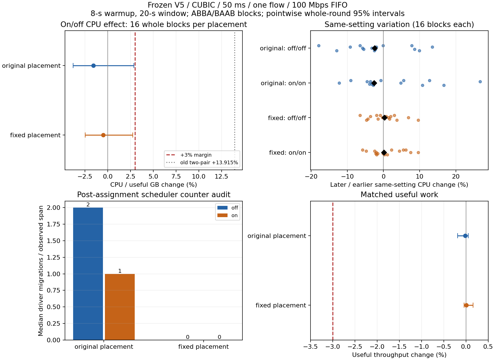

# CUBIC / 50 ms / 单连接 CPU：定点复测与环境对照

**没有复现持续的 +13.9% 栈 CPU/GB 增幅。原 CPU 配置与固定线程位置两组均通过事先声明的 3% CPU/吞吐保护；这支持原先两对样本不足以认定代码回退，不构成严格零开销或历史异常原因已完全确定的证明。**

本轮全程使用同一冻结 V5：
`96695f880dd600172e3dfa5b32304da0fa296579357785b5f83dbb87ea1a26c5`。
保留原来的 CUBIC、50 ms、单下载、100 Mbps、双向 250 KB FIFO、MTU 1420、16 MiB 栈窗口、Linux 接收自动调优最大 32 MiB，
以及 **8 秒预热、20 秒测量**。off/on 仅配置聚合出口速率为 0 / 12,375,000 IP B/s。
生产 core、Tokio 与 benchmark 的 Rust 二进制均未改动或重编译。

## 主要结果

正式 **128 次全部有效**；另有两次预检，不进入区间。16 轮，每轮原配置和固定配置各一个四次运行的区组；
每种配置的 ABBA/BAAB 各八组，运行顺序事先固定并交错，分别有 32 次 off、32 次 on。

每个区组先将同设置的两次精确窗口 CPU 相加，再除以相加的有效 GB，得到 on/off 变化。
表中为 16 个区组变化的中位数与整轮 bootstrap 95% 区间，10,000 次重采样；不是把 64 次运行或数据包视为独立轮次。

| 指标变化〔95% 区间〕 | 原 CPU 0–3 配置 | 固定线程位置 |
|---|---:|---:|
| 栈与转发 CPU/GB | −1.583%〔−3.813%, +2.876%〕 | −0.509%〔−2.479%, +2.733%〕 |
| 栈与转发 CPU/秒 | −1.406%〔−3.751%, +2.833%〕 | −0.556%〔−2.357%, +2.969%〕 |
| 有效吞吐 | −0.020%〔−0.187%, +0.051%〕 | +0.011%〔−0.042%, +0.161%〕 |
| 栈＋转发＋双向用户态链路 CPU/GB | +0.040%〔−2.280%, +1.855%〕 | −0.190%〔−1.117%, +0.710%〕 |
| 整个压测进程 CPU/GB | −0.505%〔−2.007%, +1.337%〕 | −0.107%〔−1.062%, +0.638%〕 |

两种位置的 CPU/GB 区间上界分别为 **+2.876% / +2.733%**，低于预定 +3%；
吞吐区间下界分别为 −0.187% / −0.042%，高于 −3%。本工况支持非劣结论，不能说 CPU 恰好零变化或确定降低。
这些是各指标的区间，没有提供所有指标同时覆盖的家族置信保证。

区组效应的算术均值分别为 **−0.037% / +0.023%**，接近零。
单个区组仍有波动：原配置范围 −8.039%～+15.560%，固定配置 −8.718%～+7.711%。
通过的保护适用于所估计的典型区组效应，不保证每一次运行的 CPU 都不增加。
按每种位置全部 32 次 off、32 次 on 的累计 CPU/有效 GB 算，原配置 5.568574→5.556813 CPU 秒/GB（−0.211%），
固定配置 5.876173→5.871589（−0.078%）。这些是另外的描述性统计，不能替换表中的区组估计。
各臂绝对成本不同，开关效果分别与自身位置下的 off 对照比较。



图左上为正式整区组区间，灰线是历史两对样本的中位数；历史值没有混入新估计。
右上每个点是一个区组中的同设置重复差异，黑菱形为中位数，不是开关效果的置信区间。
见 [confirmation-summary.json](confirmation-summary.json)、[verdict.json](verdict.json)。

## 同设置对照量化了多少波动

每个四次区组内既有 off/off，也有 on/on。两个重复按时间顺序比较，所有值保留；
它们包含共享主机、内核 TCP 与链路/运行动态的综合波动，不能单独指认为某一种硬件原因。

| 位置 / 设置 | 同设置变化的绝对中位数 | 全部 16 对的范围 |
|---|---:|---:|
| 原配置 / off | 6.106% | −17.920% ～ +13.492% |
| 原配置 / on | 4.651% | −12.263% ～ +26.714% |
| 固定位置 / off | 2.488% | −6.509% ～ +9.621% |
| 固定位置 / on | 2.338% | −5.748% ～ +9.651% |

原配置 **on/on 最大 +26.714%**，与原来那次 on/off 的 +25.263% 幅度相当；同一个二进制、同一个开关值也能产生这种变化。
固定位置的同设置绝对中位波动约 2.3%～2.5%，小于原配置约 4.7%～6.1%。
这与环境/运行波动解释相容；正式随机平衡对照则没有显示持续的 +13.9% 开启成本。
不能把 A/A 的存在直接当作历史那一次异常的完整因果证明。

原配置与固定位置之间，开关 CPU 效果的交互中位数为 +0.037%，95% 区间 −2.294%～+1.333%，跨零。
没有观察到开启效果对线程位置的明确依赖；不能因此断言任意位置都完全等效。

## 环境控制与实际调度核验

两组都使用 CPU 4 上的同一个外部观察器；原配置保持所有 benchmark 线程在 CPU 0–3。
固定组将真实 `zfb-stack` driver/relay 放在 CPU 0，up link 在 1、down link 在 2，其余源站/客户端/桥接线程在 CPU 3。
每次均核实实际 affinity，关键角色在启动两秒内出现，随后所有采样匹配，早于八秒预热结束。
观察器从 PPID 关系找到自有进程，未依赖本内核缺少的 proc children 文件。

| 观察到的栈线程指标（各臂 32 次的中位数） | 原/off | 原/on | 固定/off | 固定/on |
|---|---:|---:|---:|---:|
| 迁移计数 | 2.000 | 1.000 | 0.000 | 0.000 |
| 运行队列等待（毫秒） | 61.919 | 69.073 | 19.407 | 19.353 |
| 观察跨度（秒） | 26.150 | 26.149 | 26.153 | 26.151 |
| 外部观察器全生命周期 CPU（秒） | 0.354 | 0.358 | 0.361 | 0.361 |

固定配置全部 64 次的栈线程观察位置都是 CPU 0，迁移计数均为 0；原配置实际出现 CPU 0/1/2/3，迁移范围 0～6。
固定配置的排队等待中位数也更小。这里的计数覆盖**启动两秒后的约 26.15 秒观察跨度**，包含部分预热和收尾，
不是严格的 20 秒窗口；正式 CPU/GB 和吞吐始终来自原二进制自己的精确窗口计数。

四核总 quota、16 GiB 上限和可用 CPU 0–4 没变。全部 130 次 cgroup throttling 事件为 0；
两种开关所有运行的聚合 pacing 计费均为 0，单 peer 快速路径未被限速。
窗口主机 steal/softirq、进程/线程上下文切换、调度队列等待、链路迟到和丢包均逐次保留；
包数、shard runs 和丢包是生命周期诊断，未伪装成精确窗口工作计数。
原生 Tokio 不提供的裸宿主 wakeup/poll 计数也未用于解释 CPU。

观察器的生命周期 CPU 中位数约 0.35～0.36 秒，单独记录，不包含在生产栈 CPU 或整个 benchmark 进程 CPU 中。
两臂都同等受其观察；原先两对未使用这个观察器，因此新结果不用于反推当时完整原因。
没有修改频率 governor、IRQ、优先级或主机服务。sysfs 频率数据不可用，固定的是逻辑 CPU，仍不能声称独占物理核心或彻底消除宿主干扰。
CPU 指标也没有完整覆盖生产整机软中断成本。

## 与原异常及 PR 状态的关系

[原 V5 报告](../2026-10-24-pacing-fast-path/README.md) 的两对 CPU/GB 变化为 +2.568% / +25.263%，中位 +13.915%。
原始四次运行与原报告不改动；本次 128 次独立确认和两次预检都没有追加到那两个样本里。
本轮按冻结的 16 轮结束，没有删去高 steal/波动样本，没有根据中途效果改次序、窗口或样本数。

本工况的结论是“独立复测未复现持续 +13.9% 增幅，CPU/吞吐在事先声明的 3% 保护内”；
原两对结果继续作为历史小样本观测保留，不单独用于认定持续 CPU 回退。
它不证明严格零开销，也不能将原 +25.263% 那次完整归因于线程迁移、主机频率或任一单独因素。
PR #94 的其他少连接极限峰值保护仍独立未确认，不因本项通过而改变 Draft 或默认关闭状态。

## 完整性、复算与证据

2 次预检＋128 次正式运行，**130/130 测量有效**，全部命令、源码、二进制、FIFO/窗口、线程位置及关闭资源审计通过。
同一保留镜像 `534d24a0…`，Linux 6.18.55；冻结 V5 的 Rust 1.94.1/fat LTO/单 codegen unit/panic abort 身份不变。
本轮只增加 Python 观察与分析工具；新增 proc 字段解析回归和既有分析测试共 12 项通过，源码清单审计通过。
同一版本上的功能 CI 继续覆盖原 core/Tokio/bench，复测未替换业务代码。

[PROTOCOL.md](PROTOCOL.md) 保留预先指定的样本、次序、指标和判定。
在当前 PR checkout 根目录提取 [evidence.tar.gz](evidence.tar.gz) 后，可在全新目录重算：

```sh
tar -xzf docs/experiments/2026-10-24-cubic50-retest/evidence.tar.gz
python3 bench/capacity/cubic50_collect.py qa/results/cubic50-reanalysis
```

归档包括本轮所有原始输出、完整线程观察记录、固定源码与 V5 可执行文件、环境/工具测试记录，
以及单独标记的四次历史运行。后者仅供对照，不纳入本轮区间。
[evidence-files.json](evidence-files.json) 给出每项字节数和 SHA256；
[artifact-index.sha256](artifact-index.sha256) 在包外覆盖报告、图、汇总、清单与归档。
先前 V4/V5 的已封存证据包及历史区间保持不变。
