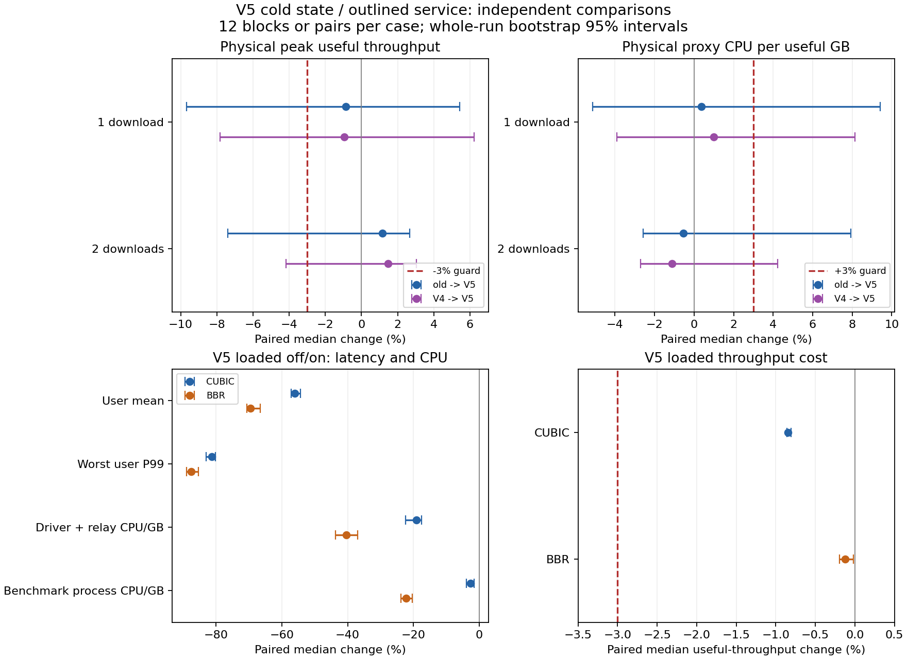

# V5 后续尝试：更小的接口热状态与独立复测

**本轮没有找到统计上可确认的峰值改进。V5 完成了接口状态与代码布局优化，并独立复现重载延迟和 CPU 收益；少连接峰值吞吐及 CPU 的非劣保护仍未建立，继续默认关闭、保留 Draft。**

这是用户要求继续尝试后的新候选与新实验。保留[上一轮 502 次生产路径结果](../2026-10-24-production-pacing/README.md)，
没有把 V5 数据追加进 V4 的置信区间，也没有将 V4 已通过的 500 ms 长窗口检查冒称为 V5 的独立确认。
本轮实际执行 **246 次，244 次测量有效**；两个无效位置预检和全部不利结果原样保留。

## 实现与配置

V5 将完整的 96 字节 pacing clock 移出接口热数据，接口内封装为 **24 字节**的速率、活跃位和可选指针。
只有首次出现不同 ready peer 的竞争才创建 clock；单用户从未竞争时不分配它，退出竞争后保留冷状态供复用。
inactive 路径不解引用 clock，服务轮次直接使用 allowance 返回的 active 判断，省去重复读取。
竞争发送循环放进非内联 `serve_paced`，无竞争轮次保留原来的非聚合发送循环；冻结二进制保留了相应独立符号。
这些事实说明状态和代码组织改变，**不等于已经证明吞吐或 CPU 优于 V4**。

本轮不改 99% 已知出口 IP 容量、2 ms 批次、10 ms credit、一秒竞争记忆、DRR、预取、窗口与预算。
不新增生产线程、包复制或包队列。配置 API 不变，宿主仍需明确提供容量；算法不需要 RTT 参数。
默认和无竞争接口热数据更小；发生过竞争后另有一个常数大小的堆对象，不承诺所有场景总内存都更低。
核心回归覆盖首次竞争使用最新容量/MTU、低速未来 deadline、同速率幂等、债务、关闭、重激活，以及真实双 peer 双向 splice。

本次建议仍是按实际链路验证后，选择已知 **IP 容量的 99%**，保留单用户快速路径与足够的 BDP 窗口。
它不是单用户套餐限速。接口共享瓶颈、未知带宽、worker 之前的入口排队，仍需宿主解决相应层级或源站读取/窗口控制。
参见 [API 与边界](../../design/0011-contention-egress-pacing.md)。

## 真实少连接峰值：三版本独立对照

冻结旧版、V4、V5，同一本机 TUN→Tokio/splice→真实内核上游路径。
单/双下载各 12 个完整三臂区组，六种排列各出现两次，总共 **72 次全部有效**。
CPU 固定 0–3，仍使用四核总 quota；MTU 65535、两个 proxy worker、独立 driver、预热 4 秒、测量 12 秒。
这里是实际本机极限路径，未经过 100 Mbps 链路模拟器。

以下为整对变化中位数及整区组 bootstrap 95% 区间，10,000 次重采样：

| 下载连接数 | 对照 | 有效吞吐 | 代理进程 CPU/GB |
|---:|---|---:|---:|
| 1 | 旧版→V4 | −1.36%〔−5.86%, +3.96%〕 | +0.44%〔−4.07%, +2.60%〕 |
| 1 | 旧版→V5 | −0.87%〔−9.68%, +5.42%〕 | +0.38%〔−5.14%, +9.41%〕 |
| 1 | V4→V5 | −0.94%〔−7.83%, +6.23%〕 | +0.99%〔−3.90%, +8.13%〕 |
| 2 | 旧版→V4 | −0.84%〔−5.33%, +2.53%〕 | +0.81%〔−2.03%, +5.84%〕 |
| 2 | 旧版→V5 | +1.16%〔−7.41%, +2.68%〕 | −0.54%〔−2.57%, +7.92%〕 |
| 2 | V4→V5 | +1.47%〔−4.16%, +3.05%〕 | −1.13%〔−2.71%, +4.22%〕 |

V5 相对旧版单/双下载的吞吐中位变化约 −0.87%/+1.16%，区间下界仍低于 −3%；
CPU/GB 区间上界也超过 +3%。四个保护项都**未确认**，不是有证据通过，也不是已证实的系统性退化。
V4→V5 的区间同样跨零，本轮不能将 V5 宣传为峰值最优解。
各臂绝对吞吐中位数，单下载约 18.593/18.559/18.308 Gbps，双下载约 13.900/14.286/13.931 Gbps（旧版/V4/V5）。
各臂中位数之比、不同比较的配对中位数不满足简单加减关系，不能混用。



图上部为本机实际峰值，下部为 100 Mbps/20 ms、200 重连接＋三个交互用户的 V5 off/on 确认。
误差线重采样整区组/整对运行，不把同一次运行内的请求当作独立样本。
所有区间是各指标的区间，没有对全部实验提供同时置信或多重检验保证。
见 [peak-summary.json](peak-summary.json)。

## V5 独立重载确认

两种 CC 各 12 对相邻、平衡 off/on，48 次全部严格有效、观察完整。
真实内核 TCP 上游→生产 Tokio splice→同一双向 100 Mbps/250 KB FIFO，基础 RTT 20 ms、MTU 1420；
一个重 peer 的 200 条下载，三个独立轻 peer 各按绝对时刻发送 25 次/秒、256 字节往返请求。
预热 8 秒、测量 20 秒；RR reader/writer 固定 CPU 4，服务与其他台架线程在 0–3，总 quota 仍为四核。

| 配对中位变化〔95% 区间〕 | CUBIC | BBR |
|---|---:|---:|
| 有效吞吐 | −0.85%〔−0.86%, −0.80%〕 | −0.12%〔−0.20%, −0.02%〕 |
| 用户等权平均延迟 | −56.01%〔−57.16%, −54.39%〕 | −69.49%〔−70.54%, −66.56%〕 |
| 最差用户 P99 | −81.18%〔−82.97%, −80.12%〕 | −87.44%〔−88.93%, −85.39%〕 |
| 生产 driver＋relay CPU/GB | −19.15%〔−22.42%, −17.47%〕 | −40.36%〔−43.71%, −36.99%〕 |
| driver＋relay＋双向链路 CPU/GB | −5.44%〔−6.46%, −4.87%〕 | −25.21%〔−26.32%, −23.16%〕 |
| 整个压测进程 CPU/GB | −2.71%〔−3.99%, −1.58%〕 | −22.17%〔−23.85%, −20.38%〕 |
| 进程峰值 RSS | +3.85%〔+3.10%, +4.63%〕 | −0.77%〔−1.46%, −0.42%〕 |

CUBIC 各臂吞吐中位数 96.149→95.338 Mbps，用户均值 55.471→24.470 ms，最差用户 P99 199.949→37.271 ms；
BBR 为 95.530→95.394 Mbps、76.412→23.179 ms、280.355→36.822 ms。
单位工作 CPU 按实际交付的有效字节归一化；固定时间内 CPU 也降低：driver＋relay CPU/秒
CUBIC −19.80%〔−23.03%, −18.15%〕，BBR −40.44%〔−43.78%, −37.08%〕；整进程 CPU/秒分别 −3.52%/−22.20%。

**79,200 个计划请求全部完成，零逾期**；候选 4,800 个重连接窗口全部有读取进展，对照有 179/4,800 个无进展窗口。
候选仍有最长约 **9.50 秒**的连续无读取进展，对照约 20.31 秒；250 ms 采样不是逐包时限保证。
它改善本负载的有限窗口公平性，不是所有用户等带宽或无限过载下永不饥饿的证明。

上述收益是 V5 相对自己的 off 控制；**不能跨轮用这些数值与 V4 的比值推断 V5 又节省了多少 CPU**。
生产 driver＋relay、用户态链路线程、整个压测进程是不同口径；整进程还包括源站、客户端和桥接，
不等于整台生产机器及所有软中断 CPU。RSS 是整进程生命周期高水位，不含内核 socket 内存。
见 [loaded-summary.json](loaded-summary.json)。

## V5 的 1–500 ms 矩阵

本轮新执行 96 次：两 CC × 1/10/50/100/250/500 ms × 一/200 下载 × 两对 off/on，全部有效。
同一 V5 二进制、同一双向 FIFO/250 KB，窗口上限 16 MiB；预热 max(8 秒, 40 RTT)，测量 20 秒。
重载的 RR 仍固定 CPU 4；与 V3/V4 不混合。每格仅两对，以下是**描述性结果，不是置信区间**。

| CC / RTT | 重载吞吐 | 用户均值 | 最差用户 P99 | driver＋relay CPU/GB | ＋链路 CPU/GB | 整进程 CPU/GB |
|---|---:|---:|---:|---:|---:|---:|
| CUBIC / 1 ms | −1.02% | −84.63% | −88.03% | −12.94% | −2.41% | −1.28% |
| CUBIC / 10 ms | −0.88% | −67.56% | −85.42% | −27.15% | −14.20% | −10.27% |
| CUBIC / 50 ms | −0.64% | −37.06% | −76.00% | −14.95% | −3.62% | +0.87% |
| CUBIC / 100 ms | +1.40% | −25.13% | −72.58% | −31.31% | −21.36% | −18.83% |
| CUBIC / 250 ms | +1.53% | −31.23% | −69.71% | −8.84% | −13.52% | −11.01% |
| CUBIC / 500 ms | +33.66% | −16.28% | −57.60% | −27.50% | −18.68% | −18.22% |
| BBR / 1 ms | −0.12% | −91.80% | −92.96% | −41.52% | −27.20% | −23.75% |
| BBR / 10 ms | −0.19% | −81.53% | −91.04% | −36.64% | −24.96% | −22.32% |
| BBR / 50 ms | +1.35% | −54.64% | −81.13% | −37.73% | −22.76% | −19.82% |
| BBR / 100 ms | +7.65% | −37.58% | −74.60% | −37.21% | −31.02% | −28.11% |
| BBR / 250 ms | +10.78% | −26.02% | −67.25% | −33.06% | −25.62% | −22.77% |
| BBR / 500 ms | +28.06% | −25.43% | −49.54% | −31.94% | −24.26% | −21.79% |

12 个重载格的用户均值/P99/driver CPU 每 GB 都改善；CUBIC/50 ms 的整进程 CPU/GB 为 **+0.87%**，
不能说所有 CPU 口径在所有 RTT 都下降。矩阵中 79,200 个计划请求全部完成，候选无完全停滞重连接窗口，
对照有 69/4,800 个；候选最长连续无读取进展约 **12.00 秒**，对照约 21.45 秒。

| RTT | CUBIC 单流吞吐 | CUBIC 单流 driver CPU/GB | BBR 单流吞吐 | BBR 单流 driver CPU/GB |
|---:|---:|---:|---:|---:|
| 1 ms | −0.06% | −2.47% | +0.03% | −2.93% |
| 10 ms | +0.06% | +0.37% | +0.13% | −0.06% |
| 50 ms | −0.21% | +13.92% | +3.58% | −1.06% |
| 100 ms | +0.30% | −3.72% | −0.03% | −6.54% |
| 250 ms | +0.79% | −6.17% | −0.19% | +2.22% |
| 500 ms | −1.73% | +1.50% | +2.84% | −3.88% |

**CUBIC/50 ms 单流 driver CPU/GB +13.92% 是未解决的不利观测。**
两个配对分别 +2.57%/+25.26%，吞吐变化 +0.067%/−0.489%；CPU/秒分别 +2.64%/+24.65%。
整进程 CPU/GB 配对中位 +2.87%。两臂聚合 pacing 计费均为零，仍不能据此把这项 CPU 保护判为通过，
也不能仅凭两个配对确定通用回退或其原因。本轮按固定计划结束，没有为此格另行扩样。
全部单流吞吐配对中位变化都在 −3% 以上，但小样本不证明所有 RTT 的吞吐非劣，也不替代本机实际峰值保护。

100 Mbps × 500 ms 的 BDP 为 6.25 MB；服务端使用原有 16 MiB 接收/在途上限，Linux 接收自动调优最大 32 MiB。
`--sock-buf-kb 16384` 约束 zfstack，不是把 Linux socket 固定为 16 MiB。
实际本机峰值保留原低 RTT client 配置，不能直接将它的窗口用于高 BDP WAN。
覆盖六个同 RTT 配置点不证明任意 RTT、异构 RTT、真实 WAN/WG、任意速率或未知瓶颈均适用。
见 [wan-summary.json](wan-summary.json)。

## 噪声诊断、预检失败与停止条件

A/A 使用完全相同的旧二进制，单/双下载、原 CPU 配置/固定角色配置，每格三对，共 24 次全部有效。
固定角色为 driver CPU 0、TUN reader 和其他代理线程 CPU 1、源站/客户端 CPU 2–3，外部观察器 CPU 4。
观察器直接核实每个线程的请求/实际 affinity，不修改冻结旧版。

| A/A 配对吞吐变化绝对值的中位数 | 原 CPU 0–3 配置 | 固定角色配置 |
|---|---:|---:|
| 单下载 | 9.572% | 0.109% |
| 双下载 | 2.719% | 10.041% |

原配置一次旧版 A/A 单流变化达 −25.03%；固定角色也有大波动。
因此没有满足预先要求的“两格都更稳定”，**不执行**条件性的 48 次固定位置峰值扩展。
这一分支不是漏测或被删去的坏结果，决定记录在 `decisions.json`，A/A 不进入三版本或重载区间。
它证明环境存在明显波动，不能据此排除 A/B 的真实回退。固定角色观察器 CPU 成本另存在各次 `affinity.json` 中，
不计作生产成本或隐藏成 CPU 优化；主要峰值与重载确认不使用该观察器。

最初两次位置预检无效：本内核缺少 `/proc/.../children`，观察器未找到代理子进程，实际未固定角色。
审计捕获问题并在 A/A/正式峰值开始前停止；原始两次及源码/错误保留。
改为按 `/proc/<pid>/stat` 的 PPID 关系发现自有后代后，单独 `preflight-v2` 两次全部通过。
没有覆盖或把预检吞吐混入确认，修正记录见 [PREFLIGHT-FIX.md](PREFLIGHT-FIX.md)。

| 实际执行阶段 | 次数 | 测量有效 |
|---|---:|---:|
| 原生 smoke | 2 | 2 |
| 原始位置 preflight | 2 | 0 |
| 修正位置 preflight-v2 | 2 | 2 |
| 同版本 A/A | 24 | 24 |
| 三版本实际峰值 | 72 | 72 |
| 独立重载确认 | 48 | 48 |
| 新 V5 RTT 矩阵 | 96 | 96 |
| 合计 | **246** | **244** |

全量计划请求 **159,300 个，缺失 0 个**，cgroup throttling 事件 0。所有计划和身份审计完成。
按 [PROTOCOL.md](PROTOCOL.md) 串行执行，测量时不构建、运行测试集、绘图、压缩或进行重分析。
主机仍共享，固定 CPU/随机平衡区组与 A/A 是量化干扰的方法，不是完全消除干扰的声明。
所有失败/不利结果保留，未改窗口或样本量取得通过结果。

最终 [qualification.json](qualification.json) 为 **`passed: false`**：单/双下载的吞吐下界、代理 CPU/GB 上界四项保护未建立。
这是性能实验判定，与功能测试和 CI 通过是不同结论。

## 功能验证、复算与交付

生产代码提交 `bee1574`，后续 runner 修正不改变该 Rust 二进制。core 260 通过/4 忽略，
Tokio 326 通过/6 忽略及相关集成测试，bench 全 feature 28 通过，Python 分析 11 通过；
fmt、Clippy、源码清单审计通过。Clippy 保留既有诊断，未声称零 warning。
单 peer 的 CUBIC/BBR、1/500 ms 包内容/发送时间/模拟步数回归保持一致，真实双 peer 双向 splice、半关闭和退出预算归零通过。

Rust 1.94.1、fat LTO、单 codegen unit、panic abort，Cargo/依赖不变。
V5 SHA256：`96695f880dd600172e3dfa5b32304da0fa296579357785b5f83dbb87ea1a26c5`；
旧版 `74a5d0f8…`、V4 `550f9732…` 都继续保留。Linux 6.18.55、四核 quota、16 GiB 上限，自有无网络容器。

在当前 PR checkout 根目录提取 [evidence.tar.gz](evidence.tar.gz) 后，用全新输出目录复算：

```sh
tar -xzf docs/experiments/2026-10-24-pacing-fast-path/evidence.tar.gz
python3 bench/capacity/fastpath_collect.py qa/results/fastpath-reanalysis
```

归档包含全部新尝试、失败、固定到达账本、逐流进展、线程 affinity、旧/V4/V5 冻结源码与可执行文件、构建/测试记录和分析工具。
[evidence-files.json](evidence-files.json) 逐文件给出字节数和 SHA256；
[artifact-index.sha256](artifact-index.sha256) 在包外覆盖报告、汇总、图和归档本身。
此前所有证据包和区间保持原样，完整原始数据保留但不合并估计。

新实现与证据已更新至 [PR #94](https://github.com/BlackLuny/zfstack/pull/94)。
重载收益已独立复现，热状态变小；**现有数据仍不足以声称满足全部少连接峰值及各 RTT CPU 约束**，因此维持可选择启用和 Draft 状态。
