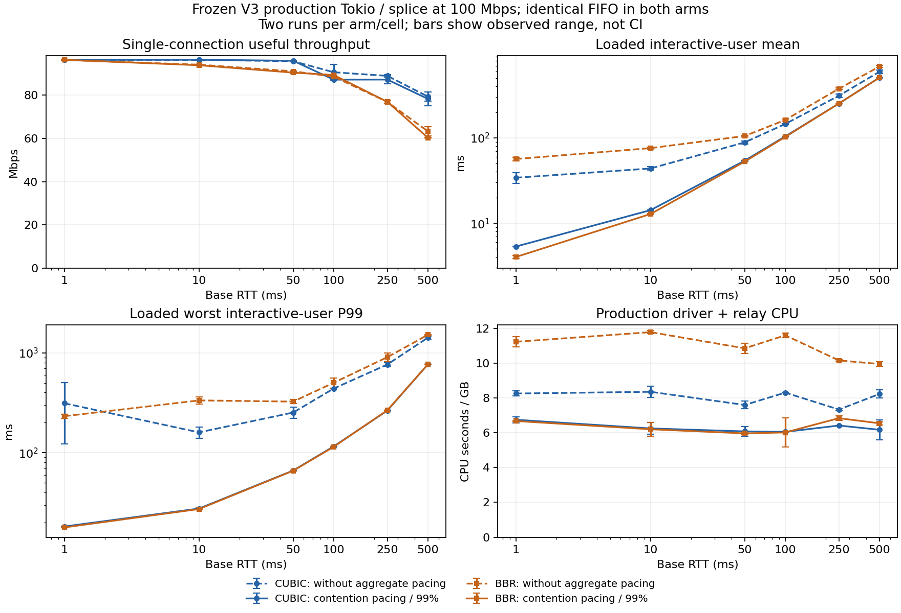

# 生产路径公平性优化：实现、重复测量与最终边界

**已实现可选择启用的生产出口聚合 pacing。在本次已知容量、多用户争用的重载确认中，以不到 1% 的有效吞吐代价，明显降低交互延迟和单位工作 CPU。少连接峰值的严格非劣保证仍未建立，因此没有将它改成生产默认值，PR 保留 Draft。**

这次修改包含真正的 `src/` 业务代码、Tokio 控制入口和真实 `TcpStream::splice` 回归。
它接续[上一轮联合因素实验](../2026-10-23-rtt/README.md)，但上一轮的模拟器 peer 队列不是本次实现；
本轮所有正式比较的外部链路始终使用相同 FIFO、相同容量。最终结论不是全局最优，也不是任意拥塞条件下的无饥饿证明。

## 当前建议

宿主知道出口 IP 容量时，给相应 iface 配置其 **99%**，保留现有窗口、预算、peer/connection DRR、预取与批量参数。
只有多个 ready peer 争用时执行聚合 pacing；一秒竞争记忆覆盖稀疏用户的请求间隔。
无竞争时走原有批量发送路径。算法不需要 RTT 参数。

```rust
let capacity_bytes_per_second = 100_000_000_u64 / 8;
handle.set_iface_egress_rate(iface, capacity_bytes_per_second * 99 / 100);
// sans-IO 宿主可调用 shard.set_iface_egress_rate(iface, ...)。
// 配置为 0 关闭该接口的聚合 pacing。
```

本次选择比较了 off、100%、99%、97% 四个档位。100% 对 CUBIC 的平均延迟改善只有 15.32%，
没有达到筛选目标；97% 增加吞吐损失，额外收益较小。因此 99% 是本次有界搜索中最合适的竞争期配置。
不猜测未知带宽，不自动更改生产默认值，也不将单个用户限制在所配置速率内。
适用 API、计费和边界见[设计说明](../../design/0011-contention-egress-pacing.md)。

## 最终代码的主要确认结果

V4 冻结二进制、CUBIC/BBR 各 **12 对**相邻、平衡 AB/BA 比较，总共 48 次；
100 Mbps、基础 RTT 20 ms、双向 250,000 字节 FIFO、MTU 1420。
一个重 peer 建立 200 条下载连接，另三个轻 peer 各按绝对时刻发送 25 次/秒、256 字节往返请求。
预热 8 秒，测量 20 秒；两臂使用相同二进制，仅接口速率为 0 或 12,375,000 IP 字节/秒。
没有把筛选、预验证、V3 或同一次运行内的请求当作额外独立重复。

| 配对变化中位数〔95% 配对 bootstrap 区间〕 | CUBIC | BBR |
|---|---:|---:|
| 有效吞吐 | **−0.855%**〔−0.880%, −0.826%〕 | **−0.092%**〔−0.121%, +0.007%〕 |
| 三个交互用户等权平均延迟 | **−56.905%**〔−58.284%, −55.602%〕 | **−69.569%**〔−72.040%, −65.949%〕 |
| 最差交互用户 P99 | **−81.604%**〔−84.195%, −81.142%〕 | **−87.119%**〔−88.206%, −85.954%〕 |
| 生产 driver＋relay CPU 秒/GB | **−17.898%**〔−22.276%, −16.135%〕 | **−44.558%**〔−46.129%, −42.077%〕 |
| driver＋relay＋双向链路 CPU 秒/GB | −5.471%〔−6.793%, −3.330%〕 | −24.838%〔−25.776%, −24.141%〕 |
| 整个压测进程 CPU 秒/GB | **−2.139%**〔−3.267%, −0.708%〕 | **−22.715%**〔−23.639%, −21.908%〕 |
| 进程峰值 RSS | +3.479%〔+2.586%, +5.122%〕 | −1.190%〔−1.608%, −0.180%〕 |

各臂结果的中位数分别为：CUBIC 吞吐 96.152→95.316 Mbps，平均延迟 56.823→24.321 ms，
最差用户 P99 200.170→36.948 ms；BBR 为 95.503→95.473 Mbps、76.549→22.928 ms、284.461→37.247 ms。
各臂中位数之比不等于配对变化中位数。区间按整对运行重采样 10,000 次得到，
是各指标的区间，没有对全部实验作同时置信或多重检验保证。

CPU/GB 用实际交付的有效字节归一化，避免通过少做工作得到较低 CPU。
本组固定时间内的 driver＋relay CPU 也下降：CUBIC **−18.609%**〔−22.949%, −16.849%〕，
BBR **−44.577%**〔−46.131%, −42.079%〕；整进程 CPU/秒分别为 −3.057% 和 −22.818%。
因此本组收益不限于链路模拟器的成本变化。
源码、参数、流量与请求完整性均通过审计；全部 48 次同时通过原始严格检查和额外观察完整性检查。
详见 [review-loaded-summary.json](review-loaded-summary.json)。

这些 CPU 口径仍有边界：driver＋relay 包含真实 Tokio driver 与应用转发；整进程另外包含
上游源站、桥接、Linux 客户端和用户态链路。它们不是整台生产机器的 CPU，未完整计入内核软中断。
RSS 是整进程生命周期高水位，包含客户端和台架缓存，不包含内核 socket 内存，不能叫作核心独占内存。

## 公平性与“饿死”的实际观察

最终主要确认组共 **79,200 个计划轻请求，全部完成，零逾期**；未增加服务截止时间或放宽发生器门槛。
48 次运行中，候选 4,800 个重连接窗口均有数据进展；对照有 **213/4,800** 个连接窗口完全无读取进展
（CUBIC 151，BBR 62）。这表明本负载下的有限窗口公平性明显改善。

这不是每条连接都持续获得固定份额的承诺。250 ms 采样记录中，候选仍存在最长约 **12 秒**的连续无读取进展，
对照最长约 21.45 秒；V3 全 RTT 矩阵候选最长约 12.25 秒。
主要延迟指标按三个轻用户等权计算，不是 203 条连接的平均完成时间，也不是所有用户等带宽。
真实部署仍需正确的 peer 身份、预算和准入策略；有限压测不能证明无限过载下永不饥饿。

## 1–500 ms RTT 的覆盖

独立 V3 矩阵保留 96 次有效运行：两种 CC × 六个 RTT × 一/200 条重连接 × 两对 off/on。
这部分测量的是冻结 V3，**没有改名为 V4 的完整矩阵**。
V4 保持所选速率、批量、credit、竞争记忆和队列算法；新增极低速 deadline 边界修复、
无竞争路径开销优化与回归，另用自己的 48 次重载确认和针对性单连接测试验证。

以下是 V3 重载组配对变化中位数，每格只有两对，属于跨场景描述，不能套用前面 V4 的置信区间。

| CC / RTT | 有效吞吐 | 平均用户延迟 | 最差用户 P99 | driver＋relay CPU/GB |
|---|---:|---:|---:|---:|
| CUBIC / 1 ms | −0.85% | −84.05% | −90.75% | −18.20% |
| CUBIC / 10 ms | −0.85% | −67.41% | −82.45% | −25.24% |
| CUBIC / 50 ms | −0.58% | −38.79% | −73.25% | −20.04% |
| CUBIC / 100 ms | +1.64% | −28.49% | −73.61% | −27.16% |
| CUBIC / 250 ms | +2.24% | −18.84% | −65.34% | −12.53% |
| CUBIC / 500 ms | +44.34% | −14.32% | −45.85% | −24.72% |
| BBR / 1 ms | −0.11% | −92.88% | −92.26% | −40.52% |
| BBR / 10 ms | −0.07% | −83.07% | −91.76% | −47.35% |
| BBR / 50 ms | +1.49% | −49.88% | −79.62% | −44.97% |
| BBR / 100 ms | +7.64% | −36.74% | −76.85% | −48.21% |
| BBR / 250 ms | +11.82% | −32.88% | −70.30% | −32.68% |
| BBR / 500 ms | +29.16% | −25.77% | −49.38% | −34.26% |

候选所有重连接窗口有进展，对照 81/4,800 个窗口无进展；79,200 个计划请求全部完成。
高 RTT 下较高吞吐仍可能带来更高 CPU/秒：例如 CUBIC/500 ms 的 driver＋relay CPU/秒 **+8.45%**，
同时吞吐 +44.34%，CPU/GB 降低。不能把单位工作改善说成所有 RTT 下绝对 CPU 一律降低。



图为 V3，每臂每格两次，误差线是实测范围，**不是置信区间**。
原始矩阵与完整指标见 [final-wan-summary.json](final-wan-summary.json)。
本次覆盖 1/10/50/100/250/500 ms 六个相同 RTT 的配置点，没有证明任意中间 RTT、异构用户 RTT 或真实 WAN/WG。

WAN 组保留服务端的 16 MiB 接收/在途上限；100 Mbps × 500 ms 的 BDP 为 6.25 MB。
Linux 客户端使用接收自动调优、最大 32 MiB。`--sock-buf-kb 16384` 配置的是 zfstack 上限，
不是把 Linux socket 接收缓冲固定成 16 MiB。更高带宽时需要重新验证 BDP、预算和窗口。
实际本地 client 峰值使用原来的低 RTT client 配置，不能将其窗口直接推广到 500 ms WAN。

## 少连接与单连接峰值保护

实现层面，单个 ready peer 不受所配置聚合速率限制。V4 的单 peer 路径还跳过 pacer 调用及逐包聚合计费。
CUBIC/BBR、1/500 ms 的确定性回归中，off/on 的包内容、发送时间和模拟步数完全相同。
所有独立单 peer WAN 运行的 `egress_paced_bytes` 均为零。
这些正确性检查不能取代真实吞吐的统计保护。

| V4 独立检查 | 每格配对数 / 测量窗口 | 吞吐配对中位变化 | 95% 区间 | 预先声明的 −3% 下界保护 |
|---|---:|---:|---:|---|
| CUBIC / 100 ms / 单连接，V4 off/on | 12 / 40 秒 | +3.192% | +0.130% ～ +3.922% | 通过 |
| BBR / 500 ms / 单连接，V4 off/on | 12 / 40 秒 | −0.793% | −4.927% ～ +2.823% | **未确认** |
| BBR / 500 ms / 单连接，独立长窗口 | 12 / 120 秒 | +0.705% | −0.326% ～ +2.575% | 通过（稳态） |
| 实际 TUN/Tokio/splice 单下载，冻结旧版→V4 | 12 / 12 秒 | −0.418% | −8.994% ～ +4.217% | **未确认** |
| 实际 TUN/Tokio/splice 双下载，冻结旧版→V4 | 12 / 12 秒 | −2.599% | −7.316% ～ +5.204% | **未确认** |

单/双下载旧新版比较共 48 次，均有效，MTU 65535、两个 proxy worker、独立 driver、预热 4 秒，设置一致。
中位变化较小，但置信区间仍允许超过 3% 的损失，不能宣称峰值无退化已证明。
单下载 service CPU/GB 中位变化 +0.716%〔−3.612%, +11.090%〕，双下载 +2.506%〔−4.136%, +7.247%〕，
这部分也不能宣传为确定的 CPU 改善。

500 ms 的最后 24 次是提前声明的独立 120 秒稳态检查，使用相同二进制、FIFO、socket 上限和 CPU 放置，
没有再调参，没有与 40 秒组混合。该独立稳态组通过了预先声明的下界保护。 此组各臂有效吞吐中位数为 60.095→60.351 Mbps，
不能将“没有观察到回退”理解成这条小 FIFO 高 RTT 单流已经跑满 100 Mbps。
原始 40 秒组仍保留为未确认，长窗口只能支持稳态结论，不能保证任意短窗口。
测完这固定 12 对后停止，没有继续扩样或加长窗口以取得通过结果。

此前 V3 同二进制高峰组的 CUBIC 双连接、BBR 单连接，以及若干旧新版检查也有宽区间；
全部保留于 [final-guard-summary.json](final-guard-summary.json)、
[final-cross-peak-summary.json](final-cross-peak-summary.json) 和 [review-peak-summary.json](review-peak-summary.json)。
V3 旧新版单下载曾通过，但不能用它替换 V4 本组的未确认结论。
最终机器判定 [qualification.json](qualification.json) 为 **`passed: false`**；
实际单/双下载的 −3% 保护仍是阻塞项，没有在看到结果后放宽它们。
这个判定是性能实验保护，独立于 Rust 功能测试与 CI 是否通过。

## 同时上传的补充检查

V3 另有 24 次有效混合负载：CUBIC/BBR 下载 × 1/20/500 ms × 两对，
200 条重下载＋三个轻用户之外增加独立 peer 的真实 Linux BBR 上传。
上传内容经真实内核上游验证，所有候选下载流有进展，轻请求全部完成；
两臂每次运行末段都有新的上传 ACK，最小约 2.24 MB。
该末段统计不是精确公共测量窗口内的上传 goodput，也不代表取消时所有未确认字节都已交付。

| 下载 CC / RTT | 下载吞吐变化 | 轻用户均值变化 | 最差用户 P99 变化 |
|---|---:|---:|---:|
| CUBIC / 1 ms | +2.15% | −75.66% | −84.69% |
| CUBIC / 20 ms | +2.06% | −44.46% | −74.57% |
| CUBIC / 500 ms | +33.87% | −3.60% | −25.81% |
| BBR / 1 ms | +2.03% | −90.85% | −95.57% |
| BBR / 20 ms | +2.17% | −65.92% | −85.78% |
| BBR / 500 ms | +29.97% | −24.83% | −49.62% |

每格两对，仅作方向和进展保护。主进程有效字节的分母不含外部上传，
因此此组明确不报告 CPU/GB；外部上传进程 CPU 单独保存。
见 [MIXED-VALIDATION.md](MIXED-VALIDATION.md) 与 [final-mixed-summary.json](final-mixed-summary.json)。

## 实现如何控制成本

聚合器在原有 DRR 出队处工作，每接口常数状态，数据保留在既有 TX 缓冲，没有第二份包队列、新生产线程或额外包复制。
名义 2 ms 批次、最多 10 ms 真实经过时间的 catch-up credit；低速率至少允许一个 MTU。
用有符号时间 credit 记录债务，按被接受、分段后的 IP 字节计费，包括 TSO 重复 IP/TCP 头。
最后一个包可以超出剩余额度，债务延续到下次唤醒，不是严格一个物理 MTU 的突发上限。

额度耗尽后利用接口 deadline 恢复，抑制 ready/spin 重试；sink Full 仍等待外部释放，其他接口、
收包、定时器及控制操作继续进展。关闭配置会通知 Tokio driver，相同配置幂等，容量更新保留竞争与债务。
V4 修复“低速一个 MTU 的发送时间长于竞争记忆”时，竞争输入重置尚未到期 deadline 的边界。
未启用或单 peer 时，编译期专门化服务路径省去逐包聚合字节核算。

它应位于真正瓶颈之前。多个 iface 共享同一物理瓶颈仍需宿主提供共享层级；
worker 之前已有的运营商入口排队不会被本地出队 pacing 消除，需配合真实源站聚合读取/接收窗口控制。
普通连接控制报文可能等待有限聚合批次，没有新增控制报文独立优先级或过载准入保证。

## 完整样本、失败与环境干扰

本轮共 **502 次、18 个实验系列**，严格有效 **498 次**，计划请求 **333,300 个**，
未完成 **1 个**。有效表示测量完整，不代表优化门槛通过。
以前两轮的 560 次和其证据包不变，不与本轮合并估计。

| 本轮阶段 | 尝试数 | 用途 |
|---|---:|---|
| V1 四档筛选 | 16 | 选择 99%，描述性 |
| V2 Tokio smoke/pilot | 10 | 原生 driver 与应用路径 |
| V3 splice smoke/pilot | 10 | 真实内核上游转发 |
| V3 全 RTT 矩阵 | 96 | 六 RTT、两 CC、一/200 重连接 |
| V3 独立 20 ms 确认 | 48 | 保留两个严格无效对照 |
| V3 同二进制少连接高峰 | 48 | 单 peer bypass 与峰值保护 |
| V3 A/A | 16 | 相同设置的噪声参照 |
| V3 旧新版实际峰值 | 60 | 下载、上传、混合方向 |
| V3 上传台架原始 smoke / 修正 smoke / 正式混合 | 2 / 2 / 24 | 原始失败保留，正式不复用 |
| V4 CPU 亲和性 preflight | 2 | 实际 reader/writer CPU 校验 |
| V4 独立重载确认 | 48 | 最终代码的主要 CPU/延迟区间 |
| V4 单连接 WAN / 实际单双下载 | 48 / 48 | 定向保护，不混合 V3 |
| V4 独立 BBR/500 ms 稳态 | 24 | 固定 120 秒、12 对 |

必须保留的失败和协议偏差：

- V1 筛选文字写 8 秒预热，但冻结执行计划在全部臂实际使用 4 秒。此偏差保留，筛选仅描述性，不进入正式区间。
- V3 确认 `005-bbr-r20-h200-off` 发生器迟到 48.629 ms，超过 20 ms 门槛，缺一个计划请求；
  `013-bbr-r20-h200-off` 全部完成，但一个响应 3.089 秒，超过 3 秒目标。两次原始严格无效，
  不将 V3 BBR 全队列区间当作确认结果，也不删除失败配对。
- 原始两次上传 smoke 的 AF_PACKET 过滤漏掉请求头，未真正产生上传，并在 TUN 关闭时退出。
  保留其源码和全部输出；修正为 `ETH_P_ALL`、等待上传启动且在测量前关闭抓包后，单独 smoke 和正式 24 次才有效。
- V4 事先区分“完整可信观察”与“服务 SLO 通过”：完整迟到响应保留原时延和 SLO 失败，
  不截断、补齐或放宽发生器门槛。实际最终确认 48 次全部严格有效，无需通过额外观察标记救回任何样本。

运行按冻结计划串行，平衡相邻 AB/BA，保留每次源码/二进制/命令、环境增量、请求账本、250 ms 连接进展和资源数据。
V3 全部完成后，V4 轻请求 reader/writer 单独固定 CPU 4，并核实六个流的真实 CPU；
服务、源站、重流、桥接和链路仍在 CPU 0–3，总 cgroup quota 仍为四核。
V4 的进程放置不同，故没有将它与 V3 合并。
测量期间不编译、运行测试集、绘图或压缩。A/A 与峰值区间量化干扰，不能把环境噪声当作已经消除。
本轮 cgroup throttling 事件共 **0**；所有队列身份审计通过。

环境为 Linux 6.18.55、Rust 1.94.1，4 CPU quota、16 GiB 内存、共享宿主上的自有无网络容器。
最终 V4 二进制 SHA256：
`550f9732a206ebfa8f8a6a0bf9fc1f49abbab0a001e0ff90b7d8c1bedde5c9ce`。
旧版对照为 `74a5d0f81bea350c2a0dfd2f217dc4f373a4c0fd52979c0aba7ea0e4a7bfb518`。
构建使用 fat LTO、单 codegen unit、panic abort；Cargo 文件与既有依赖保持一致。
完整版本、来源和环境在证据包的 `production-20261024-build/` 与各冻结计划中。

## 功能验证、复算与证据

最终生产代码完成 core **258 通过、4 忽略**，Tokio **324 通过、6 忽略**，另有集成测试；
bench 全 feature **28 通过**，Python 分析 **11 通过**，fmt、workspace Clippy 与源码测试清单审计通过。
Clippy 保留仓库已有诊断，未声称零 warning。新增回归覆盖单 peer 包/时间旁路、竞争启停、
重复配置/容量更新、低速 deadline、sink Full/定时进展、真实双 peer 双向 splice、半关闭、payload 和退出预算归零。

先读取 [PROTOCOL.md](PROTOCOL.md)、[FINAL-VALIDATION.md](FINAL-VALIDATION.md)、
[REVIEW-VALIDATION.md](REVIEW-VALIDATION.md) 与 [LONG-WINDOW.md](LONG-WINDOW.md)，再按
[复现说明](../../../bench/capacity/README.md) 配置容器。复算无需运行容器，但应在仓库根目录解开证据包，
保留其中原始路径与冻结二进制，再使用全新输出目录：

```sh
tar -xzf docs/experiments/2026-10-24-production-pacing/evidence.tar.gz
python3 bench/capacity/production_collect.py qa/results/production-reanalysis
python3 bench/capacity/production_qualify.py qa/results/production-reanalysis
```

[evidence.tar.gz](evidence.tar.gz) 包含全部新原始尝试、冻结源码、旧新版可执行文件、构建/测试日志、分析脚本和报告。
[evidence-files.json](evidence-files.json) 列出每项字节数和 SHA256；
[artifact-index.sha256](artifact-index.sha256) 在包外覆盖报告、汇总、清单和归档本身，避免自引用哈希。
原始失败没有隐藏或替换，最终未通过的峰值保护也保留为机器可读阻塞项。

本次实现提供了明确的重载收益和无需 RTT 调参的竞争期策略；**是否全面满足少连接极限吞吐保护，现有共享宿主证据仍不足**。
因此交付可审查的生产代码、可复算的全部证据和 Draft PR，而不是无条件开启的默认配置。
