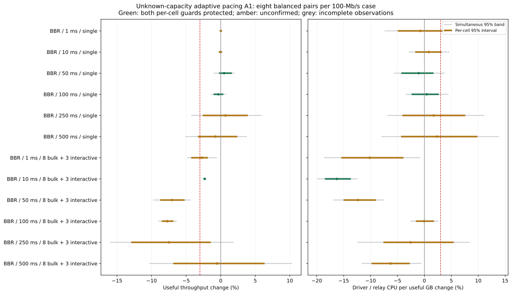
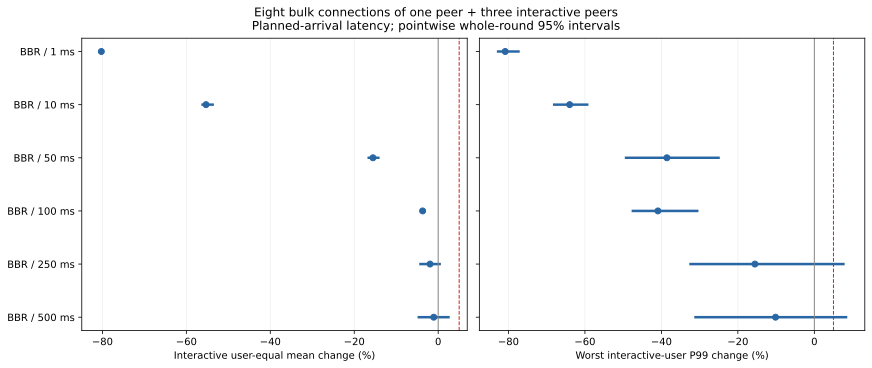
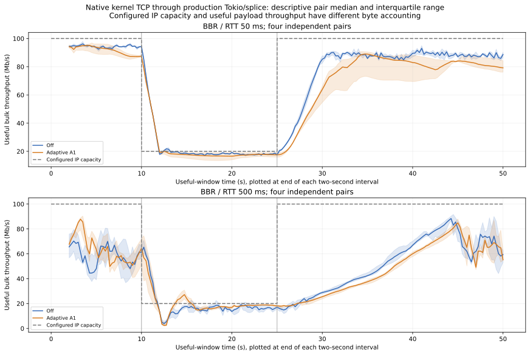
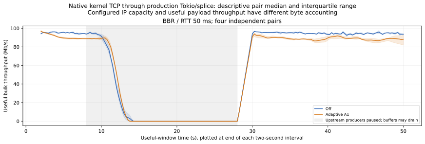

# 未知出口容量下的 BBR 自适应聚合 pacing：A1 完整验证

**结论：A1 未取得默认开启资格，保持默认关闭、Draft。** 完成预先冻结的 312 次正式运行，以及各 12 次的 A0/A1 pilot。主矩阵 192/192 次可观测有效，50/100 ms 竞争场景出现可重复的吞吐回退；容量恢复也有直接反例。当前收益与损失不满足原定的多场景保护要求，不能称为满足用户约束的最优解。

六个竞争单元等权、按完整独立对配对的几何汇总：交互用户 mean **−35.86%**、最慢用户 P99 **−48.34%**、驱动 CPU/GB **−8.11%**；同时有用吞吐 **−4.69% [−6.13%, −3.26%]**，整个 benchmark 进程 CPU/GB **+0.57% [−0.10%, +1.21%]**。驱动的节省不等于整个进程或整机 CPU 的节省。50/100 ms 竞争吞吐分别 **−7.08% / −7.72%**，两格 95% 区间完整落在原定 −3% 门槛之外；300 Mbps/50 ms 另有 **−24.56%** 的回退。这些属于 BBR 有效重复数据。

12 个主单元只有 **3/12 点态、1/12 同时受保护**，原要求为至少 9/12、7/12。已知容量的固定 V5 / PR #94 的 672 次研究完全独立，不用于证明本未知容量方案。出口未知时，本轮证据支持继续保持既有 BBR/DRR 行为，自适应仅作为实验开关；本轮不改参数、不引入 A2、不追加测量以取得通过。

[冻结协议](PROTOCOL.md) · [A1 修正前记录的反例](A1-CORRECTION.md) · [源码论证与边界](CODE-ARGUMENT.md) · [完整机器判定](qualification.json) · [PR #96](https://github.com/BlackLuny/zfstack/pull/96)

## 版本与方法

| 对象 | 精确源码/执行器 SHA | 冻结二进制 SHA-256 |
|---|---|---|
| V5 基线 | `52642445dfae1becbf21d68ee8e2276ca38c139d` | `96695f880dd600172e3dfa5b32304da0fa296579357785b5f83dbb87ea1a26c5` |
| A0 pilot | `7e6b03877225f5ab90648a531e014808c1beb5a7` | `9801eb32a4d23b5f75f4f87d2e4d634b818bc9f494faff9eee17b5e16c3fc65d` |
| A1 生产代码 | `62270937b0ad6d4709bce372465b1998e6b046bd` | `eedab794d2fc1c9910c04bc0a8f49a2cb1dcea3206f885cbf775df412bff55da` |
| 执行器、协议、原定判定与功能 CI | `7f4bc95327aef7ec77642dab7003f713809a8f12` | A1 的 54 个 Rust/Cargo 输入保持一致 |

Rust 1.94.1，release、fat LTO、1 codegen unit、panic abort、关闭 incremental。build metadata、52 个 V5 和 54 个 A0/A1 Rust/Cargo 输入、每阶段完整快照、全部冻结可执行文件均在证据包。生产源码/API 确已修改；最后的报告和回放工具提交不重建、不修改测量候选。功能 CI 的精确冻结提交为上表 7f4bc953，[CI #215 六项通过](https://github.com/BlackLuny/zfstack/actions/runs/40182266877)；最终 PR 提交的检查单独见 PR checks。

主矩阵明确选择 BBR、原生 kernel TCP → 生产 Tokio/splice → 本机受控 FIFO。两臂固定 iface rate 均为 **0**，只有候选选择 `--adaptive-egress`；核心不读取出口容量或容量变更通知。窗口累计 ACK 交付量，不相加各连接 BBR 历史峰值。受控向上探测、应用不足保持、竞争消失后的退出，以及默认关闭的 `Shard::set_iface_adaptive_egress` / `StackHandle::set_iface_adaptive_egress` 是真实生产 API。

主矩阵 100 Mbps、RTT 1/10/50/100/250/500 ms，单连接或一个 bulk peer 的 8 条连接加 3 个交互 peer；每格 8 对，4 AB/4 BA，按完整轮次打乱。额外带宽 10/300 Mbps 各 4 对，高负载 200 bulk 各 8 对。MTU 1420、FIFO 250,000 字节、零随机丢包（可发生尾丢）、栈 cap 16 MiB、seed 23；预热 max(8 s, 40 RTT)、通常测量 20 s。交互用户各固定 25 Hz，按计划到达时间计算延迟；mean 用户等权、P99 为最慢用户的 nearest-rank P99。

独立单位为整对运行，20,000 次完整轮次 bootstrap、seed 2026102506。主矩阵 CPU/吞吐 24 列另有同时区间。下文区间均为点态 95%，百分数为配对 log 比值的几何变化；所有格等权，未按请求数扩充样本量。4 对的补充单元证据较弱。主保护为吞吐下界 ≥−3%、驱动 CPU/GB 上界 ≤+3%；这是实际容忍量，**不等于严格零 CPU 开销**。所有判定使用未舍入值。

## 执行与数据有效性

原控制器退出码 0；正式采样从 09:46:47 UTC 至 **12:59:30 UTC（越南时间 19:59:30）**，完成 312/312，未重启、替换、扩样或删除异常。采样期间未构建、测试、计算正式比较效应、绘图或压缩。完成标记之后才运行本报告分析。
| 队列（pilot 单独） | 执行数 | 原始严格有效 | 既定认证后可观测有效 | 预定请求 | 缺失 |
|---|---|---|---|---|---|
| aa | 8 | 8 | 8 | 0 | 0 |
| bandwidth | 32 | 30 | 32 | 52800 | 0 |
| demand | 8 | 7 | 8 | 31200 | 0 |
| disabled | 16 | 16 | 16 | 0 | 0 |
| dynamic | 16 | 16 | 16 | 62400 | 0 |
| heavy | 16 | 15 | 15 | 26400 | 3 |
| peak | 24 | 24 | 24 | 0 | 0 |
| pilot-a0/pilot | 12 | 11 | 11 | 22200 | 2 |
| pilot-a1/pilot | 12 | 12 | 12 | 22200 | 0 |
| primary | 192 | 188 | 192 | 158400 | 0 |
全部 336 次的 375,600 条预定请求中，375,595 条完成，5 条真实漏发；完成的请求没有超过 3 s SLO。正式阶段原始严格有效 **304/312**，按采样前的既定掩码竞态证据认证后 **311/312** 可观测有效。七次外层非零退出的子进程成功、实际掩码正确，保留原始退出码、observer 错误、`valid` 和 `original_strict_valid`；没有改写为原始成功。

正式唯一真实生成失败为 `heavy/0004-steady-m100-r20-n200-r02-0-auto`：三个 baseline 请求 seq 21 原定 845 ms，启动约 871.6–871.8 ms，超过不变的 20 ms 门槛而未发送。该样本无效，不能据此还原这三条请求的服务延迟；不补跑。A0 pilot 的 `0006-dynamic-m100-r50-n8-r00-0-auto` 另有两条 seq 1009 在生成端漏发，完整保留。A1 pilot 12/12 有效、0 缺失，仍保留其容量恢复失败。heavy 数值使用原定全部 8 对，属于包含无效样本的描述结果，不能宣称该队列取得完整资格。

## 主矩阵：吞吐与 CPU
| RTT ms | 负载 | 吞吐 Δ% [95%] | 驱动 CPU/GB Δ% [95%] | 点态双保护 | 同时双保护 |
|---|---|---|---|---|---|
| 1 | 单连接 | +0.02 [-0.08, +0.12] | -0.76 [-4.94, +4.03] | 否 | 否 |
| 10 | 单连接 | -0.04 [-0.26, +0.20] | +0.81 [-1.71, +3.18] | 否 | 否 |
| 50 | 单连接 | +0.50 [-0.24, +1.62] | -1.07 [-4.29, +1.69] | 是 | 否 |
| 100 | 单连接 | -0.34 [-1.02, +0.38] | +0.42 [-2.39, +2.67] | 是 | 否 |
| 250 | 单连接 | +0.69 [-2.60, +3.93] | +1.73 [-4.11, +7.60] | 否 | 否 |
| 500 | 单连接 | -0.77 [-3.30, +2.40] | +2.35 [-4.34, +9.85] | 否 | 否 |
| 1 | 8 bulk + 3 RR | -2.72 [-4.27, -1.84] | -10.16 [-15.45, -3.89] | 否 | 否 |
| 10 | 8 bulk + 3 RR | -2.33 [-2.48, -2.14] | -16.26 [-18.51, -13.68] | 是 | 是 |
| 50 | 8 bulk + 3 RR | -7.08 [-8.75, -5.21] | -12.34 [-15.03, -8.97] | 否 | 否 |
| 100 | 8 bulk + 3 RR | -7.72 [-8.53, -6.82] | -0.04 [-1.59, +1.78] | 否 | 否 |
| 250 | 8 bulk + 3 RR | -7.49 [-12.95, -1.42] | -2.56 [-7.63, +5.44] | 否 | 否 |
| 500 | 8 bulk + 3 RR | -0.54 [-6.87, +6.35] | -6.29 [-9.83, -2.71] | 否 | 否 |


50/100 ms 竞争单元为明确吞吐回退。1 ms 竞争、250/500 ms 等格有区间跨越门槛的问题，保留为未确认。单连接等权汇总吞吐约 +0.008%，但 500 ms 单连接吞吐下界 −3.30% 尚未满足全六格要求；单连接驱动 CPU/GB 汇总 +0.57% 的上界 +3.09% 略越保护线，属于证据不足，不是已经证明 CPU 增加超过 3%。

| 汇总范围 | 吞吐 Δ% | 驱动 CPU/GB Δ% | 驱动+链路 CPU/GB Δ% | 全进程 CPU/GB Δ% | 驱动 CPU/s Δ% | 全进程 CPU/s Δ% | RSS HWM Δ% |
|---|---|---|---|---|---|---|---|
| single | +0.01 [-0.71, +0.67] | +0.57 [-2.37, +3.09] | +0.36 [-0.70, +1.28] | +0.46 [-0.60, +1.41] | +0.58 [-2.53, +3.27] | +0.47 [-0.92, +1.67] | -0.67 [-1.99, +0.13] |
| contended | -4.69 [-6.13, -3.26] | -8.11 [-9.66, -6.56] | -0.19 [-0.70, +0.30] | +0.56 [-0.10, +1.21] | -12.42 [-14.74, -9.91] | -4.15 [-6.05, -2.28] | -2.54 [-3.43, -1.68] |
| all | -2.37 [-3.34, -1.36] | -3.87 [-5.23, -2.48] | +0.09 [-0.46, +0.64] | +0.51 [+0.04, +1.06] | -6.15 [-7.69, -4.38] | -1.87 [-2.95, -0.67] | -1.61 [-2.43, -0.87] |

CPU/GB 的分母为有用业务字节，GB 为十进制；CPU/s 同时保留以区分工作量下降。全进程不是整机，也不含外部 Python observer；observer 的 CPU 另行记录，RSS 不含 kernel socket memory。竞争汇总 RSS 下降约 2.54%，并非所有格都下降；例如 250 ms 的 RSS 中位数约 25.0 →29.7 MiB。生产状态常量大小见源码论证，不能用 RSS 的波动代替状态大小。

## 交互延迟与逐流公平性
| RTT ms | mean ms 中位数 off→A1 | mean Δ% [95%] | 最慢用户 P99 ms 中位数 off→A1 | P99 Δ% [95%] |
|---|---|---|---|---|
| 1 | 21.43 → 4.22 | -80.26 [-80.74, -79.73] | 80.08 → 14.17 | -80.85 [-83.02, -77.05] |
| 10 | 29.88 → 13.12 | -55.32 [-56.42, -53.44] | 65.39 → 26.30 | -63.99 [-68.35, -59.08] |
| 50 | 63.27 → 53.02 | -15.54 [-16.84, -13.97] | 109.26 → 64.71 | -38.56 [-49.57, -24.73] |
| 100 | 107.24 → 103.50 | -3.71 [-4.40, -2.91] | 220.09 → 117.94 | -40.91 [-47.79, -30.31] |
| 250 | 263.51 → 258.82 | -1.94 [-4.51, +0.64] | 589.79 → 450.40 | -15.55 [-32.69, +7.92] |
| 500 | 524.01 → 517.03 | -1.06 [-4.90, +2.75] | 1045.25 → 965.16 | -10.15 [-31.40, +8.61] |


1/10/50 ms 三格的 mean/P99 都有明确改善；250/500 ms 的尾延迟区间上界分别约 +7.92%/+8.61%，尚未确认原定 +5% 不回退要求。汇总 −35.86%/−48.34% 是六个单元等权的几何变化，不是未知用户 RTT 分布下所有请求的统一平均收益。

主矩阵候选中，每条 bulk 在整次测量窗口均有进展，250 ms 采样观察到的最长无读进展间隔约 1.00 s。Jain 只衡量同一 bulk peer 内的连接字节分配，不把不同业务大小的 RR 当成同一吞吐需求。

200 bulk 的补充队列中，关闭侧有 3 个“整个实际观测窗口无进展”的流，候选为 0；各次最差流无进展间隔的中位数 **12.22 →2.38 s**，所有运行最坏值约 **20.17 →4.00 s**。候选 Jain 中位数约 **0.99984**，关闭侧约 **0.98184**。这些是有用的改善，也仍存在秒级停顿；heavy 的一次真实生成失败使完整队列不合格。250 ms 采样和 TCP 窗口限制不构成绝对无饥饿定理。

## 不同带宽与高负载（独立队列）
| 单元 | 对数 | 全有效 | 吞吐 Δ% | 驱动 CPU/GB Δ% | mean Δ% | P99 Δ% | 5% 保护 |
|---|---|---|---|---|---|---|---|
| steady-m10-r50-n8 | 4 | 是 | +9.11 [+7.68, +10.55] | -20.19 [-28.49, -10.93] | -41.20 [-53.06, -24.61] | -63.30 [-67.99, -57.92] | 是 |
| steady-m10-r500-n8 | 4 | 是 | +6.68 [+2.86, +10.43] | -13.33 [-23.36, -1.99] | -8.61 [-12.70, -4.34] | -29.22 [-43.08, -8.89] | 是 |
| steady-m300-r50-n8 | 4 | 是 | -24.56 [-33.75, -17.67] | -0.06 [-4.72, +4.83] | -1.90 [-2.11, -1.63] | -5.93 [-12.37, -1.30] | 否 |
| steady-m300-r500-n8 | 4 | 是 | +90.37 [+28.90, +181.14] | -8.42 [-15.79, -0.41] | +0.23 [-0.17, +0.75] | +9.85 [-0.00, +32.29] | 否 |
| steady-m100-r20-n200 | 8 | 否 | -2.09 [-3.18, -1.15] | -40.64 [-42.89, -38.52] | -67.88 [-69.36, -66.34] | -86.39 [-86.80, -85.98] | 否 |
10 Mbps 两格通过独立保护，不能据此外推所有未知容量。300 Mbps/50 ms 为明显吞吐回退；300 Mbps/500 ms 吞吐改善很大但方差也大，P99 上界约 +32.29% 未通过保护。该格关闭侧实际有用吞吐中位数约 93.97 Mbps、候选约 189.07 Mbps，均不能当成物理 300 Mbps 已被准确识别。各带宽、200 bulk、pilot 均未并入主矩阵区间。

## 关闭开销与少连接峰值

下面对照为 **V5 →新 A1**，与上文同一 A1 可执行文件的 off→on 是不同估计对象。WAN 关闭模式的额外 3% 要求在任何正式样本前已写入协议；原 10% 诊断同时保留。
| 单元/候选 | 对数 | 吞吐 Δ% | CPU/GB Δ% | 3% 双保护 | 10% 双保护 |
|---|---|---|---|---|---|
| steady-m100-r1-n1 / WAN BBR 新关闭 | 4 | +0.05 [-0.06, +0.15] | +1.64 [-1.17, +4.53] | 否 | 是 |
| steady-m100-r500-n1 / WAN BBR 新关闭 | 4 | -1.71 [-5.89, +2.96] | -1.84 [-7.71, +7.68] | 否 | 是 |
| peak-down1 / client CUBIC 新开启 | 6 | -5.25 [-9.12, -0.69] | +4.46 [+0.56, +8.45] | 否 | 是 |
| peak-down2 / client CUBIC 新开启 | 6 | +2.41 [-2.81, +6.39] | -2.21 [-5.85, +2.83] | 是 | 是 |
本地峰值固定使用 `--client-proxy zfstack-client`、单/双下载、MTU 65535、2 proxy workers、预热 8 s/窗口 30 s。源码 `StackConfig::client()` 实际为 **CUBIC、连接级 pacing 关闭**。其 CPU 范围为代理服务进程。单连接峰值下降约 5.25%，通过预定极端场景的 10% 保护，不能称为零损失。**BBR 本地极限峰值未直接测量**；BBR 六个 RTT 的 WAN 单连接与通用单 peer 旁路证明分别提供证据。峰值没有启用核心计数器快照，不能伪称直接观测到峰值路径的 controller 更新次数为零。

## 容量变化与业务不足

双向外部 FIFO 在测量 10 s 从 100 降至 20 Mbps，25 s 回到 100 Mbps；核心未收到变更通知。恢复定义为达到对应关闭侧最终 5 s 平台的 80%、连续完整 2 s 窗口，限时 max(5 s, 20 RTT)，且最终平台达到参考的 90%。原定所有条件均保持不变。下面扩展到整个阶段的首次恢复时间是采样后解释性诊断，不替换原时间门槛。
| RTT ms | 对 | 初始平台 A1/off % | 降速平台 % | 恢复平台 % | off 首次恢复 s | A1 首次恢复 s | A1 原限时通过 |
|---|---|---|---|---|---|---|---|
| 50 | 0 | 93.56 | 88.45 | 111.03 | 4.0 | 5.5 | 否 |
| 50 | 1 | 96.71 | 110.58 | 86.97 | 4.0 | 6.25 | 否 |
| 50 | 2 | 90.08 | 106.07 | 92.84 | 4.5 | 17.75 | 否 |
| 50 | 3 | 95.94 | 89.15 | 87.53 | 4.0 | 5.25 | 否 |
| 500 | 0 | 104.33 | 109.65 | 80.85 | 12.75 | 13.0 | 否 |
| 500 | 1 | 120.99 | 106.34 | 102.70 | 10.25 | 15.0 | 否 |
| 500 | 2 | 86.76 | 117.23 | 129.51 | 10.75 | 12.0 | 否 |
| 500 | 3 | 58.83 | 105.39 | 85.62 | 12.0 | 13.75 | 否 |
50 ms 基线四对全部在 4–4.5 s 恢复，A1 为 5.25–17.75 s，全部超出 5 s；恢复后的最终平台另有 2/4 低于基线 90%。500 ms 基线自身四对也未满足原 10 s 要求（完整阶段恢复 10.25–12.75 s），A1 为 12–15 s；这部分失败不能全部归因于新增控制器。候选在恢复平台另有 2/4 低于 90%。降速后虽然 2–3.5 s 达到 80% 窗口，50 ms 的最终低速平台也有 2/4 未达 90%。因此不能以单次非零估计或最终偶尔超过基线宣称稳定恢复。



业务暂停场景在 8–28 s 暂停上游 bulk producer，交互 echo 继续。四对的两臂均实际出现至少 1 s 零 bulk 进展，确认业务不足真实发生。四对均在恢复后 2 s 达到 80% 参考窗口，但一对最终平台仅 83.23%，整组未通过。
| 对 | 两臂真实空闲 | A1 恢复 s | 最终平台 A1/off % | 最终平台 ≥90% |
|---|---|---|---|---|
| 0 | 是 | 2.0 | 83.23 | 否 |
| 1 | 是 | 2.0 | 97.31 | 是 |
| 2 | 是 | 2.0 | 95.26 | 是 |
| 3 | 是 | 2.0 | 91.69 | 是 |


各阶段延迟按 native measurement origin 加计划到达时间分组，不按完成时间跨阶段挑选：
| 场景/阶段 | mean Δ% [95%] | P99 Δ% [95%] |
|---|---|---|
| dynamic-m100-r50-n8\|initial | -13.17 [-16.15, -9.05] | -43.68 [-54.31, -28.27] |
| dynamic-m100-r50-n8\|lower | -49.96 [-58.79, -39.24] | -50.78 [-57.38, -41.27] |
| dynamic-m100-r50-n8\|restored | -9.05 [-10.34, -7.37] | -47.42 [-58.38, -31.27] |
| dynamic-m100-r500-n8\|initial | -4.31 [-5.67, -3.16] | -3.70 [-22.92, +20.30] |
| dynamic-m100-r500-n8\|lower | -14.03 [-19.42, -8.57] | -17.51 [-18.21, -16.65] |
| dynamic-m100-r500-n8\|restored | -0.64 [-3.36, +2.64] | -5.00 [-33.47, +35.19] |
| demand-m100-r50-n8\|busy | -14.49 [-17.47, -11.41] | -52.22 [-57.19, -46.67] |
| demand-m100-r50-n8\|producer_paused | -1.36 [-2.00, -0.72] | -17.26 [-22.54, -8.47] |
| demand-m100-r50-n8\|resumed | -15.96 [-17.85, -14.26] | -50.55 [-58.28, -41.37] |
## 环境、源码与汇编能证明什么

同一容器、相同 sysctl、5 个可用 CPU、父 cgroup 4 CPU quota；driver=0、两个 link=1/2、普通线程=3、RR 与 observer=4。全部 336 次记录中节流事件增量为 0，正式 native driver 迁移为 0、实际 masks 均正确。**宿主 steal 非零**：主矩阵单次全系统窗口最大 1.95 CPU s，动态窗口最大 4.44 CPU s。这是全局观测，不能直接从驱动 CPU 中扣除，也不能声称排除了全部环境噪声。重现范围仍是同一宿主机。

两个明确回退单元各 8/8 对都下降，且 4 AB/4 BA 均衡；其中 9/16 对 A1 的全局 steal 更低。以下保留全部对照，不做事后筛选或修正估计：
| 对 | 50 ms 顺序 | 吞吐 Δ% | steal off/A1 s | 100 ms 顺序 | 吞吐 Δ% | steal off/A1 s |
|---|---|---|---|---|---|---|
| 0 | AB | -4.32 | 1.03 / 0.68 | AB | -9.27 | 1.07 / 0.68 |
| 1 | BA | -8.21 | 0.78 / 0.92 | AB | -6.59 | 1.06 / 1.03 |
| 2 | BA | -7.01 | 1.50 / 0.68 | BA | -8.55 | 0.75 / 0.79 |
| 3 | BA | -7.94 | 0.84 / 0.72 | BA | -5.73 | 1.14 / 0.81 |
| 4 | BA | -6.60 | 0.77 / 0.82 | AB | -8.59 | 1.36 / 1.81 |
| 5 | AB | -9.94 | 1.05 / 1.76 | BA | -8.24 | 0.73 / 0.77 |
| 6 | AB | -10.27 | 1.18 / 0.81 | AB | -6.12 | 0.85 / 0.82 |
| 7 | AB | -2.07 | 0.91 / 1.06 | BA | -8.61 | 0.87 / 0.78 |
A/A 每 RTT 仅两对、仅描述，不把它当成更窄的置信区间或用来筛掉正式运行：
| 同一二进制 off/off | 每对吞吐 Δ% | 每对驱动 CPU/GB Δ% |
|---|---|---|
| steady-m100-r1-n1 | +0.04, -0.02 | -7.45, +0.77 |
| steady-m100-r500-n1 | -8.09, -2.28 | +18.81, -1.74 |
源码归纳可证明从未竞争的 peer（包括其两条连接）不分配冷控制器、不计聚合发送、不设置聚合 deadline；该条件不依赖 RTT 或 CC。1/500 ms BBR 模拟器包内容/时间/步数一致，以及晚 peer 离开后的退出测试，是组件证据。直接包含生产源码的优化 standalone 检查通过 V5 的 1197 个旁路状态、A1 的 1197 固定加 70 自适应旁路状态。热状态 **24 B 不变**，冷 clock **96→112 B**，自适应 controller **96 B**；活跃自适应接口的两次冷分配合计 208 B（不含分配器元数据），没有新增生产包队列或线程。

实际冻结 release 二进制反汇编保留在包内：`ingress_owned` 两版符号均 1372 B，`ingress_slice` 均 832 B，`input_existing` 从 4170 B 增至 7151 B。A1 的四处 `adaptive_allowance` 调用前存在 ready-peer/active 的条件跳转；从未竞争时跳过该调用。符号变大、额外分支、寄存器与缓存布局仍能影响 CPU，不能以源码旁路或符号大小证明周期相等。完整论证见 [CODE-ARGUMENT.md](CODE-ARGUMENT.md)。

## 测试、证据与回放

冻结生产候选前 core/Tokio **339 通过、6 项既有忽略**，bench 全 feature **30 通过**，fmt/Clippy 通过（保留既有诊断），冻结执行器提交 CI 六项通过。全部测量结束后，Python 全部 **23 测试通过**，新工具实际完成全量采集、图表及诊断；standalone 状态检查与实际 release 反汇编均完成。图中区间和表格来自相同未舍入数值。

新增 `diagnostics.json` 为采样后解释性审计，提供全部 ledger 计数、bulk 静默、全局环境指标和控制组恢复时间；**未改变任何冻结门槛、原定判定或样本**。添加该审计后，原 30 个数值结果另在新目录重算、SHA-256 完全一致。失败的报告重写保护触发和初次独立诊断路径错误也保留在 preparation 中，仅修复新报告工具，不修改运行候选。

本目录的 [evidence.tar.gz](evidence.tar.gz) 包含全部 336 次原始输入/输出/失败/ledger/实际 affinity/逐流进展、A0/A1/V5 三个可执行文件、冻结源码、控制器 trace、构建与组件检查日志、绘图与回放代码。清理记录也在包内。[evidence-files.json](evidence-files.json) 是逐文件 size/SHA-256 清单；[verification.json](verification.json) 记录干净解包后的身份核对和 **31 个数值 JSON** 重新生成的逐字节一致结果；外层 [artifact-index.sha256](artifact-index.sha256) 覆盖归档、报告、图表和验证文件。verification/index 在包外避免循环哈希。本次为同一 Python 3.12 环境的独立解包重放，不是第二套独立统计实现。

离线重放不执行 benchmark，也不需要 Docker/网络。先从仓库把归档解到新的空目录，并将归档本身复制过去：

```sh
adaptive_archive="$PWD/docs/experiments/2026-10-25-adaptive-pacing/evidence.tar.gz"
adaptive_replay_dir=$(mktemp -d)
tar -xzf "$adaptive_archive" -C "$adaptive_replay_dir"
cp "$adaptive_archive" "$adaptive_replay_dir/docs/experiments/2026-10-25-adaptive-pacing/evidence.tar.gz"
cd "$adaptive_replay_dir"
python3 bench/capacity/adaptive_artifacts.py verify \
  docs/experiments/2026-10-25-adaptive-pacing --fresh replay-numbers
```

本轮边界：单宿主、对称 FIFO、相同 peer 基础 RTT、零随机丢包、有限带宽/负载网格；不是 WireGuard 或实际 WAN 测量，也未覆盖混合 RTT、路由切换、其他出口容量和 BBR 本地极限峰值。默认 BBR 这一前提已经用于主矩阵，仍有常见 50/100 ms 回退；放宽特别极端场景门槛不会消除这些失败。当前需要修复学习/探测和退出后的恢复行为，再以新候选和独立预先冻结的研究验证，现有负结果继续保留。
