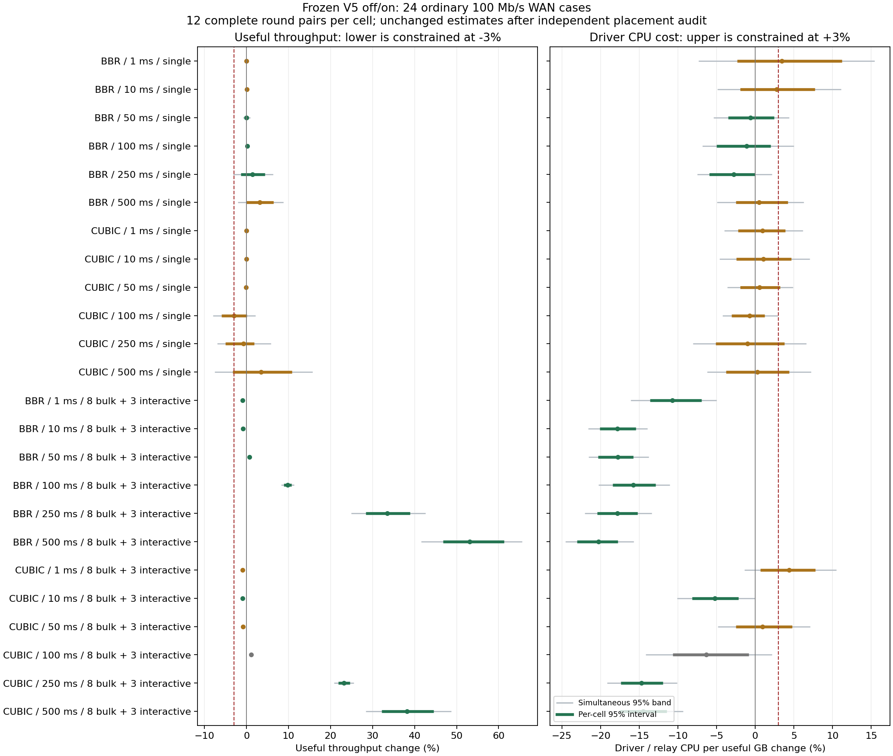
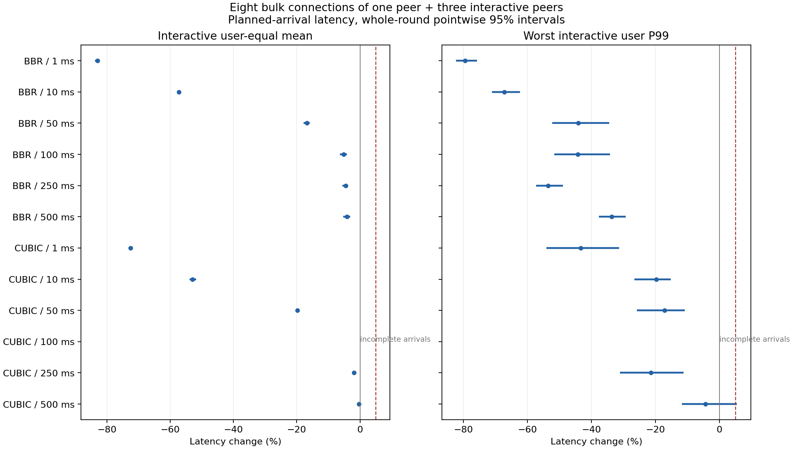

# 1–500 ms RTT 的独立重复确认

本轮完成 **672 次运行**。结论是：**保留 V5 作为已知接口容量、多用户争用时的可选功能；全局默认继续关闭。** 争用场景有明确收益，单连接平均成本接近零，放宽后的单/双连接极限保护也通过；但还不足以证明大多数逐格场景同时满足吞吐和 CPU 的 3% 保护，更不能证明严格零 CPU 开销。

本轮没有修改、重新编译或筛选生产候选：V5 仍是 `96695f880dd600172e3dfa5b32304da0fa296579357785b5f83dbb87ea1a26c5`。先前所有封存研究和未通过判定保持原样，不合并样本。

## 主要结论

- 24 格中 **12 格**同时满足逐格 95% 区间的吞吐下界 ≥ −3%、driver CPU/GB 上界 ≤ +3%；考虑 48 个主要端点的同时区间后是 **9 格**。预先固定的门槛为 18/24、13/24，未达到。
- 保守的“至少 13/24 格中位配对效应受保护”检验 **p=0.8759765625**，没有建立多数场景受保护的结论。缺失格保留在 24 格分母内并赋 p=1。
- 全部单连接格等权汇总：有效吞吐 **+0.338% [−0.514%, +1.200%]**；driver CPU/GB **+0.265% [−1.080%, +1.741%]**；driver+链路 CPU/GB **+0.315% [−0.319%, +0.984%]**；全压测进程 CPU/GB **+0.314% [−0.347%, +1.010%]**。这支持平均影响小，不能替代逐格保护。
- 单连接 CUBIC/100、250、500 ms 的吞吐区间未能全部排除 −3%，属于未确认，不是已证明超过 3% 的退化；没有完整格的整个吞吐/CPU 区间落到保护边界以外。
- 11 个到达完整的争用格中，10 格的平均延迟和 P99 上界均 ≤ +5%，6 格两项上界均 ≤ −5%。BBR 六个争用格全部满足同时 CPU/吞吐保护。CUBIC/500 ms 的平均/P99 改善未明确，不能声称每个 RTT 都显著降低用户延迟。
- **CUBIC/1 ms/8 bulk+3 交互存在实际 CPU 权衡**：driver CPU/GB +4.371% [+0.675%, +7.769%]，同时平均延迟 −72.527%、P99 −43.422%、吞吐 −0.909%。不能将全部正 CPU 变化解释成环境波动。
- 独立的 CUBIC/100 ms 争用确认 24 次达到其预设保护；仍单独报告，不替换原缺失格。真实本地单/双下载峰值都满足用户本轮允许的 10% 极端保护，原 3% 标准下单下载仍未确认。

所有方括号除另注外均为整对/整轮 bootstrap 95% 区间；变化是配对 log 比值均值对应的几何平均百分比，不是逐请求统计或旧研究的配对中位数。

## 控制与边界

先冻结[协议](PROTOCOL.md)、[多数场景补充检验](MEDIAN-SUPPLEMENT.md)和[缺失格后的独立确认规则](GENERATOR-CONFIRMATION.md)，全部测量完成后才查看开关效应。测量期间没有编译、测试套件、绘图、压缩或 PMU 采样。

同一宿主、同一隔离容器和镜像、同一冻结 V5；100 Mbps 双向 FIFO、250,000 字节队列、MTU 1420、零配置丢包、16 MiB 栈上限。off=0；on=12,375,000 IP 字节/秒，即已知容量的 99%。实际生产 Tokio/splice 路径，CUBIC/BBR × RTT 1/10/50/100/250/500 ms × 单连接或一个重用户的 8 条连接加 3 个独立交互用户。

每格 12 对，6 AB/6 BA；每一轮打乱 24 格，跨 12 轮分散时间漂移。预热 max(8 秒, 40 RTT)，测量 20 秒。CPU 固定为 driver=0、链路两方向=1/2、其他普通线程=3、交互收发及外部观察器=4；实际角色必须在原定 2 秒内就位。所有固定位置 driver 的观察迁移为零，全部 672 次 cgroup 节流事件和节流时间均为零。保留 CPU steal、softirq、调度、链路唤醒与观察器开销记录；无宿主独占声明。

16 次 A/A 仅作噪声诊断（每格两对，不用于 CI）：例如 BBR/500 ms 原配置同设置吞吐可变化 −9.795%，固定位置 CUBIC/50 ms 同设置 CPU/GB 可变化 −8.449%。配对、顺序平衡、跨轮打散和实际 affinity 审计降低干扰，但同宿主重复无法排除所有隐藏干扰。不能据此把某次历史异常完全归因于环境。

推断单位是完整独立运行对，20,000 次整轮重采样同时保留跨格相关性；同时区间使用标准化最大偏差。有限样本 bootstrap 和精确符号检验的假设见协议，不是所有网络的数学保证。CPU 另分 driver/relay、driver+模拟链路、全压测进程；这些都不等于整机软中断成本，RSS 不含内核 socket 内存。本轮未覆盖其他带宽、丢包、MTU、非对称链路或共享物理出口配置。

## 全部普通格的主要端点

单位为百分比；每格 12 对。最后一列依据独立实际 affinity 审计，原自动失败标志仍保留。原始缺失格的 CPU/吞吐数字仅供描述，不计入受保护格。

| CC / RTT / 负载 | 有效吞吐变化 [95%区间] | driver CPU/GB 变化 [95%区间] | 两项逐格保护 |
|---|---:|---:|---|
| BBR / 1 ms / 单连接 | -0.071% [-0.143, -0.003] | +3.438% [-2.307, +11.218] | 未确认 |
| BBR / 10 ms / 单连接 | +0.073% [-0.243, +0.372] | +2.786% [-1.931, +7.710] | 未确认 |
| BBR / 50 ms / 单连接 | +0.016% [-0.569, +0.497] | -0.623% [-3.478, +2.423] | 通过 |
| BBR / 100 ms / 单连接 | +0.149% [-0.062, +0.358] | -1.091% [-5.016, +1.985] | 通过 |
| BBR / 250 ms / 单连接 | +1.414% [-1.406, +4.344] | -2.803% [-5.950, -0.069] | 通过 |
| BBR / 500 ms / 单连接 | +3.191% [-0.034, +6.448] | +0.512% [-2.521, +4.195] | 未确认 |
| CUBIC / 1 ms / 单连接 | -0.007% [-0.016, -0.001] | +0.933% [-2.238, +3.907] | 未确认 |
| CUBIC / 10 ms / 单连接 | -0.015% [-0.069, +0.023] | +1.065% [-2.427, +4.633] | 未确认 |
| CUBIC / 50 ms / 单连接 | -0.126% [-0.321, +0.055] | +0.562% [-1.943, +3.204] | 未确认 |
| CUBIC / 100 ms / 单连接 | -3.036% [-5.929, +0.034] | -0.702% [-3.037, +1.223] | 未确认 |
| CUBIC / 250 ms / 单连接 | -0.794% [-5.083, +1.863] | -0.995% [-5.089, +3.796] | 未确认 |
| CUBIC / 500 ms / 单连接 | +3.422% [-3.330, +10.761] | +0.257% [-3.779, +4.355] | 未确认 |
| BBR / 1 ms / 8 bulk+3 交互 | -0.929% [-0.948, -0.912] | -10.709% [-13.627, -6.925] | 通过 |
| BBR / 10 ms / 8 bulk+3 交互 | -0.895% [-0.933, -0.852] | -17.835% [-20.098, -15.445] | 通过 |
| BBR / 50 ms / 8 bulk+3 交互 | +0.646% [+0.393, +0.937] | -17.743% [-20.321, -15.761] | 通过 |
| BBR / 100 ms / 8 bulk+3 交互 | +9.794% [+8.859, +10.685] | -15.758% [-18.440, -12.862] | 通过 |
| BBR / 250 ms / 8 bulk+3 交互 | +33.451% [+28.337, +38.946] | -17.805% [-20.434, -15.223] | 通过 |
| BBR / 500 ms / 8 bulk+3 交互 | +53.121% [+46.817, +61.237] | -20.243% [-23.043, -17.765] | 通过 |
| CUBIC / 1 ms / 8 bulk+3 交互 | -0.909% [-0.923, -0.894] | +4.371% [+0.675, +7.769] | 未确认 |
| CUBIC / 10 ms / 8 bulk+3 交互 | -0.922% [-0.967, -0.869] | -5.233% [-8.154, -2.148] | 通过 |
| CUBIC / 50 ms / 8 bulk+3 交互 | -0.805% [-0.831, -0.780] | +0.955% [-2.512, +4.744] | 未确认 |
| CUBIC / 100 ms / 8 bulk+3 交互 | +1.064% [+0.806, +1.339] | -6.349% [-10.658, -0.858] | 到达缺失 |
| CUBIC / 250 ms / 8 bulk+3 交互 | +23.153% [+21.827, +24.619] | -14.736% [-17.371, -11.940] | 通过 |
| CUBIC / 500 ms / 8 bulk+3 交互 | +38.176% [+32.152, +44.535] | -14.486% [-17.541, -11.439] | 通过 |



[完整逐格、逐对数据](ordinary-comparisons.json)及[独立审计后的同数值视图](audited/ordinary-comparisons.json)也包含 CPU/秒、进程 CPU、RSS、公平性、同时区间等端点。CUBIC/50 ms 单连接本轮 CPU/GB 为 +0.562% [−1.943%, +3.204%]；与之前更有针对性的 [128 次定点复测](../2026-10-24-cubic50-retest/README.md)共同支持未复现持续 +13.9%，但估计量和样本不能混合。

## 争用时的用户延迟

平均为交互用户等权平均；P99 为最差交互用户 P99。延迟从计划到达时刻计时，缺失请求不删除。

| CC / RTT | 平均延迟变化 [95%区间] | 最差用户 P99 变化 [95%区间] |
|---|---:|---:|
| BBR / 1 ms | -83.010% [-83.749, -82.176] | -79.538% [-82.342, -75.788] |
| BBR / 10 ms | -57.199% [-57.440, -56.955] | -67.289% [-71.077, -62.309] |
| BBR / 50 ms | -16.777% [-17.819, -15.825] | -44.117% [-52.281, -34.470] |
| BBR / 100 ms | -5.198% [-6.290, -4.146] | -44.219% [-51.663, -34.201] |
| BBR / 250 ms | -4.557% [-5.512, -3.707] | -53.546% [-57.338, -48.946] |
| BBR / 500 ms | -4.121% [-5.257, -3.045] | -33.636% [-37.672, -29.298] |
| CUBIC / 1 ms | -72.527% [-73.169, -71.813] | -43.422% [-54.044, -31.396] |
| CUBIC / 10 ms | -52.932% [-53.853, -51.760] | -19.702% [-26.596, -15.189] |
| CUBIC / 50 ms | -19.817% [-20.215, -19.405] | -17.151% [-25.762, -10.873] |
| CUBIC / 100 ms | —（到达缺失） | —（到达缺失） |
| CUBIC / 250 ms | -1.906% [-2.380, -1.500] | -21.392% [-31.092, -11.183] |
| CUBIC / 500 ms | -0.283% [-0.835, +0.250] | -4.422% [-11.788, +5.379] |



所有候选 bulk 流在各自测量窗口内都有进展，已发送交互请求无 3 秒逾期。这里只证明这些窗口内的进展，不证明任意用户永远不饿死。

## 原始异常与独立确认

全部运行与失败均保留：8 预检 +16 A/A +576 普通 +48 极限 +24 独立确认 =672；521,400 个计划交互请求缺失 1 个，已完成请求逾期 0 个。原自动严格有效 666/672；独立核实实际 CPU mask 与完整观测后 671/672。

- 原矩阵四次 RR 线程自己从 CPU 3 切换到 4 时，观察器比较前后读取发生竞态；独立 ledger、实际 mask 和子进程完成均通过。[审计说明](AUDIT-CLARIFICATION.md)保留每个原失败标志，未更改运行、阈值、配对、数字或 p 值。
- 原 `0487-cubic-r100-n8-fixed-r10-1-p99` 生成延迟 20.422219 ms 超过原定 20 ms，上游发生一个未发送请求。这是真实观测失败，不是用户快速完成；该格完整平均/P99 不可得，原整矩阵资格始终为 false。
- 后续一次独立完整 12 对 CUBIC/100 ms/8 bulk+3 交互中，又有一次启动 `taskset` 的观察比较竞态；父子关系、43.35 ms 内完成角色分配及原定 2 秒后的全部 mask 证实实际配置正确。保留原外层失败，24/24 独立完整观测。没有额外重复或替换。

独立确认的开关变化如下；它通过自己的全部保护，**不拼回原矩阵的整轮置信区间或多数计数**。

| 独立确认端点 | 变化 [95%区间] |
|---|---:|
| 有效吞吐 | +1.045% [+0.837, +1.268] |
| driver CPU/GB | -4.004% [-6.243, -1.791] |
| driver CPU/秒 | -3.001% [-5.163, -0.813] |
| driver+链路 CPU/GB | -7.718% [-8.928, -6.489] |
| 全进程 CPU/GB | -7.246% [-8.344, -6.107] |
| 用户等权平均延迟 | -7.225% [-7.579, -6.893] |
| 最差用户 P99 | -8.623% [-10.036, -7.014] |
| 进程峰值 RSS | +15.715% [+14.857, +16.526] |
| bulk 流 Jain 指数 | +5.940% [+1.015, +11.746] |

原 12 格争用/全部 24 格 CPU 与吞吐汇总仍包含缺失请求所在运行的可观察数值，只有描述意义：例如争用汇总吞吐 +11.553%、driver CPU/GB −11.616%、进程 CPU/GB −4.384%、RSS +6.440%。不发布不完整到达的争用延迟汇总，不用该聚合替代逐格资格。

## 单/双连接极限保护

48 次全部有效，旧版/V5 每格 12 对，原进程 mask 0–3、观察器 4、实际本地 TUN 下载、MTU 65535、两代理 worker、8 秒预热/30 秒测量。V5 故意配置约 100 Mbps 的速率而实际达到多 Gb/s，以检验单用户绕过。此处比较旧版与 V5；普通格比较同一 V5 的开关。

| 本地下载数 | 吞吐变化 [95%区间] | service CPU/GB 变化 [95%区间] | 放宽至 10% | 原 3% |
|---|---:|---:|---|---|
| 1 | +0.653% [-3.949, +5.282] | -0.054% [-3.937, +4.298] | 通过 | 未确认 |
| 2 | +0.623% [-2.146, +3.562] | -0.602% [-3.429, +2.315] | 通过 | 通过 |

放宽极限要求解决了这一轮的极限保护问题，历史 V5/V4 的原 3% 未确认判定仍保留；不能将旧区间改写成已通过。

## 源码、汇编与验证

[源码论证](CODE-ARGUMENT.md)通过归纳证明：从未竞争且初始 inactive 时，不论 RTT、CC 或配置速率，`allowance` 始终返回不限速/未激活，不分配 clock、不计聚合字节、不创建 deadline，选择原 `serve::<false>`。同一 peer 的多连接也成立；历史竞争后一秒 hold 明确不在该初始条件内。有限 ready peer、时钟推进、驱动最终执行和 sink 最终可写时，DRR 保留有条件的调度机会；不是 Internet 响应时间上界。

同文给出固定速率、持续 active epoch 的 credit/debt 字节包络及有限 quantum 超调，明确 GSO 重复头、重配置和 epoch 的边界。直接包含生产 Rust 模块的独立 contract 检查通过 1,197 个 bypass 状态，生产 pacer 单测 10 项通过。

[精确冻结 V5 的反汇编](ASSEMBLY.md)确认：inactive 分支只在该入口额外经过三条指令便跳回与关闭配置相同的 continuation；cold pointer 访问和 96 字节分配在分支之后，竞争发送循环单独编译。这支持快速路径结构，**三条入口指令不能换算成整栈固定百分比或零 CPU 周期**。本环境 PMU 指令计数探针不可用，未伪造 perf 数据。

本轮 18 项 Python 分析/独立审计回归通过；QA coverage audit 通过。`verification.json` 记录 52 个 Rust/Cargo 输入与冻结 V5 的身份、五阶段 source snapshot、十个运行时 Python 文件和资源 wrapper 一致性，以及 20 个最终 JSON 独立重算逐字节一致。生产 Rust/benchmark 源码没有在本轮改变。

## 封存与重算

[完整证据压缩包](evidence.tar.gz)包括所有尝试、失败、环境、实际 affinity、到达 ledger、原/候选二进制、冻结源代码、完整汇编和报告工具。[逐文件清单](evidence-files.json)、[独立验证](verification.json)、[外部 SHA256 索引](artifact-index.sha256)核对封存内容，索引不包含自身以避免循环。

在本分支 checkout 根目录解压证据；不需要 Docker 或再次测量：

```sh
tar -xzf docs/experiments/2026-10-25-common-cases/evidence.tar.gz
python3 bench/capacity/common_verify.py docs/experiments/2026-10-25-common-cases qa/results/common-replay-fresh
(cd docs/experiments/2026-10-25-common-cases && sha256sum -c artifact-index.sha256)
```

重算目录必须不存在；证据与报告不可覆盖。`engineering-decision.json` 是本轮多数场景判定，`verdict.json` 是原完整矩阵判定，两者均为 false；单独确认通过不改写它们。
