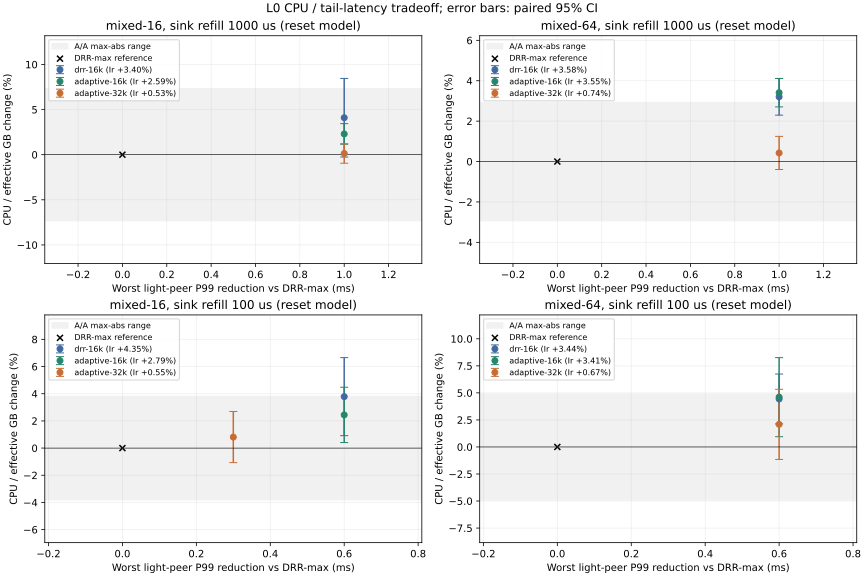
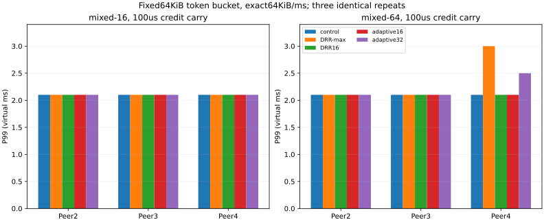

# 出口调度第二轮：独立门控、拥塞 quantum 与生产计数

| 项目 | 结果 | 决定 |
|---|---|---|
| A 独立门控 | 32/39门禁通过；7项虽减少空服务，Ir/GB仍上升 | 不作为默认候选；保留独立实验patch |
| B 自适应 quantum | 安静输出46/46一致；Ir极值43/46通过，3项非劣效未证明 | 放弃本轮候选晋升；仅保留默认关闭实验开关 |
| C 分辨率 | 时钟本身ns；保留额度的100µs模型下，16KiB与真正对照P99同为2.1ms，32KiB可更差 | 不宣称稳定的1ms收益；按出口服务模型解释 |
| D 生产计数 | 公共API可读；整进程差分最高+1.667%，Slot增加8B | 可导出限定语义字段；常开不宣称零成本，未修改zfc |

本分支从 `9d6fb7684e3842da16e673825d3c9ace724aa433` 建立。先确认上一轮分支 HEAD=e6b79e9 及全部八项指定提交存在，见 [source-verification.json](source-verification.json)。没有导入 ad11de3/4e40410 的稀疏优先开关、资格状态或 new_peers 队列。根 Cargo.toml/Cargo.lock、send_share 和预算公式未改；现有默认参数未改，新增 adaptive_quantum 默认为 false。此为实验分支，门控是单独候选提交，未晋升到 main。未 push、未创建 PR。

## 冻结与源码隔离

[冻结计划](frozen-plan.json) 与 SHA256 在本轮工作负载测量之前提交。A 的 39 个 case 为完整矩阵 21 行、上一轮 14 个公平性/Peer 数臂和四个门控臂。每个优化构建重复三次 Callgrind Ir；辅助 CPU 每 case 20 对交替 AB/BA 与 20 对 A/A，均另有每臂一次 warmup。CPU 不作为 A 的门禁。0.5% 指令门槛和 serve_zero>0 时必须降低的规则未改变；原始失败、未完成流、异常样本全部保留。

A 对照核心恰为 main+e21b5aa，候选恰为对照+b44c26a+6f3f4a9，三次 cherry-pick 均无冲突。两侧只附加相同的 L0 输入/观察工具，没有 DRR 或 adaptive 字段。D 另用没有计数的 main 核心和相同驱动。B 才 cherry-pick c9dc10e；唯一冲突位于 harness::Overrides，保留两个测试配置入口，先应用显式 stack_override，再应用原 sched_mode。没有改 c9 的 DRR 服务逻辑。B 在此基础上增加每 iface 的自适应状态。

硬件事件探测未成功（[tool-capability.json](tool-capability.json)），采用 Valgrind 3.24.0 Callgrind Ir，关闭 cache/branch 模拟。主门槛使用 release、fat LTO、codegen-units=1、panic=abort 的正常优化二进制；函数归因另建 noinline 的 schedule/serve/wants_tx/new_data_len 诊断二进制，不把其总 Ir 当成主门槛。函数归因也在开始之前补充冻结为三次重复：[attribution-plan.json](attribution-plan.json)。

预检的首个门控写入最初与握手最终 ACK 同在 150 ms，驱动先处理脚本，造成十二次失败。完整记录为 functional-A-raw.jsonl.gz；[输入修正](input-correction.json) 在正式指令/配对 CPU 测量前将首个写入改为 200 ms，没有修改门槛、字节目标、RTT 或原有 case。修正后 functional-A2 的 117 次均完成。失败样本未删除或混入有效完成子集。

原矩阵中重用 PeerId 跨 iface 的 case，旧观察器无法拆出各 iface 的核心 pending 间隔，该字段明确留 N/A；完整包捕获仍保留接口与时间。所有公平性和门控拥塞臂均为单 iface，逐用户间隔可辨识。小于一百次单流请求的矩阵分位数标为样本估计，不与 128 次 RR 公平性臂混用。

所有成本为完整 L0 进程（两端 TCP、应用、校验、观察及 JSON）的指令/CPU，不是生产单端数据面成本。有效 GB 为两端实际校验通过的应用接收字节，按十进制 GB；不把超时流从计划数量中移除。CPU 固定同一 CPU、串行运行；Ir 独立进程可并行。程序使用的标准 HashMap 及分配器仍可能造成指令波动，因此逐 case 保留三次极值和变化率，不预设 Ir 完全确定。

## A：门控的行为与输出

频繁 512 B 小写入的 cwnd 臂，serve_zero=102→0；零窗口臂为 129→0，且实际观测到零窗口及恢复。多连接臂有 64/1024 Peer、每 Peer 四条连接。它们不是人为改 cwnd 的私有测试钩子，而是 100 ms RTT 与真实应用到达形成的传输限制。

38/39 场景的完整包字节、顺序和虚拟时间戳相同。gate-peers-1024 的 89,088 个包有 2,704 个位置发生同刻置换；包含虚拟时间戳的包多重集完全相同，每条 TCP 连接内的顺序/时间完全相同，逐流完成与请求结果也相同。第一处为 200.3 ms 的 Peer185/186 顺序轮转。移除仍有 unsent 但已 cwnd 受限的空服务项，改变 ready 环在同一虚拟时刻的跨连接位置；没有改变任何连接的服务时刻或包。该例外逐项记录在 functional-comparisons.json，不把它标为“包序列完全一致”。D 的 main/计数对照为 39/39 全部一致。

唤醒审计沿用已 cherry-pick 的 [wake-audit](../2026-10-22-sched-order/wake-audit.md)：ACK 推进/CC 增窗、纯窗口更新、SACK/loss、RTO、PRR quota、pacing 改价及到期、预算释放、MTU/TSO/SWS 条件均有回归。ACK/input/app/timer 的 after_conn_change 路径与 pacing/预算直接 schedule 路径分别核对，不声称所有路径均经过同一个函数。4096 次固定种子随机事件检查 wants_tx 的假阴性与出队不变量。未修改既有断言。

## B：状态机、边界与成本范围

主参数 W=2 ms、K=2、H=8 ms：W 覆盖两次原本地出口补充周期，K 至少有一个竞争者，H=4W 提供迟滞。另冻结 (1 ms,2,4 ms)、(4 ms,2,16 ms)、(2 ms,4,8 ms) 三组敏感性对照。拥塞档分别试 16/32 KiB；安静时使用 max_quantum。所有 Q 仍至少容纳 iface MTU/最大 TSO 包；启用大TSO时小档可能被提升，当前无TSO的收益不能直接外推。

仅真实 Full 或轮预算耗尽记录 pressure_at。下一次服务时，最近 W 内有压力且队列 Peer 数≥K 才进入小档；已有小档连续安静严格超过 H 才退出。没有数据时惰性检查，不新增定时器或唤醒。K 小于二也按二处理；只有一个 Peer 不进入。K 只约束进入；已经处于小档时，即使竞争者离开，剩余 bulk Peer 持续触发 Full 也会保持小档，直至安静超过 H。因而 mixed 臂末尾的单 bulk 阶段并不保证恢复大批量效率；该边界另加一项回归。

切档只决定下一次新 visit 的信用增量，不充值、截断或清零正在服务的 deficit。Full 或轮预算中断的 Peer、连接头与剩余额度保留；因此刚进入小档时，原 64 KiB visit 可先完成。这是必要的过渡边界，不能据小 Q 宣称切档瞬间就有小 Q 的间隔界限。负的报文取整债务按 c9 原语义结转。iface 移除连同迟滞状态回收。七项初始边界/布局回归与公共 Stats API 测试均已执行。

B 的无本地压力臂中，46 项 adaptive16/32 对 DRR-max 的完整包流和逐流完成结果一致；包括原矩阵的十九个安静场景、三档真正 uncongested Peer 对照及 peers-8-open。拥塞臂的性能收益只在明确有 Full 或轮预算耗尽时归因。Q=16/32 的取舍不被称为零成本或严格帕累托改进。

L0 不进行真实出口阻塞 sleep：Full 后驱动执行其他事件并跳到虚拟释放时刻。进程 CPU/wall 接近一不能证明生产 CPU 是瓶颈，虚拟 Full 也不证明真实线程在空闲等待。逐 case 同列 CPU/虚拟完成时间作为模型诊断，不能由它推导 zfc/WG 单端 CPU 余量。要判断增加 CPU 是否降低真实吞吐，需要 L1/L2 测量线程等待/运行时间、出口繁忙时间和真实 goodput。

## C：时钟与模型分辨率（先保留原重置式模型）

Instant 与事件选择没有 1 ms 全局 tick，包延迟、pacing 及脚本截止均可精确到 ns。旧模型每 1 ms 给出口 65,536 B，本轮细模型每 100 µs 给 6,553 B，因整数取整容量低约 0.0092%。传播延迟仍为每向 1 ms，不把它同步缩短。

mixed-16/64 的细模型中，三位轻用户的 off P99 均为 2.1 ms，DRR-max 为 2.7 ms，DRR-16k 和 adaptive16 均为 2.1 ms。adaptive32 的 mixed-16 Peer2 为 2.1 ms、Peer3/4 为 2.4 ms；mixed-64 三位均为 2.1 ms。相对 DRR-max 的 0.3–0.6 ms 改善仍存在；相对原 off 对照的 P99 优势消失，mixed-16 的 32 KiB 档还更差。最大核心未服务间隔中，off/16k 为 0.1 ms，DRR-max 为 0.7 ms，adaptive32 为 0.3–0.5 ms（mixed-16）和 0.3–0.4 ms（mixed-64）。全部逐用户均值和各 Peer 数值另列 CSV。补测的真正 main+e21 对照（非 gated-off）也为三位 P99=2.1 ms、间隔=0.1 ms，见 functional-C 原始记录。

因此原来的 3→2 ms 不能直接解释为真实网络中可获得的完整 1 ms 收益。细化出口补充还改变服务批量，而非仅改变显示小数位；这里没有把全部差异归因于一种纯粹的舍入误差。所有延迟结论都附带本地出口补充粒度和传播条件。

## D：公开计数与建议导出语义

公开 `Shard::stats() -> &ShardStats` 可读取下面字段；tests/scheduler_stats_api.rs 在外部集成测试中验证，不依赖私有模块。累计 u64 应按相邻快照差值计算，分母为零时输出 N/A。poll_event 不承载这些计数，不增加 zfc 改动。

| 字段 | 建议用途与语义 |
|---|---|
| runs | run 调用次数；Full、轮预算的每 run 事件频率分母 |
| serve_calls / serve_zero | 实际连接服务次数与无产出次数；排除 Full、pacing 推迟和发送记录预算阻塞；不包括出队后已失效的 stale entry |
| sink_full | sink 拒收次数；多 iface 下除以 runs 是事件频率，不是概率，也不是出口繁忙时长 |
| round_budget_exhausted | 出口循环结束后仍有非 Full 就绪工作；不单独等同于链路拥塞 |
| idle_rounds | 未发包、未服务有效字节的 run；可帮助识别调用端空转 |
| share_retry_visits / share_retry_blocked | 份额 epoch 重试扫描数量及扫描后仍受限数量；不是 Writable 通知数量 |
| share_wakes / share_wake_noop | 实际 Writable 与其后首次无效写入/再次 park 或关闭；按 e21 原口径 |
| tx_packets / tx_bytes | 成功接受的 IP 包/字节；不是应用有效 GB，也不含真实 WG 封装 |

share_wake_noop 是 e21 的第一版，未覆盖“成功写入后在下一次事件前又被份额挡住”的扩展分类；本轮没有为补齐它引入稀疏提交或改 A 对照。建议生产先将它作为该限定语义的诊断计数，不能将 share_retry_blocked 当作 share_wake_noop，也不能据此宣称已完整检测惊群。share_wake_noop 的完成可跨采样窗口，增量比值不是即时概率。share_wake_pending() 是单独的 O(连接槽位数) 扫描，不建议频繁抓取。本轮 D 整进程差分包含一次最终报告读取和该 pending 扫描，不能把它全归因于递增计数本身，也不能外推为纯生产 datapath 成本。

## 内存、身份与验证

[memory-layout.json](memory-layout.json) 为同工具链的实际布局。计数原提交使 Slot=184→192 B（按连接槽位容量计）、ShardStats=264→312 B；Conn 不变。DRR 使原 peer value=32→48 B；adaptive 仅再增加每 iface 48 B，Iface=120→168 B，没有增加 Conn/Slot/PeerReady/Drr，配置增加每 shard 48 B。这些不是总 RSS；HashMap 容量和原有未计费元数据仍需真实部署测量。

构建身份、源文件 hash、共同驱动 patch、诊断 noinline patch、每次 argv 和二进制 SHA256 均保存。完整重建补丁见 reproduction-sources.json：初期普通 git diff 未包含控制工作树中未跟踪的新 driver，完整补丁已补齐并在独立工作树验证十六份均可应用、逐文件 hash 相符；初期快照仍保留。测量后仅修复 CLI 和原 pareto 示例测试的新字段初始化，并增加一项 K 降到一的迟滞边界测试，不影响所测 example 的库/数据面代码。正常优化二进制与诊断二进制分别命名，禁止互相替代。

包捕获保留每次运行路径；只归一化 gzip filename/mtime header 并对完全相同的压缩内容做硬链接复用，DEFLATE 数据、CRC、未压缩字节及原始 JSONL 中的包流 SHA256 未改。见 packet-storage.json；没有删除失败或不利样本。

目前 workspace 回归：339 项库测试、33 项 harness、19 项 bench、6 项集成通过；保留原 6 项单元/1 项集成忽略项。中间的 CLI 漏初始化编译失败和修复后的完整日志均保留。Clippy 与仅改动 Rust 文件的 rustfmt 检查日志另附，没有全仓格式化。

<!-- GENERATED RESULTS -->
## 确定性成本、重复波动与决定

A 的 39 项中，0.5% 指令非劣效条件在三次观测极值内全部满足；严格下降条件仅 32/39 通过。以下七项虽然减少白调度，总 Ir/有效 GB 仍上升，因此不作为默认行为候选。CPU 的辅助结果不用于推翻这一门禁。

| 场景 | 原 serve_zero | Ir/GB 三次均值变化 |
|---|---:|---:|
| matrix/zero-window | 12 | +0.0158% |
| matrix/sink-full | 3 | +0.0931% |
| matrix/sink-full-iface | 3 | +0.0927% |
| peers-64-open | 1 | +0.0504% |
| peers-1024-open | 4 | +0.0351% |
| gate-peers-64 | 3 | +0.0686% |
| gate-peers-1024 | 66 | +0.0385% |

新增长度检查的三次诊断构建均值如下。调用次数和函数成本为两端合计；主门槛仍用正常优化构建。诊断 noinline 改变优化形态，不把下表成本直接从主构建 Ir 中相减；完整 schedule/serve 调用数、self/inclusive Ir/次及全程序摊销 Ir/次见 [attribution.csv](attribution.csv)。空服务被删除后，剩余 serve 的平均 Ir/次可上升，这不等于有效发送变贵。

| 场景 | 新长度检查调用/次运行 | 其中 wants_tx 调用 | wants_tx 中 Ir/调用 | 正常构建净 Ir/GB |
|---|---:|---:|---:|---:|
| gate-cwnd-small | 244 | 172 | 74.44 | -0.4213% |
| gate-rwnd-zero | 295 | 145 | 68.65 | -0.4539% |
| gate-peers-64 | 5,925 | 2,585 | 72.02 | +0.0686% |
| gate-peers-1024 | 94,824 | 41,378 | 72.02 | +0.0385% |

B 的安静对比中，包流/完成结果 46/46 一致，指令极值条件 43/46 通过。以下重复范围跨越 0.5%：这是非劣效未获证明，不把噪声样本判成可归因退化，也不删掉它们。故放弃本轮 B 候选晋升；实现只作为默认关闭的复现实验开关保留。

| 模式 / 场景 | 三次均值 | 观测范围上沿 |
|---|---:|---:|
| B-adaptive-32k / matrix/noisy-cross-iface | +0.2926% | +0.8856% |
| B-adaptive-16k / matrix/noisy-cross-shard | +0.0030% | +0.8822% |
| B-adaptive-32k / matrix/noisy-cross-shard | -0.2881% | +0.8827% |

部分原矩阵的进程随机性没有被虚拟时钟 seed 消除：A 控制/门控重复变化最高约 0.325%，无计数 bare 最高约 0.863%；B 的上述约 0.88% 上沿主要不能与这些重复变化区分。逐次值、极值和变化率均在 instruction-runs/summary 中，不声称所有 Ir 完全确定。

## CPU 与尾延迟的价格（重置式出口模型）

下表以同二进制 DRR-max 为参考，三位轻用户每人每次各 128 个请求；每行最差值只用于价格坐标，逐用户数据完整分列在 light-users.csv / formal-user-ranges。1 ms 模型为二十对，100 µs 为六对。CPU 区间跨零或均值落入相应 A/A 最大绝对差内写“无可归因变化”。单位价格为点估计的百分点/1 ms；无可归因变化的价格不视作已证实的成本/节省，没有正的 P99 改善时为 N/A。

| case / 放行周期 | 模式 | 最差 P99 降低 ms | CPU/GB 均值 [95% CI] | Ir/GB | CPU百分点/降低1ms | CPU判读 |
|---|---|---:|---:|---:|---:|---|
| mixed-1 / 1000µs | drr-16k | 0.000 | -1.45% [-4.98%, +2.07%] | +0.07% | N/A | 无可归因变化 |
| mixed-1 / 1000µs | adaptive-16k | 0.000 | +1.64% [-0.96%, +4.24%] | +0.06% | N/A | 无可归因变化 |
| mixed-1 / 1000µs | adaptive-32k | 0.000 | +1.67% [-0.66%, +4.01%] | +0.03% | N/A | 无可归因变化 |
| mixed-16 / 1000µs | drr-16k | 1.000 | +4.10% [-0.26%, +8.45%] | +3.40% | 4.097 | 无可归因变化 |
| mixed-16 / 1000µs | adaptive-16k | 1.000 | +2.30% [+1.16%, +3.44%] | +2.59% | 2.297 | 无可归因变化 |
| mixed-16 / 1000µs | adaptive-32k | 1.000 | +0.13% [-0.95%, +1.21%] | +0.53% | 0.134 | 无可归因变化 |
| mixed-16 / 100µs | drr-16k | 0.600 | +3.79% [+0.92%, +6.66%] | +4.35% | 6.310 | 无可归因变化 |
| mixed-16 / 100µs | adaptive-16k | 0.600 | +2.44% [+0.40%, +4.48%] | +2.79% | 4.069 | 无可归因变化 |
| mixed-16 / 100µs | adaptive-32k | 0.300 | +0.81% [-1.07%, +2.69%] | +0.55% | 2.697 | 无可归因变化 |
| mixed-64 / 1000µs | drr-16k | 1.000 | +3.20% [+2.29%, +4.11%] | +3.58% | 3.205 | 可归因上升 |
| mixed-64 / 1000µs | adaptive-16k | 1.000 | +3.41% [+2.71%, +4.11%] | +3.55% | 3.408 | 可归因上升 |
| mixed-64 / 1000µs | adaptive-32k | 1.000 | +0.43% [-0.39%, +1.24%] | +0.74% | 0.426 | 无可归因变化 |
| mixed-64 / 100µs | drr-16k | 0.600 | +4.44% [+2.13%, +6.75%] | +3.44% | 7.398 | 无可归因变化 |
| mixed-64 / 100µs | adaptive-16k | 0.600 | +4.61% [+0.95%, +8.26%] | +3.41% | 7.676 | 无可归因变化 |
| mixed-64 / 100µs | adaptive-32k | 0.600 | +2.09% [-1.15%, +5.33%] | +0.67% | 3.485 | 无可归因变化 |

敏感性对照仅覆盖持续拥塞的 mixed-16/64，三组小档均为16KiB。它们未表现出额外尾部差异；这组输入并不能充分识别不同W/H退出速度，不能据相同结果断言参数普遍等价。

| case / 模式 (W,K,H) | 最差轻用户P99 ms | 最大核心间隔 ms | CPU/GB [95% CI] | Ir/GB |
|---|---:|---:|---:|---:|
| mixed-16 / 1ms,2,4ms | 2.0 | 0.0 | +2.07% [-1.24%,+5.39%] | +2.59% |
| mixed-16 / 4ms,2,16ms | 2.0 | 0.0 | +3.00% [+1.54%,+4.47%] | +2.59% |
| mixed-16 / 2ms,4,8ms | 2.0 | 0.0 | +1.90% [+0.06%,+3.75%] | +2.59% |
| mixed-64 / 1ms,2,4ms | 2.0 | 0.0 | +3.85% [+2.06%,+5.64%] | +3.55% |
| mixed-64 / 4ms,2,16ms | 2.0 | 0.0 | +2.87% [+1.04%,+4.70%] | +3.55% |
| mixed-64 / 2ms,4,8ms | 2.0 | 0.0 | +3.32% [+2.13%,+4.52%] | +3.55% |

mixed-64、1 ms 中，adaptive16 的 CPU/GB 为 **+3.41% [2.71%,4.11%]**，该 case A/A 最大绝对差 2.93%，可归因上升；adaptive32 为 **+0.43% [-0.39%,1.24%]**，无可归因变化，但 Ir 仍约 +0.74%。不把后者写成零 CPU 成本。相对真正 main+计数的细模型比较另见 [fine-control-reference.svg](fine-control-reference.svg) 和 tradeoff.csv；有 CPU 下降样本，也有更差的 Peer 尾延迟/服务间隔，不能称严格帕累托。

## 保留额度的细粒度对照

reset100us 的名义速率只差 0.0092%，但 6,553 B 放行后可遗留不足一个大包的额度；每次清零会损失更多实际容量。这使原 fine 结果成为服务模型敏感性，不能当作纯时钟量化检验。为控制这个混淆，另在测量前冻结 C-token-plan：初始及桶容量均为64KiB，按精确64KiB/ms补充，保留余量和整数余数，100µs唤醒。核心栈源码不改，模型补丁仅在隔离工作树使用；原 reset 数据全部保留。

每组重复三次，完整包流均相同。该组开启全包捕获，只用于虚拟延迟/容量诊断，不将其 CPU 当作性能门槛。

| case / 模式 | Peer2 P99/间隔 ms | Peer3 P99/间隔 ms | Peer4 P99/间隔 ms |
|---|---:|---:|---:|
| mixed-16 / control | 2.1 / 0.1 | 2.1 / 0.1 | 2.1 / 0.1 |
| mixed-16 / DRR-max | 2.1 / 0.1 | 2.1 / 1.0 | 2.1 / 1.0 |
| mixed-16 / DRR16 | 2.1 / 0.1 | 2.1 / 0.2 | 2.1 / 0.2 |
| mixed-16 / adaptive16 | 2.1 / 0.1 | 2.1 / 0.2 | 2.1 / 0.2 |
| mixed-16 / adaptive32 | 2.1 / 0.1 | 2.1 / 0.5 | 2.1 / 0.5 |
| mixed-64 / control | 2.1 / 0.1 | 2.1 / 0.1 | 2.1 / 0.1 |
| mixed-64 / DRR-max | 2.1 / 0.1 | 2.1 / 1.0 | 3.0 / 1.0 |
| mixed-64 / DRR16 | 2.1 / 0.1 | 2.1 / 0.2 | 2.1 / 0.2 |
| mixed-64 / adaptive16 | 2.1 / 0.1 | 2.1 / 0.2 | 2.1 / 0.2 |
| mixed-64 / adaptive32 | 2.1 / 0.1 | 2.1 / 0.5 | 2.5 / 0.5 |

保留额度后，16KiB/Adaptive16 的三位 P99 仍为2.1ms，与真正对照相同；mixed-64 的 adaptive32 Peer4 则为2.5ms。16KiB 的 Peer3/4 最大间隔为0.2ms，对照为0.1ms，平均延迟虽降低，尾部机会未全面改善。mixed-16/64 的 bulk 完成在此组各模式分别同为0.2704s/1.0693s；完整单流记录仍保留。时钟本身不是1ms取整，原3→2ms收益依赖出口分组与Full持有visit过程，不能外推成真实WG的固定1ms收益。

## 账本、丢包、压力与生产计数的限制

每个 case 的 goodput、完成（最后一条 bulk flow 的有序收尾）、账本峰值、丢包和 serve_zero/Full/轮预算比例见 functional-cases.csv、cpu-summary.json；DUT server 账本不含客户端预算和原有未计费容器元数据，不等于 RSS。每个正式样本及每用户分母另见 formal-user-ranges，缺失/失败/删失不以完成子集替代。

同一重置模型下，以DRR-max为参考，mixed-16/64 的两种adaptive bulk完成时间均未改变；但以真正main+计数为参考，mixed-16由0.272s到0.273s，仍增加约0.368%。bulk-16:1:1则有约0.329%的完成缩短，作为模型/反馈下的具体样本保留，不泛化为免费的吞吐增益。

账本有明确不利值：mixed-64的adaptive32峰值由63,038,624B增到63,544,192B；mixed-16的adaptive16由16,161,280B增到16,329,952B。每iface常数字段不等于实际TX占用峰值不变；既有预算公式未动。

| 不利 CPU 样本 | 最大配对变化 | 均值 [95% CI] | 判读 |
|---|---:|---:|---|
| peers-8-congested / adaptive-32k | +89.31% | +4.71% [-7.47%, +16.90%] | no attributable change |
| peers-8-uncongested / adaptive-16k | +57.96% | +5.04% [-1.69%, +11.77%] | no attributable change |
| peers-8-uncongested / adaptive-32k | +22.17% | +1.04% [-3.21%, +5.28%] | no attributable change |

D 的整进程计数/报告差分点估计范围为 -0.767% 至 +1.667%，最高为 matrix/noisy-cross-shard。它包括计数、一次报告读取和 pending 扫描；负样本不能用来宣称计数器免费或加速。API 可供之后 zfc/zf-worker 接入，但常开代价与 Slot 容量增量均非零，尚无真实节点的可忽略开销证明。

peers-64/1024-open 是 round-only 压力（无 Full），也会触发小档；这只证明就绪工作超过一次 run 的限额，不能认定是链路拥塞。CPU/wall 与 CPU/虚拟完成时间逐 case 保留，但 L0 不真实等待出口释放，无法据此判定 WG 节点 CPU 是否饱和。该类场景增加 CPU 可能影响真实 goodput，须在 L1/L2 看真实运行/等待和出口繁忙时间。

## 数据完整性与入口

- [instruction-summary.json](instruction-summary.json) / [instruction-comparisons.csv](instruction-comparisons.csv)：全部三次 Ir/GB、波动与门禁。
- [attribution.csv](attribution.csv)：全部39个case、三种源码、三次重复的schedule/serve/wants_tx/new_data_len调用数与指令成本。
- [cpu-summary.json](cpu-summary.json) / [tradeoff.csv](tradeoff.csv)：全部配对差值、95%区间、A/A及价格，不删除极端样本。
- [user-summary.jsonl.gz](user-summary.jsonl.gz) / [formal-user-ranges.jsonl.gz](formal-user-ranges.jsonl.gz)：逐用户点值和所有正式重复范围；多iface别名间隔明确N/A，bulk P99明确N/A。
- [C-token-cases.csv](C-token-cases.csv) / [C-token-users.csv](C-token-users.csv) / [C-model-capacity.csv](C-model-capacity.csv)：保留额度模型与原模型的诊断。
- [validation.json](validation.json)、[binary-identities.json](binary-identities.json)、[reproduction-sources.json](reproduction-sources.json)：完整性和可重建源码身份。
- 各阶段 *-raw.jsonl.gz 保留完整输出、失败、warmup、argv；profiles/ 为全部1182份Callgrind，packets/为全部430次完整有序捕获。

全计 **7,604次执行**：831次主Ir、351次函数归因、5,992次辅助CPU（其中正式5,672、warmup320）、430次全包功能捕获。最初十二次无效输入预检失败保留，修正后没有意外失败/超时。原21/21回归、独立A的327项库回归、最终workspace339项库/33项harness/19项bench/6项集成和5项示例通过；另补的第八项迟滞边界回归通过。source replay共九个快照、十六份完整源码补丁均应用并验哈希通过；十六个二进制哈希均已核对。948组正式重复的流结果和链路trace各自一致；包捕获组另外保存完整字节与SHA。

<!-- END GENERATED RESULTS -->

## 适用范围与复现

交付文件校验见 [SHA256SUMS](SHA256SUMS) 和 [artifact-index.json](artifact-index.json)。

所有延迟、服务间隔和完成时间只在这些 L0 固定输入、虚拟链路与本地 sink 模型下成立。常开计数的 L0 Ir 是生产代价评估的证据，不覆盖真实 IO、缓存、IRQ 或并发抓取；L1 应复测实际 TUN/系统调用、CPU cycles/GB、RSS 与长寿命 Peer 生命周期，L2 应覆盖真实 WireGuard、zfc 驱动、Full/释放事件和线程等待。当前结果不授权部署。

顺序：校验 frozen-plan 与输入补充的 SHA；从构建记录的 base commit 建立隔离工作树并应用完整重建补丁，按 build.py 的 release 参数构建独立 target；包捕获的每条记录为 little-endian link-id u64、absolute ns u64、tag u32、peer u64、length u32、完整 IP 包字节；analyze.py 可重放比较。

在新的实验输出目录运行，ZF_R2_BIN_DIR 可指定新二进制目录，旧清单与二进制拒绝覆盖；run.py 保存 job 清单后运行；analyze.py 分析 functional/instructions/attribution/cpu；最终报告与校验索引一并归档。完整原始记录、所有 Callgrind 文件、完整有序包捕获和测试日志都在本目录。
